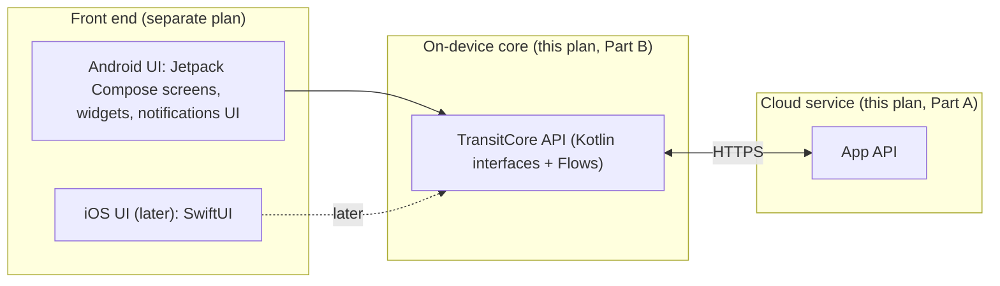
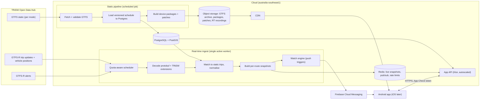
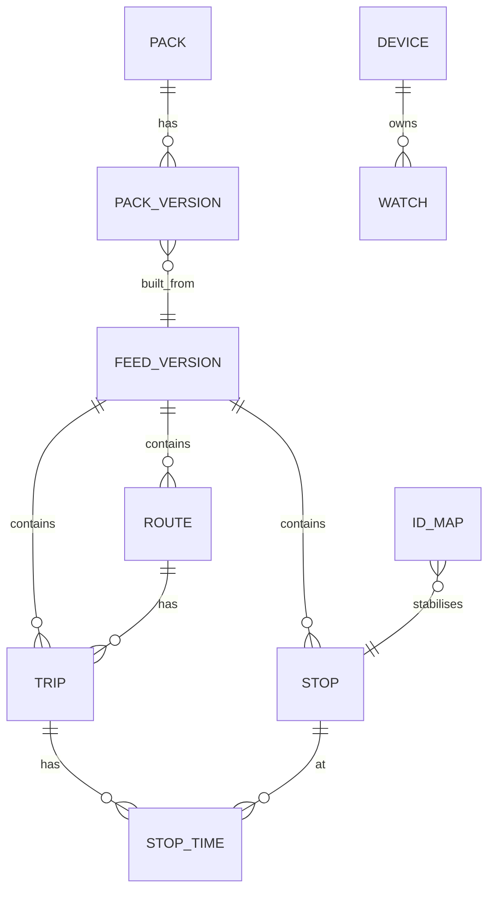

# TransitTracker Backend Plan

Status: **Draft for review** · Platform: **Android first, iOS later** · Scope:
**everything below the UI** (the front end is planned separately)

This plan turns the design lessons in
[tripview-architecture.md](tripview-architecture.md) and the direction in
[tripview-purpose-and-plan.md](tripview-purpose-and-plan.md) into a buildable
backend for TransitTracker, using Transport for NSW (TfNSW) open data only.
TripView is a design reference, not a data source: nothing here calls
TripView's servers or reuses its formats.

---

## 0. Executive summary

- **Shape.** The backend has two halves:
  1. a **cloud service** that ingests TfNSW data once and serves it to every
     device, so device count never affects our TfNSW quota; and
  2. a **shared on-device core** (Kotlin Multiplatform) that holds the
     timetable, answers "when is my next service?" offline, and overlays live
     data. The Android UI calls it now; an iOS UI calls the same code later.
- **Offline first.** Timetables live on the phone in a compact package that
  is updated with small daily patches. The network adds freshness (delays,
  cancellations, platforms, vehicles, alerts), not core function.
- **The server controls load.** Every real-time response tells the app when
  to ask next (30 s by default, 15 s while tracking). Load can be tuned with no
  app release.
- **Push instead of background polling.** Android restricts background work,
  so "tell me if my 7:42 is late" runs on the server and is delivered by
  Firebase Cloud Messaging (which also reaches iPhones later).
- **Stack.** Kotlin everywhere (Ktor server, Kotlin Multiplatform core),
  PostgreSQL + PostGIS, Redis, object storage + CDN, Firebase for push and app
  attestation. Hosted in an **Australian region** (recommended: Google Cloud
  `australia-southeast1`, Sydney). Infrastructure as code (Terraform).
- **First release scope.** Sydney Trains and Sydney Metro. This fits inside
  the default TfNSW quota (about 43% of it). Adding light rail, ferries and
  buses needs a **quota increase from TfNSW**, which is on the critical path
  for phase B6.
- **Effort.** Roughly 16–20 engineer-weeks to a production-ready trains and
  metro backend (section 15). Rough running cost for a public beta: low
  hundreds of AUD per month (section 13).

---

## 1. Scope and boundaries

### 1.1 What "backend" means here



| In scope | Out of scope (front end) |
|---|---|
| TfNSW data ingest, processing and redistribution | Screens, navigation, theming, accessibility of the UI |
| Timetable packages and patch delivery | Maps rendering (the core supplies shapes and positions) |
| Real-time API, alerts API, push notifications | Notification and widget layouts |
| On-device timetable store, query engine, real-time overlay, sync logic | On-device alarm UI (the core supplies alarm scheduling logic) |
| Security, observability, CI/CD, infrastructure | App store listing, onboarding copy |

**The contract between the two teams** is (a) the `TransitCore` Kotlin API
in section 9.2 and (b) the HTTP API in section 6. Both get a mock
implementation in phase B1 so front-end work can start immediately.

### 1.2 Assumptions (each one is a decision to confirm, see section 17)

| # | Assumption | Why it matters |
|---|---|---|
| A1 | Public app with many users, not a personal tool | Needs a server so devices never hold the TfNSW key |
| A2 | Release 1 covers Sydney Trains and Sydney Metro; then light rail, ferries, buses, then NSW TrainLink and regional | Drives quota, package size and effort |
| A3 | No user accounts in release 1; trips stay on the device | Smaller privacy footprint; sync added later |
| A4 | Free, no ads | No ad SDK, no advertising ID |
| A5 | Saved stop-to-stop trips first; free-form journey planning later | On-device multi-modal routing is the largest single engineering item |

---

## 2. Design principles

Carried over from TripView, adapted for TfNSW open data.

1. **Answer from the phone.** The first thing a user sees is computed locally.
2. **Overlay, don't replace.** The timetable is the source of truth; live
   data adjusts it. If live data is missing or doubtful, show the timetable
   and say so.
3. **Fetch once, serve many.** Each TfNSW feed is fetched once per interval
   by the server, no matter how many devices are open.
4. **Ask for less.** Devices request only the routes they are showing, and
   use conditional requests so unchanged data costs nothing.
5. **Server-set pacing.** Poll intervals come from the server in every
   response.
6. **Fail soft.** If TfNSW, our server or the phone's network fails, the app
   still shows timetabled departures, marked as such.
7. **Write once, run on both phones.** Engine logic lives in shared Kotlin so
   iOS behaves identically when it arrives.

---

## 3. Data sources (TfNSW Open Data Hub)

All calls go to `https://api.transport.nsw.gov.au` with header
`Authorization: apikey <key>`. **Endpoint paths and versions below must be
checked against the TfNSW developer portal and the _TfNSW GTFS / GTFS-R
Implementation Specification v2 (June 2025)_ before build.** TfNSW is
moving Sydney Trains and Metro from v1 to v2 real-time feeds, and sources
disagree on the current alerts version.

| Need | Feed | Example path (verify) | Format | Notes |
|---|---|---|---|---|
| Timetable that matches live data | GTFS static, "for realtime", per mode | `/v1/gtfs/schedule/sydneytrains` | Zipped CSV | Trip IDs must align with the real-time feed. Use the per-mode bundles, not the "complete" planning bundle, for matching |
| Delays, cancellations, platforms, added trips | GTFS-R trip updates | `/v2/gtfs/realtime/sydneytrains`, `/v2/gtfs/realtime/metro` | Protobuf | Sydney Trains carries TfNSW extensions (carriages, occupancy, consist) |
| Positions, occupancy | GTFS-R vehicle positions | `/v2/gtfs/vehiclepos/sydneytrains`, `/v2/gtfs/vehiclepos/metro` | Protobuf | Needs the TfNSW extension `.proto` (the "1007" extension listed on the dataset page) |
| Disruptions | GTFS-R service alerts | `/v2/gtfs/alerts/{mode}` | Protobuf | Must add the "Realtime Alerts v2" product to the API application |
| Ad-hoc journey planning (later) | Trip Planner API | `/v1/tp/trip`, `/v1/tp/stop_finder` | JSON | Costs one quota call per user query; proxy and cache, phase B7 |

Other modes (light rail lines, Sydney Ferries, Manly Fast Ferry, buses, NSW
TrainLink, regional buses) follow the same pattern with v1 paths.

### 3.1 Licence and attribution

TfNSW open data is generally published under Creative Commons Attribution.
**Confirm the current terms on the Open Data Hub.** The server returns the
required attribution text in `/v1/config` so it can change without an app
release, and the front end must display it (About screen at minimum).

---

## 4. Quota strategy

### 4.1 Limits

The default ("Bronze") plan is **60,000 requests per day and 5 requests per
second** per API key, shared across all endpoints. Over-limit responses have
been reported as 401, 403 and 503, so the ingest client treats all three as
"possibly throttled" (section 5.3). Higher limits are requested by emailing
TfNSW Open Data Help.

### 4.2 Budget for release 1 (Sydney Trains + Metro)

| Feed | Interval | Calls/day |
|---|---|---|
| Trip updates, Sydney Trains | 15 s | 5,760 |
| Vehicle positions, Sydney Trains | 15 s | 5,760 |
| Trip updates, Metro | 15 s | 5,760 |
| Vehicle positions, Metro | 15 s | 5,760 |
| Alerts, Sydney Trains + Metro | 60 s each | 2,880 |
| GTFS static change checks (conditional), 2 bundles | hourly | 48 |
| **Total** | | **25,968 (≈43% of 60,000)** |

Peak rate is about 0.3 calls per second, far below 5 per second. Headroom
covers retries, a staging environment on a **separate key**, and spikes.

### 4.3 Adding modes

Adding 4 light rail lines, 2 ferry feeds and the bus feed (7 more modes,
trip updates + vehicles) at 30 s adds 40,320 calls/day, taking the total to
about 66,000, **over the default limit**. Options, in order of preference:

1. **Request a higher quota from TfNSW** before phase B6 (critical path; start
   the conversation in phase B0).
2. **Demand-aware polling** (built in from day one, section 5.2): skip or slow
   feeds that no device has asked about in the last 10 minutes. Overnight and
   for low-use modes this cuts calls sharply.
3. **Mode-specific intervals**: vehicle positions for light rail and ferries
   at 60 s instead of 30 s (total ≈ 56,000, 93% of quota; too tight to rely
   on alone).

The scheduler holds a **daily budget**: if projected use passes 85% of quota,
it lengthens intervals automatically and raises an alert.

---

## Part A: Cloud service

## 5. Architecture



### 5.1 Components

| Component | Runs as | Responsibility |
|---|---|---|
| **Static pipeline** | Scheduled container job (hourly change check, full build on change) | Download GTFS, validate, load to Postgres as a new version, build device packages and patches, publish signed manifest |
| **Real-time ingest** | One always-on container with a warm standby (leader election) | Poll TfNSW on schedule, decode, match, build snapshots, run watch engine |
| **App API** | Autoscaled stateless containers | Serve config, manifests, real-time, alerts, shapes, device registration, watches |
| **PostgreSQL + PostGIS** | Managed database | Versioned static schedule, devices, watches, package metadata, audit |
| **Redis** | Managed cache | Latest real-time snapshots, feed health, pub/sub to API instances, per-device rate limits, quota counters, leader lock |
| **Object storage + CDN** | Managed | Raw GTFS archive (90 days), device packages and patches, route shapes, real-time recordings (14 days) |
| **Firebase** | SaaS | Cloud Messaging (push), App Check (attestation), Crashlytics, Remote Config (kill switches) |

### 5.2 Real-time ingest in detail

Each cycle, per feed:

1. **Schedule.** The scheduler picks the next feed due, respecting the per
   second throttle (token bucket, max 4/s to leave margin) and the daily
   budget. Feeds have a base interval (15 s trains and metro, 30 s others,
   60 s alerts) multiplied by a **demand factor**: ×1 if any device asked for
   that mode in the last 10 minutes, ×4 if none, paused overnight if none for
   an hour.
2. **Fetch** with a 10 s timeout. Record latency, size and status.
3. **Decode** GTFS-R protobuf, including TfNSW extensions (using Square's
   Wire library with the official `.proto` files, pinned and versioned in the
   repo).
4. **Check freshness.** If the feed header timestamp has not advanced, skip
   processing (cheap no-op). If it is older than 2× the interval, mark the
   feed stale.
5. **Match each trip update to the static schedule** (section 5.4).
6. **Normalise** into our own compact model (section 6.3): per trip, a list
   of stop deltas (arrival/departure delay, actual platform stop, skipped),
   status (scheduled, cancelled, added, replaced), occupancy, vehicle, consist.
7. **Build per-route snapshots**, each with a version number and a hash.
   Write only routes whose hash changed to Redis, then publish a change event.
8. **Run the watch engine** for affected trips (section 7).
9. **Record** the raw feed to object storage (sampled, compressed) for replay
   tests and incident analysis.

**Single active worker.** Only one ingest instance polls at a time (Redis
lock with 30 s lease, renewed each cycle). A standby takes over within one
lease if the leader dies. This keeps quota use deterministic.

### 5.3 Failure handling

| Condition | Behaviour |
|---|---|
| 401/403/503 with throttle message, or 429 | Exponential backoff for that feed: 30 s, 60 s, 120 s, cap 5 min, with jitter. Alert if any feed is in backoff > 5 min |
| Other 5xx or timeout | Retry once after 5 s, then back off as above |
| Malformed protobuf | Keep last good snapshot, mark feed degraded, store payload for analysis |
| Feed header not advancing for > 2× interval | Mark stale; snapshots carry `stale=true`; app shows "live data delayed" |
| Static bundle update fails validation | Keep serving previous version; alert; do not publish packages |
| Redis down | API serves last snapshot held in memory, marked stale; ingest buffers latest only |

### 5.4 Matching live data to the timetable

This is the part most likely to produce wrong answers, so it has its own
rules and tests.

1. **Primary key:** GTFS `trip_id` + `start_date` against the static version
   the feed is aligned to. The pipeline records which static version each
   real-time feed matches, and rejects a new static version if live trip IDs
   stop matching (match rate drop > 10% triggers an alert and rollback).
2. **Platform changes:** in TfNSW data, stops are platform-level child stops.
   A trip update that names a different child stop of the same parent station
   is a platform change.
3. **Delay propagation:** follow GTFS-R semantics. A stop without an update
   inherits the delay of the previous updated stop. Pre-compute delays for
   every remaining stop so devices do no propagation logic.
4. **Added and replacement trips:** trips not in the static schedule
   (`ADDED`, replacement services) are sent with their full stop list and
   times, since the device cannot look them up.
5. **Cancellations and skipped stops:** trip-level `CANCELED` and stop-level
   `SKIPPED` are passed through explicitly.
6. **Unmatched updates:** counted and logged, never guessed. Target match
   rate above 98% for trains and metro.
7. **Static version skew:** each real-time response carries the static
   version it was matched against. If a device holds an older package, the
   server includes a small `tripIdMap` for changed IDs or the device falls
   back to "timetabled" for unmatched services.

### 5.5 Time handling

- All service times are in `Australia/Sydney`. GTFS times can exceed 24:00
  and are measured from "noon minus 12 hours" of the service day, which
  matters on daylight-saving change days. Both the pipeline and the device
  core use one shared, heavily tested conversion function.
- Every API response carries the server time so the device can correct a
  wrong phone clock when showing countdowns in seconds.

---

## 6. App API

### 6.1 Conventions

- HTTPS only, HTTP/2, base path `/v1`. Versioned; breaking changes go to
  `/v2` and `/v1` is kept for at least 6 months.
- **Formats:** real-time endpoints return **protobuf** (`application/x-protobuf`)
  with gzip, and JSON when `Accept: application/json` (for debugging and
  tests). Other endpoints are JSON.
- **Every response** includes headers `X-Server-Time` (epoch ms) and, where
  relevant, `X-Poll-Interval` and `X-Tracker-Poll-Interval` (seconds).
- **Conditional requests** everywhere: `ETag` + `If-None-Match`, returning
  `304 Not Modified` when unchanged.
- **Auth:** every call carries a Firebase App Check token (Play Integrity on
  Android, App Attest on iOS later) and an anonymous install ID. No user
  login in release 1.
- **Errors:** RFC 9457 problem JSON with a stable `code` field.
- The API is described in an OpenAPI 3.1 file plus `.proto` files in
  `/proto`, both used to generate client code and mock servers.

### 6.2 Endpoints

| Method and path | Purpose | Cache | Phase |
|---|---|---|---|
| `GET /v1/config` | Poll intervals, feature flags, minimum app version, attribution text, list of available packs, status banner | CDN 5 min | B1 |
| `GET /v1/packs/manifest` | Signed manifest: pack versions, sizes, SHA-256, full and patch URLs | CDN 5 min, ETag | B2 |
| `GET {cdn}/packs/{pack}/{version}.ttpk` | Full timetable package (immutable) | CDN 1 year | B2 |
| `GET {cdn}/packs/{pack}/{from}-{to}.patch` | Patch between versions (immutable) | CDN 1 year | B2 |
| `GET /v1/rt?routes=R1,R2&v=…` | Live data for listed routes: trip deltas, vehicles, alert IDs, feed health | 5 s server cache per canonical route set, ETag | B3 |
| `GET /v1/rt/trip/{tripId}?date=YYYYMMDD` | Single-service tracking (faster interval) | 5 s, ETag | B3 |
| `GET /v1/vehicles?routes=…` | Vehicle positions for map view | 5 s, ETag | B4 |
| `GET /v1/alerts?modes=…` | Active alerts, translated into our model, with affected routes and stops | ETag; 304 when unchanged | B4 |
| `GET /v1/shapes/{shapeId}` | Route shape as an encoded polyline | CDN 1 day, immutable per version | B4 |
| `POST /v1/devices` | Register install ID and FCM token; returns device ID | none | B5 |
| `PUT /v1/devices/{id}` | Update FCM token, locale, notification settings | none | B5 |
| `DELETE /v1/devices/{id}` | Delete device and all its watches (privacy) | none | B5 |
| `GET/PUT/DELETE /v1/devices/{id}/watches[/{watchId}]` | Manage push watches (section 7) | none | B5 |
| `POST /v1/diagnostics` | Opt-in log upload for support | none | B5 |
| `GET /v1/plan?from=…&to=…&at=…` | Proxy to TfNSW Trip Planner, cached, rate-limited | 60 s | B7 |

### 6.3 Real-time payload (sketch)

```proto
message RealtimeResponse {
  int64  server_time_ms           = 1;
  int32  poll_interval_s          = 2;  // default 30
  int32  tracker_poll_interval_s  = 3;  // default 15
  string static_version           = 4;  // pack version these IDs match
  repeated FeedHealth feeds       = 5;
  repeated TripDelta  trips       = 6;
  repeated Vehicle    vehicles    = 7;  // only if requested
  repeated string     alert_ids   = 8;  // fetch details via /v1/alerts
  string alerts_etag              = 9;  // tells the app whether to refetch alerts
  repeated TripIdMap  trip_id_map = 10; // only when device pack is behind
}

message FeedHealth { string mode = 1; int64 data_time_ms = 2; bool stale = 3; }

message TripDelta {
  string trip_id    = 1;
  string start_date = 2;               // YYYYMMDD
  Status status     = 3;               // SCHEDULED, CANCELLED, ADDED, REPLACED
  repeated StopDelta stops = 4;        // remaining stops only
  Occupancy occupancy      = 5;
  string vehicle_id        = 6;
  int32  car_count         = 7;        // from TfNSW consist extension
  int64  updated_ms        = 8;
  bool   stale             = 9;
  repeated AddedStop added_stops = 10; // full timetable for ADDED trips
}

message StopDelta {
  uint32 stop_sequence  = 1;
  sint32 arr_delay_s    = 2;
  sint32 dep_delay_s    = 3;
  string actual_stop_id = 4;  // set only on platform change
  bool   skipped        = 5;
}
```

**Staleness rules** (applied on the server and re-checked on the device):
feed data older than 2× its interval is stale; a trip update older than
3 minutes is stale; a vehicle position older than 2 minutes is hidden.

### 6.4 Serving model and capacity

- Each API instance subscribes to Redis change events and keeps the latest
  per-route snapshots **in memory**. A request for a route set is assembled
  from memory and cached for 5 s under its canonical (sorted) key. No database
  call is on the real-time path.
- Rough capacity: 10,000 devices open at once polling every 30 s is about
  330 requests/second, which two small instances handle. The poll interval is
  the safety valve: raising it to 60 s halves load instantly for all devices.
- If load grows by another order of magnitude, put per-route snapshots behind
  the CDN with a 5 s TTL and have the device request one URL per route.

### 6.5 Abuse protection

- App Check token required (unattested traffic rejected in production).
- Per-device and per-IP rate limits in Redis (for example 20 requests/minute
  on real-time, 5/minute on watches).
- Route list capped (for example 30 routes per request).
- Cloud edge firewall (Cloud Armor) with basic bot and geo rules.

---

## 7. Push notifications (watch engine)

Android limits background polling (Doze, App Standby), so "tell me if my
usual train is late" must be driven by the server.

**Watch model** (stored in Postgres):

| Field | Example |
|---|---|
| `device_id` | anonymous device |
| `origin_stop`, `dest_stop` (parent stations) | Central → Parramatta |
| `routes` (optional filter) | T1 |
| `days` | Mon–Fri |
| `window` | 07:15–08:15 departure |
| `rules` | delay ≥ 5 min, cancellation, platform change |
| `lead_time` | notify from 60 min before departure |
| `quiet_hours`, `paused_until` | |

**How it runs:**

1. Each morning, and when packages change, the pipeline expands every active
   watch into the **concrete trips** it covers that day (from the static
   schedule) and stores an index `trip_id → watches` in Redis.
2. On every ingest cycle, changed trips are looked up in that index. For each
   watch whose rule is newly met (state change, not every cycle), a message is
   queued.
3. A sender sends via FCM HTTP v1 with a collapse key per trip, so updates
   replace rather than stack. Delivery results are recorded; invalid tokens are
   removed.
4. Deduplication: one notification per trip per rule state; a follow-up only
   when the situation materially changes (for example, delay rises by 5+ min,
   or the service is cancelled).

Time-based "leave now" alarms and location alarms stay **on the device**
(they need no server and work offline); the core provides the scheduling
logic (section 9).

---

## 8. Static pipeline and timetable packages

### 8.1 Pipeline steps

1. **Check** each GTFS bundle hourly with a conditional request. Do nothing if
   unchanged.
2. **Download** and archive the raw zip in object storage (90 days).
3. **Validate** with the MobilityData GTFS Validator. Block publication on
   errors; record warnings.
4. **Load** into Postgres under a new `feed_version` (the previous version
   stays live until the new one is fully built and checked).
5. **Check alignment** against live trip IDs (section 5.4, step 1).
6. **Build device packages** (section 8.2).
7. **Build patches** from each of the last 14 versions to the new one.
8. **Sign and publish** the manifest (Ed25519; the public key ships in the
   app), then flip the live version pointer.

Target: new packages published by 04:30 each day when the source changes,
and within 2 hours of any TfNSW mid-day update.

### 8.2 Device package format (`.ttpk`)

A **SQLite database**, built deterministically and compressed with zstd.
SQLite is chosen over a custom binary format because it works identically on
Android and iOS, needs no custom parser, and is fast enough for the queries
needed. The size savings come from the schema, not the container.

| Table | Contents |
|---|---|
| `meta` | pack ID, version, source feed versions, validity window, build time, schema version |
| `stops` | compact integer ID, GTFS stop ID, parent, name, lat/lon, platform code, mode mask, accessibility |
| `routes` | ID, short and long name, mode, colour, agency |
| `patterns` | ID, route, direction, headsign, **ordered stop list** (packed varints) |
| `time_profiles` | **deduplicated** arrival/departure offsets for a pattern (packed varints) |
| `trips` | GTFS trip ID, pattern, time profile, start time (seconds), service ID, flags (wheelchair, bikes) |
| `services` | active-day **bitset** over the pack window (for example 70 days from build date) |
| `stop_patterns` | index: stop → (pattern, position), for fast "what serves this stop" |
| `transfers` | interchange walking times between stops |

Storing each trip as *pattern + time profile + start time* rather than one
row per stop visit is the key saving: most trips on a line share a few stop
patterns and a few time profiles. This mirrors TripView's "pattern maps".

**Packs** are split by area and mode so users download only what they need:
`syd-rail` (Sydney Trains + Metro, release 1), `syd-lightrail`,
`syd-ferry`, `syd-bus`, `nsw-trainlink`, regional packs. Shapes are not in
packs; they are fetched on demand and cached.

**Targets (validate in phase B2):** `syd-rail` under 5 MB compressed; daily
patch under 150 KB.

### 8.3 Patches

- Patches are made with `zstd --patch-from` (old pack as the dictionary).
  Small patches depend on **deterministic builds**: stable ordering of rows,
  stable compact IDs across versions (kept in a Postgres ID map), fixed page
  size and `VACUUM` before publication.
- The device applies a patch, checks the result's SHA-256 against the
  manifest and swaps it in atomically. On any mismatch it downloads the full
  pack.
- If a patch would be larger than 40% of the full pack, or the device is more
  than 14 versions behind, the manifest points to the full pack instead.

---

## Part B: On-device core

## 9. Shared core (Kotlin Multiplatform)

### 9.1 Why Kotlin Multiplatform

TripView's lesson is "one engine, many shells". Kotlin Multiplatform (KMP)
gives that without C++: the same Kotlin code compiles for Android now and to
an iOS framework later, and shares data models and protobuf code with the
server. The UI on each platform stays native (Compose on Android, SwiftUI on
iOS).

### 9.2 `TransitCore` API (the contract with the front end)

```kotlin
interface TransitCore {
  // Lifecycle
  suspend fun start()                       // open packs, load trips, schedule updates
  fun onForeground(); fun onBackground()    // starts / pauses real-time polling

  // Saved trips
  val trips: Flow<List<SavedTrip>>
  suspend fun saveTrip(trip: SavedTrip); suspend fun deleteTrip(id: TripId)
  suspend fun reorderTrips(ids: List<TripId>)

  // Departures (timetable + live overlay, re-emits when live data arrives)
  fun upcoming(tripId: TripId, count: Int = 6): Flow<List<Departure>>
  fun timetable(tripId: TripId, date: LocalDate): Flow<List<Departure>>
  fun service(serviceRef: ServiceRef): Flow<ServiceDetail>   // every stop of one service
  fun track(serviceRef: ServiceRef): Flow<TrackingState>     // 15 s tracking mode

  // Search and reference data
  suspend fun searchStops(query: String, near: LatLng? = null): List<Stop>
  suspend fun linesAt(stopId: StopId): List<Line>
  suspend fun shape(shapeId: ShapeId): Polyline
  fun vehicles(routes: Set<RouteId>): Flow<List<VehiclePosition>>

  // Alerts and status
  val alerts: Flow<List<Alert>>
  val dataStatus: Flow<DataStatus>          // pack versions, last live update, stale flags

  // Notifications and alarms
  suspend fun setWatch(tripId: TripId, rules: WatchRules)    // server push
  suspend fun nextAlarmTimes(alarm: AlarmSpec): List<Instant> // device alarms
}
```

`Departure` carries scheduled time, estimated time, delay, status
(on time / late / cancelled / added), platform (and whether it changed),
occupancy, car count, data age and a `stale` flag, so the front end never
reimplements transit logic.

A **fake implementation** with canned data ships in phase B1 so UI work can
start before the real engine exists.

### 9.3 Core modules

| Module | Responsibility |
|---|---|
| `store` | Opens `.ttpk` packs read-only (SQLDelight), plus a small read-write database for trips, alarms, cached alerts and settings |
| `query` | Next departures between stop sets on a date; service detail; multi-leg trips with connection times. Later: RAPTOR for free-form journeys |
| `overlay` | Applies `TripDelta`s to query results; adds `ADDED` trips; marks stale data; re-emits Flows |
| `realtime` | Poller: one request per poll for the routes currently on screen; obeys server intervals; pauses in background; exponential backoff on errors; conditional requests |
| `updater` | Checks manifest, downloads full pack or patch, verifies signature and SHA-256, atomic swap; runs via Android WorkManager on unmetered network and charging when possible |
| `timesync` | Corrects device clock from `X-Server-Time` |
| `api` | Ktor client, generated protobuf models (Wire), App Check token injection |
| `alarms` | Computes alarm instants; the Android layer schedules them with `AlarmManager` and geofences |
| `platform` | Thin `expect/actual` layer: file paths, network status, background scheduling, secure storage |

### 9.4 Query approach for release 1

For a saved trip (origin stop set → destination stop set):

1. From `stop_patterns`, find patterns that visit an origin stop **before** a
   destination stop.
2. For each such pattern, find trips active on the date (service bitset)
   whose departure from the origin is after "now".
3. Merge and sort; cache results per trip per day (the TripView
   "SuperQuery" idea), extending the window on demand.

This is fast (patterns per stop are few) and needs no graph search. Multi-leg
trips chain this per leg with the configured connection time. A full journey
planner (RAPTOR over the same tables) is phase B7.

### 9.5 iOS later

Nothing in the backend changes for iOS. The KMP core builds as an
XCFramework; FCM delivers via APNs; App Check uses App Attest. If optional
Google sign-in is added for sync, App Store rules also require Sign in with
Apple.

---

## 10. Data model (server)



- **Schedule tables** (`stop`, `route`, `trip`, `stop_time`, `calendar`,
  `shape`) are partitioned by `feed_version`; old versions are dropped after
  14 days.
- **`id_map`** keeps compact integer IDs stable across versions (needed for
  small patches).
- **`device`**: random ID, FCM token, platform, app version, locale,
  created/last seen. No name, email or location.
- **`watch`**: section 7.
- **`pack_version`**: pack, version, size, SHA-256, URLs, patches available.
- Migrations with Flyway; every migration reversible.

---

## 11. Security and privacy

| Area | Control |
|---|---|
| TfNSW API key | In Secret Manager only; separate keys for dev, staging and prod; rotated twice a year; never in the app or repo; secret scanning on the repo |
| App to API | TLS 1.2+; Firebase App Check (Play Integrity) enforced in production; rate limits; anonymous device IDs |
| Data integrity | Pack manifests signed (Ed25519); SHA-256 on every pack and patch |
| Cloud access | Least-privilege service accounts per component; no public database endpoints; infrastructure changes only via Terraform in CI |
| Personal data | Release 1 stores only an anonymous device ID, FCM token and watch settings. No accounts, no location on the server, no advertising ID. Location for alarms stays on the device |
| User rights | `DELETE /v1/devices/{id}` removes everything; deleting the app makes data orphaned and it is purged after 90 days of inactivity |
| Compliance | Privacy policy aligned to the Australian Privacy Principles; Google Play Data Safety form; data hosted in Australia |
| Supply chain | Dependency pinning, Dependabot/Renovate, container image scanning, signed images |
| Logging | No FCM tokens or IPs in application logs beyond 7 days; request logs sampled |

---

## 12. Observability and operations

### 12.1 Service levels (initial targets)

| Measure | Target |
|---|---|
| Live data freshness: TfNSW feed time → available on our API | p95 under 20 s |
| Real-time API availability | 99.9% monthly |
| Real-time API latency | p95 under 150 ms (server time) |
| Match rate, trains and metro | above 98% |
| Push notification: trigger → sent | p95 under 30 s |
| New timetable package after TfNSW change | within 2 hours |

### 12.2 Signals

- **Metrics** (OpenTelemetry → Cloud Monitoring): per-feed fetch latency,
  status codes, payload size, data age, match rate, unmatched count; quota
  used vs budget; API requests, latency and 304 ratio; active devices by mode
  (from demand tracker); push sent/failed; pack downloads vs patch downloads.
- **Logs:** structured JSON with request and feed IDs.
- **Traces:** API requests and ingest cycles.
- **Alerts:** any feed stale > 2 minutes; quota projection > 85%; match rate
  < 95%; API error rate > 1%; pipeline failure; leader lock lost with no
  takeover.
- **Status:** a public status banner can be set via `/v1/config` without a
  release.

### 12.3 Runbooks (written in phase B6)

TfNSW outage; quota exhausted; bad static bundle; real-time mismatch after a
timetable change; push provider outage; key rotation; restoring Postgres.

---

## 13. Infrastructure and cost

### 13.1 Recommended stack

| Layer | Choice | Reason |
|---|---|---|
| Language | Kotlin (JVM 21 server; KMP on device) | One language and shared models across server, Android and iOS |
| Server framework | Ktor | Lightweight, coroutine-based, same HTTP client on device |
| Protobuf | Wire (Square) | Works in KMP; handles GTFS-R and TfNSW extensions |
| Database | PostgreSQL 16 + PostGIS (Cloud SQL) | Geospatial stop queries; mature |
| Cache / pub-sub | Redis 7 (Memorystore) | Snapshots, locks, rate limits |
| Compute | Cloud Run (API autoscaled; ingest with always-on CPU, min 1 instance); Cloud Run Jobs + Cloud Scheduler for pipeline | No servers to patch |
| Storage / CDN | Cloud Storage + Cloud CDN | Immutable packs, cheap egress at the edge |
| Push, attestation, crashes | Firebase (FCM, App Check, Crashlytics, Remote Config) | Covers Android now, iOS later |
| IaC / CI/CD | Terraform; GitHub Actions; Artifact Registry | Repeatable environments |
| Region | `australia-southeast1` (Sydney) | Low latency to users; data stays in Australia |

AWS works equally well (`ap-southeast-2`: ECS Fargate, RDS, ElastiCache,
S3 + CloudFront, SNS → FCM). The design is container-based and portable.

**Lean alternative for a private beta:** one small VM running the same
containers with Docker Compose (Postgres, Redis, API, ingest) for tens of
dollars a month, moving to managed services before public launch.

### 13.2 Rough monthly cost (public beta, up to ~10,000 users)

| Item | Estimate (AUD/month) |
|---|---|
| Cloud Run (API min 1 instance + ingest always-on) | 80–150 |
| Cloud SQL (small, with backups) | 60–120 |
| Memorystore Redis (basic, 1 GB) | 50–80 |
| Storage + CDN egress | 10–50 |
| Monitoring, logging, secrets | 10–40 |
| Firebase (FCM and App Check are free at this scale) | 0 |
| **Total** | **≈ 210–440** |

These are order-of-magnitude figures to validate with the Google Cloud
pricing calculator. Staging runs scaled to zero where possible.

### 13.3 Environments

| Env | Purpose | TfNSW key | Data |
|---|---|---|---|
| `local` | Developer laptops (Docker Compose) | Personal dev key, or replay recordings | Recorded feeds |
| `dev` | Integration, nightly | Dev key | Live, low intervals |
| `staging` | Release candidate, load tests | Staging key | Live |
| `prod` | Users | Prod key | Live |

---

## 14. Repository layout and engineering practice

```
/proto            GTFS-R .proto, TfNSW extension .proto, TransitTracker API .proto
/api-spec         OpenAPI 3.1 for JSON endpoints
/server
  /common         shared server code: config, db, observability
  /api            Ktor App API
  /ingest         real-time ingest + watch engine
  /pipeline       static pipeline + pack builder
/shared           Kotlin Multiplatform core (TransitCore), incl. fake implementation
/androidApp       front end (separate plan)
/infra            Terraform modules and environments
/tools            replay harness, pack inspector, load tests
/docs             this plan, TripView reference docs, ADRs, runbooks
```

- **Testing:** unit tests for time conversion (including DST days), matching,
  delay propagation, query engine; **golden tests** that build a pack from a
  fixed GTFS input and compare output byte-for-byte (determinism); **replay
  tests** that feed recorded GTFS-R into ingest and check outputs; contract
  tests from OpenAPI/proto; load tests (k6) at 3× expected peak; chaos tests
  (feed down, Redis down).
- **CI:** build, test, lint, secret scan and image scan on every pull request;
  deploy to `dev` on merge; promote to `staging` and `prod` by tagged release
  with manual approval.
- **Decisions** are recorded as short Architecture Decision Records in
  `/docs/adr`.

---

## 15. Delivery plan (backend phases)

Phases map to the product phases in
[tripview-purpose-and-plan.md](tripview-purpose-and-plan.md) section 2.6.
Estimates are engineer-weeks for an experienced Kotlin engineer and are
rough.

| Phase | Goal | Main work | Done when | Est. |
|---|---|---|---|---|
| **B0. Foundations** | Decisions and accounts | Confirm section 17; TfNSW keys (dev, staging, prod); **start quota-uplift request**; cloud project, Terraform skeleton, CI; repo layout; ADRs | Empty services deploy to `dev` from CI | 1–2 |
| **B1. Contracts and fakes** | Unblock the front end | `TransitCore` interfaces + fake; OpenAPI + proto; mock server from spec; `/v1/config` | Front end can build every screen against fakes | 1–2 |
| **B2. Static data** | Offline departures | Pipeline: fetch, validate, load; `syd-rail` pack builder; manifest; KMP `store` + `query` + `updater` | Android test app lists next departures between two stations offline; pack and patch size targets met | 4 |
| **B3. Real-time** | Live overlay | Ingest worker, Wire decoding, matching, snapshots, Redis; `/v1/rt` and tracking endpoint; KMP `realtime`, `overlay`, `timesync` | A live delay appears on device within one poll interval; match rate > 98% | 4 |
| **B4. Alerts, vehicles, shapes** | Complete the picture | Alerts ingest with conditional fetch; `/v1/alerts`, `/v1/vehicles`, `/v1/shapes` | Disruptions shown; trains on map | 2 |
| **B5. Push** | Server-driven notifications | Device registration, watches, watch engine, FCM sender, diagnostics upload | "My 7:42 is 6 min late" arrives on a locked phone within 30 s of the feed | 2–3 |
| **B6. Production readiness** | Safe to launch | App Check enforcement, rate limits, dashboards, alerts, runbooks, load and chaos tests, privacy policy, backups and restore drill | Launch checklist signed off | 2 |
| **B7. Expansion** | More modes and features | New packs and feeds (after quota uplift), multi-leg refinements, RAPTOR journey planning or Trip Planner proxy, optional accounts and cloud sync, iOS enablement | As prioritised | ongoing |

**B0–B6 total: roughly 16–20 engineer-weeks.** B1 is deliberately early so
front-end and back-end work proceed in parallel.

---

## 16. Risks

| Risk | Likelihood | Impact | Mitigation |
|---|---|---|---|
| TfNSW quota insufficient for more modes | High | Blocks B7 expansion | Request uplift in B0; demand-aware polling; daily budget guard |
| TfNSW changes feed versions or formats (v1 → v2) | Medium | Live data breaks | Pin protos; monitor TfNSW forum and spec; replay tests; feature flag per feed |
| Live updates matched to wrong service | Medium | Wrong answers, trust loss | Strict trip ID + date matching, alignment check on static updates, show "timetabled" when unsure |
| Package too large for users | Medium | Poor first-run experience | Pattern/time-profile compression, per-mode packs, size budget in CI |
| Patches not small because builds are non-deterministic | Medium | Data costs | Stable ID map, deterministic build, golden tests |
| DST and after-midnight service errors | Medium | Wrong times twice a year | Single shared time function with dedicated tests |
| API key leak | Low | Quota theft, account suspension | Secret Manager, secret scanning, per-env keys, rotation |
| Push notifications unreliable on some Android devices (vendor battery savers) | Medium | Missed alerts | High-priority FCM for time-critical alerts; in-app guidance (front end) |
| Licence or attribution breach | Low | Data access withdrawn | Confirm terms in B0; attribution served from config |
| Cost creep | Low | Budget | Budgets and alerts in cloud billing; scale-to-zero staging |
| Repo contains reverse-engineering notes about a third party | Low | Reputational/legal | Keep `tripview-low-level-notes.md` out of any public copy of the repo (as that file already says) |

---

## 17. Decisions needed

Defaults below are what this plan assumes; changing them changes scope.

| # | Decision | Recommended default |
|---|---|---|
| D1 | Audience: personal tool or public app? | Public app (plan assumes this) |
| D2 | Release 1 modes | Sydney Trains + Metro |
| D3 | Cloud provider | Google Cloud, Sydney region |
| D4 | Accounts and cross-device sync in release 1? | No; Android Auto Backup for trips; accounts in B7 |
| D5 | Business model | Free, no ads |
| D6 | Journey planning in release 1? | No; saved stop-to-stop trips only |
| D7 | Who owns the TfNSW relationship (keys, quota uplift, licence)? | Product owner, starting in B0 |
| D8 | Repo visibility | Private while low-level reference notes are in history |

---

## 18. Sources

- TfNSW Open Data Hub, API basics (quota and throttle limits):
  <https://opendata.transport.nsw.gov.au/developers/api-basics>
- TfNSW developer documentation:
  <https://opendata.transport.nsw.gov.au/developers/documentation>
- TfNSW GTFS / GTFS-R Implementation Specification v2 (June 2025):
  <https://opendata.transport.nsw.gov.au/sites/default/files/2025-09/TfNSW%20GTFS%20%20GTFS%20R%20Implementation%20Specification%20v2%20June%202025.pdf>
- Real-time vehicle positions v2 dataset:
  <https://opendata.transport.nsw.gov.au/data/dataset/public-transport-realtime-vehicle-positions-v2>
- Real-time alerts v2 dataset:
  <https://opendata.transport.nsw.gov.au/dataset/public-transport-realtime-alerts-v2/resource/811affc9-7415-4558-9e9c-efc982fae6a2>
- Sydney Trains GTFS-R version 2 (forum):
  <https://opendataforum.transport.nsw.gov.au/t/sydney-trains-gtfs-r-version-2/2551>
- Over-limit response codes discussion (forum):
  <https://opendataforum.transport.nsw.gov.au/t/intermittent-http-503-response-your-api-quota-or-rate-limit-has-been-exceeded/1006>
