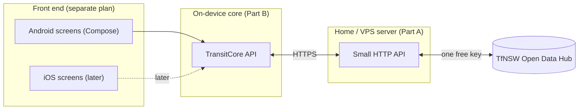
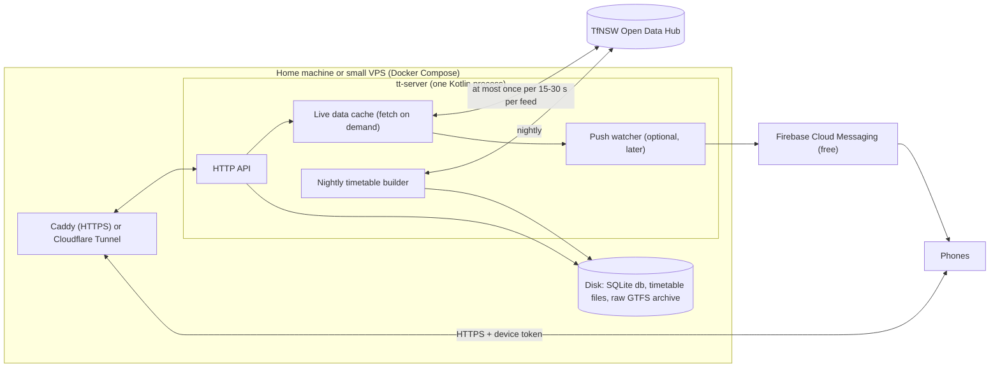

# TransitTracker Backend Plan

Status: **Draft v2** · Audience: **me and a few friends, not for profit** ·
Data: **TfNSW Open Data Hub, free public tier only** · Platform: **Android
first, iOS later** · Scope: **everything below the UI** (front end planned
separately)

This plan applies the design lessons in
[tripview-architecture.md](tripview-architecture.md) and
[tripview-purpose-and-plan.md](tripview-purpose-and-plan.md) to a small,
personal TransitTracker. TripView is a design reference only: nothing here
calls TripView's servers or reuses its formats.

> An earlier draft of this file planned for a public app at scale (managed
> cloud database, Redis, CDN, quota uplift). It is in git history at commit
> `9c80976` if the app ever grows. Section 14 lists what would change.

---

## 0. Summary

- **One small server, one free API key.** A single Kotlin program on a
  home machine or a cheap Sydney VPS holds the one free TfNSW key, builds the
  timetable file for phones each night, and passes on live data. Friends need
  no TfNSW account, and the key never sits on a phone.
- **Fetch only when someone is looking.** The server calls TfNSW only when a
  phone asks, at most once per feed every 15–30 seconds, and shares that
  answer with everyone. With a handful of users this uses a small fraction of
  the free quota, so **all Sydney modes fit** without asking TfNSW for
  anything.
- **Offline first.** Each phone keeps the timetable locally and answers
  "when's my next train?" with no signal. Live data is a layer on top.
- **Shared engine for Android now, iOS later.** The on-device logic is
  written once in Kotlin Multiplatform; only the screens differ per platform.
- **Cost:** about A$0–15 a month, plus a one-off US$25 Google Play developer
  fee if you distribute through Play. **Effort:** roughly 9–12 engineer-weeks
  for the full backend (section 12).

---

## 1. Scope and boundaries



| Backend (this plan) | Front end (separate) |
|---|---|
| Fetching and processing TfNSW data | Screens, navigation, styling |
| Timetable file for phones | Map drawing (core supplies shapes and positions) |
| Live data, alerts, optional push | Notification and widget layouts |
| On-device timetable, search, live overlay, alarm timing | Alarm and settings screens |

The hand-off between the two is the `TransitCore` Kotlin interface (section
8.2). A fake version with sample data comes first so screen work can start
straight away.

### 1.1 Assumptions

| # | Assumption |
|---|---|
| A1 | Up to about 10 users, all known to you |
| A2 | Not for profit, no ads, no accounts |
| A3 | Only public TfNSW open data on the free tier; no agreement with TfNSW |
| A4 | Release 1: Sydney Trains + Metro. Then light rail, ferries, buses (no quota barrier, just effort) |
| A5 | Saved stop-to-stop trips first; free-form journey planning later, if ever |

---

## 2. Data sources and terms

### 2.1 Feeds

All calls go to `https://api.transport.nsw.gov.au` with header
`Authorization: apikey <key>`. **Check exact paths against the TfNSW
developer portal and the _TfNSW GTFS / GTFS-R Implementation Specification
v2 (June 2025)_ before building:** Sydney Trains and Metro are moving from
v1 to v2 live feeds, and published sources disagree on the current alerts
path.

| Need | Feed | Example path (verify) | Notes |
|---|---|---|---|
| Timetable | GTFS static, per mode, "for realtime" | `/v1/gtfs/schedule/sydneytrains` | Use the per-mode bundles, whose trip IDs match the live feeds, not the "complete" planning bundle |
| Delays, cancellations, platforms | GTFS-R trip updates | `/v2/gtfs/realtime/sydneytrains`, `/v2/gtfs/realtime/metro` | Protobuf; Sydney Trains has TfNSW extensions (carriages, occupancy) |
| Train positions | GTFS-R vehicle positions | `/v2/gtfs/vehiclepos/sydneytrains`, `/v2/gtfs/vehiclepos/metro` | Needs the TfNSW extension `.proto` from the dataset page |
| Disruptions | GTFS-R alerts | `/v2/gtfs/alerts/{mode}` | Add the "Realtime Alerts v2" product to your API application |

Other modes (light rail, Sydney Ferries, Manly Fast Ferry, buses, NSW
TrainLink) follow the same pattern.

### 2.2 What the free tier allows

- **Getting a key:** register on the Open Data Hub, create an application,
  add the products above. Free.
- **Limits:** 60,000 requests a day and 5 a second per key, shared across all
  endpoints. Over-limit responses have been reported as 401, 403 and 503, so
  the server treats all three as "possibly throttled".
- **Licence:** datasets are under **Creative Commons Attribution 4.0**, which
  allows reuse and redistribution with attribution. Use of the Hub is also
  covered by the Hub Terms and an Acceptable Use Policy. Sharing the data with
  friends through your own server fits within this; **sharing the key itself
  does not**, so the key stays on the server. Re-read the terms before
  launch, as TfNSW can change them.
- **Attribution:** the app shows an attribution line such as "Contains
  Transport for NSW data" (check the Hub terms for any required wording),
  served by the server so it can be changed without an app update.

### 2.3 Quota in practice

The server fetches a feed only when a phone asks for it, and never more often
than its minimum age (15 s for trains and metro, 30 s for other modes, 60 s
for alerts).

| Scenario | TfNSW calls/day |
|---|---|
| Worst case: someone has trains + metro open 24 hours a day | ≈ 26,000 (43%) |
| Realistic: 5 people, ~1 hour of app-open time each, mostly overlapping commute times | ≈ 1,500–3,000 (under 5%) |
| Nightly timetable check, 2–8 bundles | under 50 |

A **daily budget guard** stops calling TfNSW at 50,000 calls and serves the
last data marked "stale" instead, so the key can never be suspended for
overuse. Because of this, adding every Sydney mode later needs no quota
change.

---

## Part A: The server

## 3. Architecture

One program, one machine, one database file.



| Part | What it does |
|---|---|
| **HTTP API** | Serves config, timetable file info and downloads, live data, alerts, shapes, device sign-up |
| **Live data cache** | Fetches a TfNSW feed only when asked and the cached copy is older than its minimum age. Concurrent requests share one fetch. Decodes, matches to the timetable, keeps the result in memory |
| **Timetable builder** | Nightly: checks TfNSW for new timetables, validates, builds the phone timetable file (section 7) |
| **Push watcher** | Optional, phase P6: during the time windows friends set, checks their trips and sends "your train is late" via Firebase |
| **SQLite database** | Devices, invite codes, watches, timetable file versions, daily call counter |

No separate database server, cache server or CDN: at this size they add cost
and upkeep without benefit.

**Code sharing:** the server uses the **same Kotlin modules as the phone**
for reading the timetable file, time calculations and decoding live feeds.
The server opens the timetable file it built to match live updates to
scheduled services, so the phone and server can never disagree about what a
trip ID means.

## 4. Live data path

When a phone asks for live data on some routes:

1. Work out which feeds those routes need (for example T1 → Sydney Trains
   trip updates).
2. For each feed: if the cached copy is younger than its minimum age, use it.
   Otherwise fetch once (other requests wait for the same fetch), with a
   10 s timeout.
3. Decode the protobuf, including TfNSW extensions (Square's Wire library,
   with the official `.proto` files pinned in the repo).
4. **Match each update to a timetabled trip** (section 4.1) and pre-compute
   the delay at every remaining stop, so phones do no transit logic.
5. Return only the trips on the requested routes, with the time the data was
   produced and the next poll interval.

**If TfNSW fails or throttles:** back off for that feed (30 s, 60 s, 120 s,
up to 5 minutes), keep serving the last good copy marked stale.

### 4.1 Matching rules

| Case | Rule |
|---|---|
| Normal trip | Match on GTFS `trip_id` + start date |
| Platform change | The update names a different platform stop of the same station |
| Stops with no update | Inherit the delay of the previous updated stop (GTFS-R rule) |
| Cancelled trip / skipped stop | Pass through explicitly |
| Added or replacement trip (not in timetable) | Send its full stop list and times |
| No match | Count and log; never guess. Show as "timetabled" |
| Phone has an older timetable file | Response says which timetable version it matched; phone treats unmatched trips as "timetabled" |

**Staleness:** feed data older than 2× its minimum age is stale; a trip
update older than 3 minutes is stale; a vehicle position older than
2 minutes is hidden.

### 4.2 Time handling

All times are `Australia/Sydney`. GTFS times can go past 24:00 and are
counted from "noon minus 12 hours" of the service day, which matters on
daylight-saving change days. One shared, well-tested function does this for
both server and phone. Every response carries the server time so the phone
can correct a wrong clock in second-by-second countdowns.

## 5. API

Plain HTTPS + JSON for most calls; live data in protobuf (smaller, faster)
with JSON available for debugging. Every response carries `X-Server-Time`.
Live responses carry `pollInterval` (default 30 s) and `trackerPollInterval`
(default 15 s), which the phone obeys, so you can change everyone's refresh
rate from the server.

| Method and path | Purpose | Phase |
|---|---|---|
| `POST /v1/join` | Exchange an invite code for a device token | P1 |
| `GET /v1/config` | Poll intervals, feature flags, minimum app version, attribution, available timetable files, status message | P1 |
| `GET /v1/packs` | Timetable files: name, version, size, SHA-256, download URL | P2 |
| `GET /v1/packs/{name}/{version}` | Download a timetable file | P2 |
| `GET /v1/rt?routes=T1,T9` | Live data for those routes; `ETag` so unchanged data returns `304` | P3 |
| `GET /v1/rt/trip/{tripId}?date=YYYYMMDD` | One service, for live tracking | P3 |
| `GET /v1/vehicles?routes=…` | Vehicle positions for the map | P4 |
| `GET /v1/alerts?modes=…` | Current disruptions; `ETag` / `304` | P4 |
| `GET /v1/shapes/{shapeId}` | Route line for the map (encoded polyline) | P4 |
| `PUT /v1/watches` · `DELETE /v1/watches/{id}` | "Tell me if this trip is late" (with Firebase token) | P6 |
| `GET /status` | Your own page: feed ages, calls used today, errors, devices | P3 |

### 5.1 Live data payload (sketch)

```proto
message RealtimeResponse {
  int64  server_time_ms          = 1;
  int32  poll_interval_s         = 2;   // default 30
  int32  tracker_poll_interval_s = 3;   // default 15
  string timetable_version       = 4;   // version these trip IDs match
  repeated FeedHealth feeds      = 5;   // per mode: data time, stale
  repeated TripDelta  trips      = 6;
  string alerts_etag             = 7;   // tells the phone whether to refetch alerts
}

message TripDelta {
  string trip_id    = 1;
  string start_date = 2;               // YYYYMMDD
  Status status     = 3;               // SCHEDULED, CANCELLED, ADDED, REPLACED
  repeated StopDelta stops = 4;        // remaining stops only
  Occupancy occupancy = 5;
  int32  car_count    = 6;
  int64  updated_ms   = 7;
  bool   stale        = 8;
  repeated AddedStop added_stops = 9;  // full timetable for ADDED trips
}

message StopDelta {
  uint32 stop_sequence  = 1;
  sint32 arr_delay_s    = 2;
  sint32 dep_delay_s    = 3;
  string actual_stop_id = 4;           // only on platform change
  bool   skipped        = 5;
}
```

## 6. Access and security

Kept proportionate to "me and a few friends".

| Area | Approach |
|---|---|
| TfNSW key | Only on the server, in an environment file excluded by `.gitignore`. Never in the app or the repo. Turn on GitHub secret scanning |
| Who can use the server | **Invite codes.** A small command (`tt-admin invite`) creates a one-time code; the app exchanges it for a device token. `tt-admin revoke` cuts a device off |
| Abuse | Per-device rate limit (for example 20 live requests a minute); route list capped at 30; unknown tokens rejected |
| Transport | HTTPS only: Caddy with automatic certificates, or Cloudflare Tunnel (no open ports at home) |
| Timetable integrity | SHA-256 for every timetable file, checked on the phone |
| Personal data | Only a random device ID, app version and (if push is on) a Firebase token. No names, emails or locations. Location alarms run on the phone |
| Repo | Keep private while `tripview-low-level-notes.md` is in its history (that file already says so) |

## 7. Timetable files for phones

### 7.1 Nightly build

1. At about 03:00, ask TfNSW whether each timetable bundle has changed
   (conditional request). Stop if not.
2. Download and keep the raw zip for 30 days.
3. Validate with the MobilityData GTFS Validator; if it fails, keep serving
   yesterday's file and log the problem.
4. Build the phone timetable file (below) and publish its version and SHA-256.

### 7.2 Format

Each timetable file is a **SQLite database**, zstd-compressed. SQLite works
the same on Android and iOS and needs no custom reader. The size savings come
from how the data is arranged:

| Table | Contents |
|---|---|
| `meta` | Version, source versions, valid dates, schema version |
| `stops` | Small integer ID, GTFS ID, parent station, name, position, platform, modes, accessibility |
| `routes` | Name, mode, colour |
| `patterns` | Each distinct ordered list of stops a line runs (packed) |
| `time_profiles` | Each distinct set of stop-to-stop times (packed, shared between trips) |
| `trips` | GTFS trip ID, pattern, time profile, start time, service days |
| `services` | Which days each service runs, as a bitset over the next ~70 days |
| `stop_patterns` | Index: stop → patterns that call there, and at which position |
| `transfers` | Walking times between stops at interchanges |

Storing each trip as "pattern + time profile + start time" instead of one row
per stop visit is what keeps the file small (TripView does the same).

**Files by mode**, so people download only what they use: `syd-rail`
(Trains + Metro), then `syd-lightrail`, `syd-ferry`, `syd-bus`.

**Updates:** phones download the whole file when the version changes,
preferring Wi-Fi. Target: `syd-rail` under 5 MB. Small patch updates (as
TripView does) are **left out** for now; the build is kept deterministic so
they can be added later if file sizes or friends' data use make it
worthwhile.

## 8. Hosting and operations

### 8.1 Where to run it

| Option | Cost | Good | Watch out for |
|---|---|---|---|
| **Home machine** (mini PC, Raspberry Pi 4/5, NAS) with **Cloudflare Tunnel** | ≈ A$0 (plus a domain, ≈ A$15/year) | Free; no open ports | Home internet or power outage takes it down (the app still shows timetables) |
| **Small VPS in Sydney** (1 vCPU, 1–2 GB RAM) with Caddy | ≈ A$6–15/month | Always on; simple | Small monthly cost |

**Recommendation:** start on whichever you already have. Both run the same
`docker compose up`, so moving later takes minutes. The program needs about
512 MB RAM; the bus timetable build needs more briefly, so allow 2 GB once
buses are added.

### 8.2 Keeping it running

- `restart: unless-stopped` in Docker Compose; automatic OS security updates.
- **Backups:** nightly copy of the SQLite database and the env file to
  another location. Timetable files can be rebuilt, so they need no backup.
- **Monitoring:** a free uptime checker pinging `/health`; the `/status` page
  for feed ages and calls used; Firebase Crashlytics (free) for app crashes.
- **Updates:** GitHub Actions builds and tests on every push and publishes a
  container image; the box pulls the new image (manually or with Watchtower).
- **Environments:** your laptop (with a second free key, or replays of
  recorded feeds) and the one live server. No separate staging.

### 8.3 Getting the app to friends

Front-end concern, noted here because it affects sign-up: either Google Play
**internal testing** (up to 100 testers by email, one-off US$25 developer
account) or **Firebase App Distribution** (free). Both avoid a public store
listing. Friends then enter an invite code on first launch.

---

## Part B: On-device core

## 9. Shared core (Kotlin Multiplatform)

### 9.1 Why

TripView's lesson is "one engine, many shells". Kotlin Multiplatform does
that without C++: the same code runs on Android now and becomes an iOS
framework later, and it shares the timetable reader, time function and feed
models with the server. Screens stay native on each platform.

### 9.2 `TransitCore` interface (hand-off to the front end)

```kotlin
interface TransitCore {
  // Lifecycle
  suspend fun start()                        // open timetable files, load trips
  fun onForeground(); fun onBackground()     // start / pause live polling

  // Saved trips
  val trips: Flow<List<SavedTrip>>
  suspend fun saveTrip(trip: SavedTrip); suspend fun deleteTrip(id: TripId)
  suspend fun reorderTrips(ids: List<TripId>)

  // Departures: timetable + live layer; re-emits when live data arrives
  fun upcoming(tripId: TripId, count: Int = 6): Flow<List<Departure>>
  fun timetable(tripId: TripId, date: LocalDate): Flow<List<Departure>>
  fun service(ref: ServiceRef): Flow<ServiceDetail>       // all stops of one service
  fun track(ref: ServiceRef): Flow<TrackingState>         // 15 s tracking

  // Reference data
  suspend fun searchStops(query: String, near: LatLng? = null): List<Stop>
  suspend fun linesAt(stopId: StopId): List<Line>
  suspend fun shape(shapeId: ShapeId): Polyline
  fun vehicles(routes: Set<RouteId>): Flow<List<VehiclePosition>>

  // Alerts and status
  val alerts: Flow<List<Alert>>
  val dataStatus: Flow<DataStatus>   // timetable versions, last live update, stale flags

  // Setup, alarms and push
  suspend fun join(inviteCode: String): JoinResult
  suspend fun nextAlarmTimes(alarm: AlarmSpec): List<Instant>
  suspend fun setWatch(tripId: TripId, rules: WatchRules)  // phase P6
}
```

`Departure` includes scheduled time, expected time, delay, status (on time,
late, cancelled, added), platform and whether it changed, occupancy, car
count, data age and a `stale` flag. The front end never has to work out
transit logic.

### 9.3 Modules

| Module | Job |
|---|---|
| `store` | Opens timetable files read-only (SQLDelight); small read-write database for trips, alarms, cached alerts, settings |
| `query` | Next departures between two stations on a date; service detail; multi-leg trips with connection times |
| `overlay` | Applies live updates to timetable results, adds added trips, marks stale data |
| `realtime` | Polls only for routes on screen; obeys server intervals; pauses in background; backs off on errors; sends `If-None-Match` |
| `updater` | Checks for new timetable files, downloads (Wi-Fi preferred, via Android WorkManager), checks SHA-256, swaps in atomically |
| `timesync` | Corrects the phone clock using server time |
| `api` | Ktor HTTP client, Wire protobuf models, device token |
| `alarms` | Works out alarm times; the Android layer schedules them (`AlarmManager`, geofences) |
| `fake` | Sample-data implementation for front-end development and tests |

### 9.4 How "next departures" works

For a saved trip (origin station → destination station):

1. Find the patterns that call at the origin **before** the destination.
2. For those patterns, find trips running today that leave the origin after
   now.
3. Sort, cache for the day, and extend on demand.

This is fast and needs no route-graph search. Multi-leg trips repeat it per
leg with the connection time. A full journey planner is not needed for
version one.

### 9.5 iOS later

No server changes. The shared core builds as an iOS framework; Firebase
handles iPhone push through Apple's service. You will need an Apple
Developer account (US$99/year) and TestFlight to share it with friends.

---

## 10. Repository layout

```
/proto           GTFS-R .proto, TfNSW extension .proto, our API .proto
/shared          Kotlin Multiplatform core (also used by the server)
/server          tt-server: API, live cache, timetable builder, push watcher, tt-admin
/androidApp      front end (separate plan)
/deploy          docker-compose.yml, Caddyfile, .env.example (no secrets)
/tools           feed recorder and replayer, timetable file inspector
/docs            plans, TripView reference docs
```

## 11. Testing

- **Time function:** normal days, after-midnight services, both daylight
  saving change days.
- **Matching:** recorded real feeds replayed against a fixed timetable, with
  expected delays, cancellations and platform changes.
- **Timetable builder:** a fixed GTFS input must produce the same file
  every time (checked in CI).
- **Query:** known departures between known stations on a known date.
- **API:** contract tests against the `.proto` and JSON examples.
- **Manual:** a week of real commutes compared against station displays.

## 12. Delivery plan

Rough engineer-weeks for one experienced Kotlin developer.

| Phase | Goal | Done when | Est. |
|---|---|---|---|
| **P0. Setup** | Key, repo, build | TfNSW key works from your laptop; repo layout and CI build an empty server and shared module | 0.5 |
| **P1. Contracts and fake** | Front end can start | `TransitCore` interface, fake data, `/v1/join` and `/v1/config` | 1 |
| **P2. Timetable** | Offline departures | Nightly builder makes `syd-rail`; phone downloads it and lists next trains between two stations with no network | 3 |
| **P3. Live data** | Live delays | Fetch-on-demand cache, matching, `/v1/rt`, tracking endpoint, `/status`; phone shows a real delay within one poll interval | 2.5 |
| **P4. Alerts, map** | Full picture | Alerts, vehicle positions and route shapes on the phone | 1.5 |
| **P5. Friends** | Share it | Server on home box or VPS with HTTPS, invite codes, rate limits, backups, uptime check; first friend joined | 1 |
| **P6. Push (optional)** | "Your train is late" while the phone is locked | Firebase set up; watches; notification arrives within ~30 s of the feed | 1.5–2 |
| **P7. More** | As wanted | Light rail, ferries, buses timetable files and feeds; multi-leg polish; iOS | ongoing |

**P0–P5: about 9–10 weeks. With push: about 11–12 weeks.**

## 13. Risks

| Risk | What we do |
|---|---|
| TfNSW changes feed versions or paths | Pin `.proto` files; recorded-feed tests; watch the TfNSW developer forum; feeds configured, not hard-coded |
| Live update matched to the wrong service | Strict trip ID + date matching; show "timetabled" when unsure |
| Key suspended for overuse | Fetch on demand, daily budget guard at 50,000, back off on errors |
| Key leaked | Server only, `.gitignore`d env file, GitHub secret scanning; regenerate on the Hub if exposed |
| Home server offline | App still works from its timetable; consider a VPS if it happens often |
| Daylight-saving and after-midnight bugs | One shared time function with dedicated tests |
| Terms change | Re-read Hub Terms before sharing; attribution served from the server |

## 14. If it ever grows

The design scales up without a rewrite. In order, roughly:

| Trigger | Change |
|---|---|
| More than ~50 users, or you want it always on | Move to a Sydney VPS or cloud containers |
| Data use matters | Add timetable patch updates (build is already deterministic) |
| Hundreds of users | Postgres instead of SQLite; Redis for live snapshots; CDN for timetable files; app attestation (Play Integrity) instead of invite codes |
| Public release, commercial, or quota pressure | Talk to TfNSW about higher limits; privacy policy and Play data-safety work; see the scaled design at commit `9c80976` |

## 15. Open decisions

| # | Decision | Default in this plan |
|---|---|---|
| D1 | Home machine or VPS? | Whichever you already have |
| D2 | Push notifications in the first version? | No; add in P6 |
| D3 | Distribution to friends | Play internal testing (or Firebase App Distribution if you'd rather not pay the Play fee) |
| D4 | Modes after trains and metro | Light rail, then ferries, then buses |

## 16. Sources

- TfNSW API basics (limits): <https://opendata.transport.nsw.gov.au/developers/api-basics>
- TfNSW developer documentation: <https://opendata.transport.nsw.gov.au/developers/documentation>
- TfNSW GTFS / GTFS-R Implementation Specification v2 (June 2025):
  <https://opendata.transport.nsw.gov.au/sites/default/files/2025-09/TfNSW%20GTFS%20%20GTFS%20R%20Implementation%20Specification%20v2%20June%202025.pdf>
- Realtime vehicle positions v2: <https://opendata.transport.nsw.gov.au/data/dataset/public-transport-realtime-vehicle-positions-v2>
- Realtime alerts v2: <https://opendata.transport.nsw.gov.au/dataset/public-transport-realtime-alerts-v2/resource/811affc9-7415-4558-9e9c-efc982fae6a2>
- Sydney Trains GTFS-R v2 (forum): <https://opendataforum.transport.nsw.gov.au/t/sydney-trains-gtfs-r-version-2/2551>
- Over-limit responses (forum): <https://opendataforum.transport.nsw.gov.au/t/intermittent-http-503-response-your-api-quota-or-rate-limit-has-been-exceeded/1006>
- Open Data Hub Terms: <https://opendata.transport.nsw.gov.au/sites/default/files/TfNSW-Open-Data-Portal-Terms.pdf>
- Acceptable Use Policy: <https://opendata.transport.nsw.gov.au/sites/default/files/TfNSW-Acceptable-Use-Policy.pdf>
- Open Data Hub FAQs (licence and redistribution): <https://opendata.transport.nsw.gov.au/faqs>
