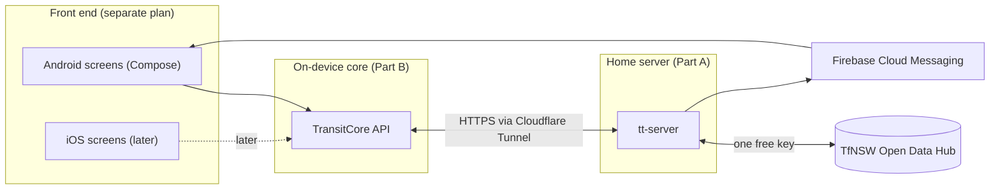
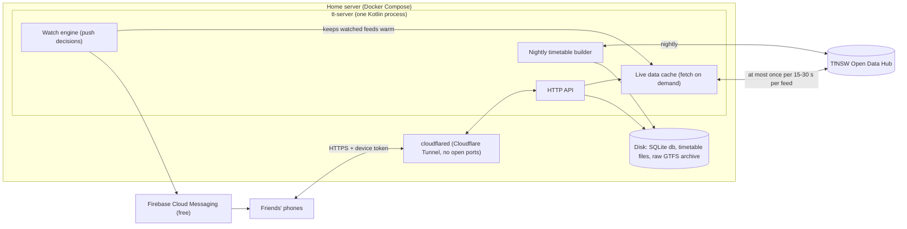

# TransitTracker Backend Plan

Status: **Draft v4** · Audience: **me and a few friends, not for profit** ·
Budget: **free** · Data: **TfNSW Open Data Hub, free public tier only** ·
Platform: **Android first, iOS later** · Scope: **everything below the UI**
(front end planned separately)

This plan applies the design lessons in
[tripview-architecture.md](tripview-architecture.md) and
[tripview-purpose-and-plan.md](tripview-purpose-and-plan.md) to a small,
personal TransitTracker. TripView is a design reference only: nothing here
calls TripView's servers or reuses its formats.

> An earlier draft of this file planned for a public app at scale (managed
> cloud database, Redis, CDN, quota uplift). It is in git history at commit
> `9c80976` if the app ever grows. Section 15 lists what would change.

### Decisions made

| # | Decision | Choice |
|---|---|---|
| D1 | Where the server runs | **Your home server** |
| D2 | Push notifications | **In the first version** |
| D3 | How friends get the app | **Firebase App Distribution** (free) |
| D4 | Budget | **Free** apart from a domain for Cloudflare (≈ A$15/year): no paid hosting or store fees |
| D5 | Exposure to the internet | **Cloudflare Tunnel** (Cloudflare Zero Trust, free plan) instead of Tailscale Funnel |
| D6 | Proxmox guest | **LXC container** (unprivileged, nesting + keyctl), VM as fallback |

---

## 0. Summary

- **One program on your home server, one free API key.** It holds the free
  TfNSW key, builds the timetable file for phones each night, passes on live
  data and sends push notifications. Friends need no TfNSW account, and the
  key never sits on a phone.
- **Reachable from anywhere** through a **Cloudflare Tunnel** (Zero Trust free
  plan) on your own domain: no router port forwarding, no open ports, and
  Cloudflare Access guarding the admin page.
- **Fetch only when needed.** The server calls TfNSW only when a phone is
  looking at something or a friend's "tell me if my train is late" window is
  active, at most once per feed every 15–30 seconds, shared by everyone. A
  handful of users uses well under 10% of the free quota, so **all Sydney
  modes fit**.
- **Push notifications through Firebase Cloud Messaging** (free): "Your 7:42
  to Central is 6 min late", cancellations and platform changes, delivered to
  a locked phone.
- **Offline first.** Each phone keeps the timetable locally and answers
  "when's my next train?" with no signal. Live data is a layer on top.
- **Shared engine for Android now, iOS later** (Kotlin Multiplatform).
- **Cost: A$0.** The only future cost is Apple's developer fee if you add
  iPhones (section 10.5). **Effort:** about 11–12 engineer-weeks
  (section 13).

---

## 1. Scope and boundaries



| Backend (this plan) | Front end (separate) |
|---|---|
| Fetching and processing TfNSW data | Screens, navigation, styling |
| Timetable file for phones | Map drawing (core supplies shapes and positions) |
| Live data, alerts, push notifications (deciding *when* and *what* to send) | Notification appearance, channels, permission prompts |
| On-device timetable, search, live overlay, alarm timing | Alarm, watch and settings screens |

The hand-off between the two is the `TransitCore` Kotlin interface (section
10.2). A fake version with sample data comes first so screen work can start
straight away.

### 1.1 Assumptions

| # | Assumption |
|---|---|
| A1 | Up to about 10 users, all known to you |
| A2 | Not for profit, no ads, no accounts |
| A3 | Only public TfNSW open data on the free tier; no agreement with TfNSW |
| A4 | Release 1: Sydney Trains + Metro. Then light rail, ferries, buses (no quota barrier, just effort) |
| A5 | Saved stop-to-stop trips first; free-form journey planning later, if ever |

---

## 2. Data sources and terms

### 2.1 Feeds

All calls go to `https://api.transport.nsw.gov.au` with header
`Authorization: apikey <key>`. The Sydney Trains and Metro paths below were checked against the
live API on 11 Nov 2026 (`DefaultSources` in `ServerConfig.kt`): every one answered 200 and decoded.

| Need | Feed | Path (verified 11 Nov 2026) | Notes |
|---|---|---|---|
| Timetable | GTFS static, per mode, "for realtime" | `/v1/gtfs/schedule/sydneytrains`, `/v2/gtfs/schedule/metro` | Use the per-mode bundles, whose trip IDs match the live feeds, not the "complete" planning bundle. Sydney Trains has no v2 bundle (404). The **v1 Metro bundle is frozen** (version 17092024, Metro North West only, no service in the current window): use v2 |
| Delays, cancellations, platforms | GTFS-R trip updates | `/v2/gtfs/realtime/sydneytrains`, `/v2/gtfs/realtime/metro` | Protobuf. Sydney Trains sends TfNSW's pre-standard `StopTimeUpdate` field 6 (departure occupancy, a varint) where GTFS-R now has the `stop_time_properties` message; `TfnswWireFixes` renumbers it to 7 before decoding. No `start_date` is sent (inferred) |
| Train positions | GTFS-R vehicle positions | `/v2/gtfs/vehiclepos/sydneytrains`, `/v2/gtfs/vehiclepos/metro` | TfNSW extension 1007 (`consist`): car counts 8 (trains) and 6 (metro) decoded |
| Disruptions | GTFS-R alerts | `/v2/gtfs/alerts/sydneytrains`, `/v2/gtfs/alerts/metro` | |

TfNSW's 5 calls a second behave like a spike arrest: a burst of three calls within 60 ms got HTTP
429. The server's limiter therefore spaces calls evenly (4 a second, no burst).

Other modes (light rail, Sydney Ferries, Manly Fast Ferry, buses, NSW
TrainLink) follow the same pattern.

### 2.2 What the free tier allows

- **Getting a key:** register on the Open Data Hub, create an application,
  add the products above. Free.
- **Limits:** 60,000 requests a day and 5 a second per key, shared across all
  endpoints. Over-limit responses have been reported as 401, 403 and 503, so
  the server treats all three as "possibly throttled".
- **Licence:** datasets are under **Creative Commons Attribution 4.0**, which
  allows reuse and redistribution with attribution. Use of the Hub is also
  covered by the Hub Terms and an Acceptable Use Policy. Sharing the data with
  friends through your own server fits within this; **sharing the key itself
  does not**, so the key stays on the server. Re-read the terms before
  sharing, as TfNSW can change them.
- **Attribution:** the app shows an attribution line such as "Contains
  Transport for NSW data" (check the Hub terms for any required wording),
  served by the server so it can be changed without an app update.

### 2.3 Quota in practice

The server fetches a feed only when **(a)** a phone asks for it, or **(b)** a
push watch that needs it is active (section 7), and never more often than its
minimum age: 15 s for trains and metro on screen, 30 s for watches and other
modes, 60 s for alerts.

| Scenario | TfNSW calls/day |
|---|---|
| Worst case: trains + metro open on screen 24 hours a day | ≈ 26,000 (43%) |
| App use: 5 people, ~1 hour of app-open time each | ≈ 1,500–3,000 |
| Watches: 5 people × 2 commutes × ~2 hours active (incl. lead time), trains + alerts, mostly overlapping | ≈ 1,000–2,500 |
| Nightly timetable check, 2–8 bundles | under 50 |
| **Realistic total** | **≈ 3,000–5,500 (under 10%)** |

A **daily budget guard** stops calling TfNSW at 50,000 calls and serves the
last data marked "stale" instead, so the key can never be suspended for
overuse.

---

## Part A: The home server

## 3. Architecture

One program, one machine, one database file.



| Part | What it does |
|---|---|
| **HTTP API** | Serves config, timetable files, live data, alerts, shapes, device sign-up, watches |
| **Live data cache** | Fetches a TfNSW feed only when asked and the cached copy is older than its minimum age. Concurrent requests share one fetch. Decodes, matches to the timetable, keeps the result in memory |
| **Timetable builder** | Nightly: checks TfNSW for new timetables, validates, builds the phone timetable file (section 8) |
| **Watch engine** | During each friend's watch windows, keeps the needed feeds fresh, checks their trips and decides when to send a notification (section 7) |
| **SQLite database** | Devices, invite codes, watches, notification history, timetable file versions, daily call counter |

No separate database server, cache server or CDN: at this size they add
upkeep without benefit.

**Code sharing:** the server uses the **same Kotlin modules as the phone**
for reading the timetable file, time calculations and decoding live feeds.
The server opens the timetable file it built to match live updates to
scheduled services and to work out which trips a watch covers, so the phone
and server can never disagree about what a trip ID means.

## 4. Live data path

When a phone (or the watch engine) asks for live data on some routes:

1. Work out which feeds those routes need (for example T1 → Sydney Trains
   trip updates).
2. For each feed: if the cached copy is younger than its minimum age, use it.
   Otherwise fetch once (other requests wait for the same fetch), with a
   10 s timeout.
3. Decode the protobuf, including TfNSW extensions (Square's Wire library,
   with the official `.proto` files pinned in the repo).
4. **Match each update to a timetabled trip** (section 4.1) and pre-compute
   the delay at every remaining stop, so phones do no transit logic.
5. Notify the watch engine of trips that changed.
6. Return only the trips on the requested routes, with the time the data was
   produced and the next poll interval.

**If TfNSW fails or throttles:** back off for that feed (30 s, 60 s, 120 s,
up to 5 minutes), keep serving the last good copy marked stale.

### 4.1 Matching rules

| Case | Rule |
|---|---|
| Normal trip | Match on GTFS `trip_id` + start date |
| Platform change | The update names a different platform stop of the same station |
| Stops with no update | Inherit the delay of the previous updated stop (GTFS-R rule) |
| Cancelled trip / skipped stop | Pass through explicitly |
| Added or replacement trip (not in timetable) | Send its full stop list and times |
| No match | Count and log; never guess. Show as "timetabled" |
| Phone has an older timetable file | Response says which timetable version it matched; phone treats unmatched trips as "timetabled" |

**Staleness:** feed data older than 2× its minimum age is stale; a trip
update older than 3 minutes is stale; a vehicle position older than
2 minutes is hidden. The watch engine never sends a notification based on
stale data.

### 4.2 Time handling

All times are `Australia/Sydney`. GTFS times can go past 24:00 and are
counted from "noon minus 12 hours" of the service day, which matters on
daylight-saving change days. One shared, well-tested function does this for
both server and phone. Every response carries the server time so the phone
can correct a wrong clock in second-by-second countdowns.

## 5. API

Plain HTTPS + JSON for most calls; live data in protobuf (smaller, faster)
with JSON available for debugging. Every response carries `X-Server-Time`.
Live responses carry `pollInterval` (default 30 s) and `trackerPollInterval`
(default 15 s), which the phone obeys, so you can change everyone's refresh
rate from the server.

| Method and path | Purpose | Phase |
|---|---|---|
| `POST /v1/join` | Exchange an invite code for a device token | P1 |
| `GET /v1/config` | Poll intervals, feature flags, minimum app version, attribution, available timetable files, status message | P1 |
| `GET /v1/packs` | Timetable files: name, version, size, SHA-256, download URL | P2 |
| `GET /v1/packs/{name}/{version}` | Download a timetable file | P2 |
| `GET /v1/rt?routes=T1,T9` | Live data for those routes; `ETag` so unchanged data returns `304` | P3 |
| `GET /v1/rt/trip/{tripId}?date=YYYYMMDD` | One service, for live tracking | P3 |
| `GET /v1/vehicles?routes=…` | Vehicle positions for the map | P4 |
| `GET /v1/alerts?modes=…` | Current disruptions; `ETag` / `304` | P4 |
| `GET /v1/shapes/{shapeId}` | Route line for the map (encoded polyline) | P4 |
| `PUT /v1/device` | Update Firebase token, app version, notification settings | P5 |
| `GET /v1/watches` | List this device's watches | P5 |
| `PUT /v1/watches/{id}` | Create or update a watch | P5 |
| `DELETE /v1/watches/{id}` | Remove a watch | P5 |
| `POST /v1/watches/{id}/test` | Send a test notification | P5 |
| `GET /v1/places?q=…&lat=…&lon=…&limit=…` | Address, stop and place search for journey planning (`PlacesResponse`); nearer results first when a position is given | Planner |
| `POST /v1/plan` | Journeys from A to B (`PlanRequest` → `PlanResponse`): rides, changes and walks, rides matched to timetable trips | Planner |
| `GET /status` | Your own page: feed ages, calls used today, errors, devices, notifications sent | P3 |

### 5.0 Journey planning

The phone never talks to TfNSW. `/v1/places` and `/v1/plan` (contract:
`shared/model/.../Planning.kt`) are answered by `:server:planner`, which asks TfNSW's Trip
Planner (`/v1/tp/stop_finder`, `/v1/tp/trip`) with the server's key and trims the answer:

- **Mapping.** Walking legs become `WALK`, public transport legs `RIDE`; a walk TfNSW gives as
  foot-path information on a ride becomes its own `WALK`, so every change has its minutes;
  consecutive walks are merged and empty ones dropped; journeys needing cycling, taxi, car or
  on-demand are dropped. Names lose " Station" and the platform; `stopId` is set only for ids in
  the loaded timetable. Order: earliest arrival (depart at) or latest departure (arrive by),
  then fewer changes.
- **Matching.** A ride gets `routeId`/`tripId`/`serviceDate` only when the planner's real-time
  trip id is a timetable trip running that day at that time, or exactly one trip of the same line
  leaves the boarding station at the planned time and calls later at the alighting station.
  Never guessed; matched and unmatched counts are on `/status`.
- **Quota.** Planner calls draw on the same daily budget and per-second limiter as the live feeds
  (one `TfnswQuota` per server), back off on 401/403/429/503, and answer
  `503 planner_unavailable` meanwhile, when the budget is used up or with no key;
  `502 planner_upstream` when TfNSW answers with something unusable. Per device: `/v1/plan` 30 an
  hour (burst 5), `/v1/places` 60 a minute (burst 20). Identical plans are cached 60 s, searches
  5 minutes (bounded, in memory).
- **Privacy.** Positions, place ids and search text go only to TfNSW, are not stored and are never
  logged; logs carry counts, status and duration.
- **Without a key** `TT_REPLAY_DIR/planner/` answers from fixture files
  (`testdata/planner/README.md`). The mapping was checked against the live API on 11 Nov 2026
  (18 real journey requests plus no-route and error cases; raw answers in `testdata/planner/live/`); findings and what is still open are
  in that README. Notably: the planner's real-time trip id equals the GTFS trip id for every
  Sydney Trains and Metro ride, but Sydney Trains' GTFS splits trains running through the City at
  Central into two trips, so rides past Central (T1 Western to Town Hall/Wynyard, T9) stay
  unmatched: one `tripId` per leg cannot describe them.

### 5.1 Live data payload (sketch)

```proto
message RealtimeResponse {
  int64  server_time_ms          = 1;
  int32  poll_interval_s         = 2;   // default 30
  int32  tracker_poll_interval_s = 3;   // default 15
  string timetable_version       = 4;   // version these trip IDs match
  repeated FeedHealth feeds      = 5;   // per mode: data time, stale
  repeated TripDelta  trips      = 6;
  string alerts_etag             = 7;   // tells the phone whether to refetch alerts
}

message TripDelta {
  string trip_id    = 1;
  string start_date = 2;               // YYYYMMDD
  Status status     = 3;               // SCHEDULED, CANCELLED, ADDED, REPLACED
  repeated StopDelta stops = 4;        // remaining stops only
  Occupancy occupancy = 5;
  int32  car_count    = 6;
  int64  updated_ms   = 7;
  bool   stale        = 8;
  repeated AddedStop added_stops = 9;  // full timetable for ADDED trips
}

message StopDelta {
  uint32 stop_sequence  = 1;
  sint32 arr_delay_s    = 2;
  sint32 dep_delay_s    = 3;
  string actual_stop_id = 4;           // only on platform change
  bool   skipped        = 5;
}
```

## 6. Access and security

Kept proportionate to "me and a few friends".

| Area | Approach |
|---|---|
| Secrets | The TfNSW key and the Firebase service-account key live only on the server, in an env file excluded by `.gitignore`. Never in the app or the repo. Turn on GitHub secret scanning |
| Who can use the server | **Invite codes.** `tt-admin invite` creates a one-time code; the app exchanges it for a device token. `tt-admin revoke` cuts a device off |
| Abuse | Per-device rate limit (for example 20 live requests a minute); route list capped at 30; watches capped at 10 per device; unknown tokens rejected |
| Exposure to the internet | **Cloudflare Tunnel**: only tt-server is reachable, over HTTPS on your domain; nothing else on your home network is reachable; no router changes. Cloudflare Access (your email) protects `/status`; the API keeps its own invite/token auth because the phone can't do an Access login (section 9.2) |
| Timetable integrity | SHA-256 for every timetable file, checked on the phone |
| Personal data | Only a random device ID, app version, Firebase token and watch settings (stations and times). No names, emails or locations. Location alarms run on the phone. `tt-admin revoke` deletes everything for a device |
| Repo | Keep private while `tripview-low-level-notes.md` is in its history (that file already says so) |

## 7. Push notifications

Android limits apps polling in the background, so "tell me if my train is
late" is decided on your server and delivered by **Firebase Cloud Messaging
(FCM)**, which is free and will also reach iPhones later.

### 7.1 One-off setup

1. Create a Firebase project on the free **Spark** plan (no billing account
   needed). It also gives you Crashlytics and App Distribution.
2. Add the Android app to the project; the front end includes the
   `google-services.json` file (an identifier, not a secret).
3. Create a service-account key for FCM and put it in the server's env file.
   The server sends messages with the **FCM HTTP v1 API**.

### 7.2 Watches

A **watch** is a friend's standing request, stored in SQLite.

| Field | Example | Default |
|---|---|---|
| `origin`, `destination` (stations) | Strathfield → Central | |
| `routes` (optional filter) | T1, T9 | any |
| `days` | Mon–Fri | Mon–Fri |
| `window` (departure times to cover) | 07:15–08:00 | |
| `lead_time` | start watching 45 min before the window | 45 min |
| `delay_threshold` | 5 min | 5 min |
| `notify_cancel`, `notify_platform`, `notify_alerts` | yes | yes |
| `paused_until` | holidays | none |

There is also a **one-off watch** for a single service ("notify me about
this train"), created from the service screen: trip ID + date, expires after
arrival.

### 7.3 How the watch engine runs

1. **Each morning at 03:30** (and after a new timetable file), work out the
   concrete trips each watch covers today from the timetable file: trips that
   call at the origin within the window and later at the destination. Store
   them in memory as `trip → watches`.
2. **Every minute**, mark a watch *active* from `window start − lead time`
   until the last covered trip has left the origin. Active watches register
   demand on their feeds (trip updates + alerts) at a 30 s minimum age, so the
   live cache keeps those feeds fresh even when no app is open.
3. **On each feed refresh**, check the covered trips of every active watch.
4. **Notify on a change of state, not on every refresh.** For each watch and
   trip the engine remembers what it last told the friend:

   | Send when | Example |
   |---|---|
   | Trip becomes cancelled | "07:42 Strathfield → Central is cancelled. Next: 07:51 (on time)" |
   | Delay first reaches the threshold | "07:42 to Central is running 6 min late (now 07:48)" |
   | Delay grows by another 5 min or more | "07:42 to Central now 12 min late (07:54)" |
   | Departure platform changes | "07:42 to Central now leaves from platform 6" |
   | A new major alert affects the watched line or stations | Alert headline |
   | Trip recovers after a delay notification (optional) | "07:42 to Central back on time" |

5. **Never notify** from stale data, for trips that have already left the
   origin, or during `paused_until`.

### 7.4 Sending

- **High priority** FCM messages so they arrive promptly on a locked phone;
  **collapse key** = trip + date, so an update replaces the previous one
  instead of stacking; time-to-live = until the scheduled departure.
- Payload includes the trip ID and date so tapping opens that service in the
  app.
- Each send is logged (watch, trip, reason, result). If FCM reports the token
  is no longer valid, the device's token is cleared until the app sends a new
  one.
- **Target:** notification on the phone within about 45 s of TfNSW
  publishing the change (30 s refresh + processing + delivery).

### 7.5 Things the front end needs to handle

Noted here so nothing falls between the two plans: the Android 13+
notification permission prompt; notification channels (delays,
cancellations, alerts) so friends can mute categories; sending the Firebase
token to `PUT /v1/device` whenever it changes; and a tip for phones with
aggressive battery savers (some Samsung, Xiaomi, Oppo models) to exclude the
app.

## 8. Timetable files for phones

### 8.1 Nightly build

1. At about 03:00, ask TfNSW whether each timetable bundle has changed
   (conditional request). Stop if not.
2. Download and keep the raw zip for 30 days.
3. Validate with the MobilityData GTFS Validator; if it fails, keep serving
   yesterday's file and log the problem.
4. Build the phone timetable file (below) and publish its version and SHA-256.
5. Recompute today's watch coverage (section 7.3, step 1).

### 8.2 Format

Each timetable file is a **SQLite database**, zstd-compressed. SQLite works
the same on Android and iOS and needs no custom reader. The size savings come
from how the data is arranged:

| Table | Contents |
|---|---|
| `meta` | Version, source versions, valid dates, schema version |
| `stops` | Small integer ID, GTFS ID, parent station, name, position, platform, modes, accessibility |
| `routes` | Name, mode, colour |
| `patterns` | Each distinct ordered list of stops a line runs (packed) |
| `time_profiles` | Each distinct set of stop-to-stop times (packed, shared between trips) |
| `trips` | GTFS trip ID, pattern, time profile, start time, service days |
| `services` | Which days each service runs, as a bitset over the next ~70 days |
| `stop_patterns` | Index: stop → patterns that call there, and at which position |
| `transfers` | Walking times between stops at interchanges |

Storing each trip as "pattern + time profile + start time" instead of one row
per stop visit is what keeps the file small (TripView does the same).

**Files by mode**, so people download only what they use: `syd-rail`
(Trains + Metro), then `syd-lightrail`, `syd-ferry`, `syd-bus`.

**Updates:** phones download the whole file when the version changes,
preferring Wi-Fi. Target: `syd-rail` under 5 MB. Small patch updates (as
TripView does) are **left out** for now; the build is kept deterministic so
they can be added later if needed.

## 9. Home server setup and operations

### 9.1 Requirements

- Any always-on Linux machine (mini PC, NUC, Raspberry Pi 4/5 with 4 GB+,
  NAS that runs Docker) with **Docker and Docker Compose**.
- About 512 MB RAM for tt-server with trains and metro; allow 2 GB once
  buses are added (the bus timetable build is the heavy part). A few GB of
  disk.
- **If your home server runs Home Assistant OS**, it can't run arbitrary
  Docker Compose stacks directly. Run tt-server on a separate machine, or in
  a separate VM on the same host, rather than as a Home Assistant add-on.

### 9.2 Making it reachable for free

| Option | Cost | Notes |
|---|---|---|
| **Cloudflare Tunnel** (chosen) | Zero Trust free plan; needs a domain on Cloudflare (≈ A$15/year) | `https://tt.<your-domain>`; outbound-only `cloudflared` container, no port forwarding, home IP not exposed; Access can protect admin paths; server trusts `CF-Connecting-IP` for per-IP limits |
| Tailscale Funnel | Free on Tailscale's Personal plan | Alternative with no domain needed (`*.ts.net` address); previously the default |
| DuckDNS + Caddy + router port forward | Free | Fallback; exposes port 443 on your home IP |

The app reads the server address from its build configuration, so moving
to another option later only needs a new build (or a config redirect).

### 9.3 Keeping it running

- `restart: unless-stopped` in Docker Compose; automatic OS security
  updates.
- **Backups:** nightly copy of the SQLite database and the env file to
  another disk or a free cloud drive (for example with `rclone`). Timetable
  files can be rebuilt, so they need no backup.
- **Monitoring (free):** an uptime checker (for example UptimeRobot or
  Healthchecks.io free tiers) pinging `/health`; the `/status` page for
  feed ages, calls used and notifications sent; Firebase Crashlytics for app
  crashes.
- **If the server is down:** the app keeps working from its timetable and
  shows "live data unavailable"; push notifications pause. Worth knowing if
  you're relying on them for a commute.
- **Updates:** GitHub Actions builds and tests on every push and publishes a
  container image to GitHub Container Registry (free for private repos within
  the free allowance); the server pulls the new image (manually or with
  Watchtower).
- **Environments:** your laptop (with a second free TfNSW key, or replays of
  recorded feeds) and the one home server. No separate staging.

### 9.4 Getting the app to friends: Firebase App Distribution

Free, uses the Firebase project you already need for push.

- You upload each build (from GitHub Actions with the Firebase Gradle plugin
  or CLI) and add friends by email. They get an invite and install the app,
  allowing "install unknown apps" once.
- Add the App Distribution SDK's **in-app update alert** so friends are told
  when a new build is ready.
- **Sign builds with your own release key and back it up.** If it is lost,
  friends must uninstall and reinstall (losing saved trips) to get updates.
- First launch asks for an invite code (section 6).
- **Watch for Google's Android developer verification.** Google is starting
  to require that apps installed outside the Play Store come from verified
  developers: enforcement starts in a few countries from September 2026 and
  goes global in 2027. Google has announced a free "limited distribution"
  account for hobbyists and students, for sharing with a small number of
  devices. **Register for that when it is available in Australia** so
  friends can keep installing without warnings or extra steps. Until then,
  nothing changes.

---

## Part B: On-device core

## 10. Shared core (Kotlin Multiplatform)

### 10.1 Why

TripView's lesson is "one engine, many shells". Kotlin Multiplatform does
that without C++: the same code runs on Android now and becomes an iOS
framework later, and it shares the timetable reader, time function and feed
models with the server. Screens stay native on each platform.

### 10.2 `TransitCore` interface (hand-off to the front end)

```kotlin
interface TransitCore {
  // Lifecycle
  suspend fun start()                        // open timetable files, load trips
  fun onForeground(); fun onBackground()     // start / pause live polling

  // Setup
  suspend fun join(inviteCode: String): JoinResult
  suspend fun updatePushToken(token: String)

  // Saved trips
  val trips: Flow<List<SavedTrip>>
  suspend fun saveTrip(trip: SavedTrip); suspend fun deleteTrip(id: TripId)
  suspend fun reorderTrips(ids: List<TripId>)

  // Departures: timetable + live layer; re-emits when live data arrives
  fun upcoming(tripId: TripId, count: Int = 6): Flow<List<Departure>>
  fun timetable(tripId: TripId, date: LocalDate): Flow<List<Departure>>
  fun service(ref: ServiceRef): Flow<ServiceDetail>       // all stops of one service
  fun track(ref: ServiceRef): Flow<TrackingState>         // 15 s tracking

  // Reference data
  suspend fun searchStops(query: String, near: LatLng? = null): List<Stop>
  suspend fun linesAt(stopId: StopId): List<Line>
  suspend fun shape(shapeId: ShapeId): Polyline
  fun vehicles(routes: Set<RouteId>): Flow<List<VehiclePosition>>

  // Alerts and status
  val alerts: Flow<List<Alert>>
  val dataStatus: Flow<DataStatus>   // timetable versions, last live update, stale flags, server reachable

  // Push watches
  val watches: Flow<List<Watch>>
  suspend fun saveWatch(watch: Watch)          // standing commute watch
  suspend fun watchService(ref: ServiceRef)    // one-off "notify me about this train"
  suspend fun deleteWatch(id: WatchId)
  suspend fun sendTestNotification(id: WatchId)
  fun openFromNotification(payload: Map<String, String>): ServiceRef?

  // Device alarms
  suspend fun nextAlarmTimes(alarm: AlarmSpec): List<Instant>
}
```

`Departure` includes scheduled time, expected time, delay, status (on time,
late, cancelled, added), platform and whether it changed, occupancy, car
count, data age and a `stale` flag. The front end never has to work out
transit logic.

A saved trip can offer "notify me" defaults (window from the trip's usual
departure times), but trips and watches are stored separately: trips live
on the phone, watches live on the server because the server sends the
notifications.

### 10.3 Modules

| Module | Job |
|---|---|
| `store` | Opens timetable files read-only (SQLDelight); small read-write database for trips, alarms, cached alerts, settings |
| `query` | Next departures between two stations on a date; service detail; multi-leg trips with connection times; trips covered by a watch (also used by the server) |
| `overlay` | Applies live updates to timetable results, adds added trips, marks stale data |
| `realtime` | Polls only for routes on screen; obeys server intervals; pauses in background; backs off on errors; sends `If-None-Match` |
| `updater` | Checks for new timetable files, downloads (Wi-Fi preferred, via Android WorkManager), checks SHA-256, swaps in atomically |
| `watches` | Watch create/edit/delete against the server; caches the list for offline display |
| `timesync` | Corrects the phone clock using server time |
| `api` | Ktor HTTP client, Wire protobuf models, device token |
| `alarms` | Works out alarm times; the Android layer schedules them (`AlarmManager`, geofences) |
| `fake` | Sample-data implementation for front-end development and tests |

### 10.4 How "next departures" works

For a saved trip (origin station → destination station):

1. Find the patterns that call at the origin **before** the destination.
2. For those patterns, find trips running today that leave the origin after
   now.
3. Sort, cache for the day, and extend on demand.

This is fast and needs no route-graph search. Multi-leg trips repeat it per
leg with the connection time. The server uses the same code to work out
which trips a watch covers.

### 10.5 iOS later

No server changes. The shared core builds as an iOS framework and Firebase
delivers iPhone push through Apple's service. **This is the one part that
can't be free:** installing on friends' iPhones (via TestFlight) and sending
push to iPhones need an Apple Developer Program membership (US$99/year). A
free Apple ID can only install on your own phone, and the app expires after
7 days.

---

## 11. Repository layout

```
/proto           GTFS-R .proto, TfNSW extension .proto, our API .proto
/shared          Kotlin Multiplatform core (also used by the server)
/server          tt-server: API, live cache, timetable builder, watch engine, tt-admin
/androidApp      front end (separate plan)
/deploy          docker-compose.yml (tt-server + cloudflared), .env.example (no secrets)
/tools           feed recorder and replayer, timetable file inspector
/docs            plans, TripView reference docs
```

## 12. Testing

- **Time function:** normal days, after-midnight services, both daylight
  saving change days.
- **Matching:** recorded real feeds replayed against a fixed timetable, with
  expected delays, cancellations and platform changes.
- **Watch engine:** replayed feeds through a morning with known delays must
  produce exactly the expected notifications: no duplicates, none from stale
  data, none after departure.
- **Timetable builder:** a fixed GTFS input must produce the same file
  every time (checked in CI).
- **Query:** known departures between known stations on a known date.
- **API:** contract tests against the `.proto` and JSON examples.
- **Manual:** a week of real commutes with watches on, compared against
  station displays.

## 13. Delivery plan

Rough engineer-weeks for one experienced Kotlin developer.

| Phase | Goal | Done when | Est. |
|---|---|---|---|
| **P0. Setup** | Key, repo, home server, Firebase | TfNSW key works from your laptop; Firebase project created; Docker and the Cloudflare Tunnel running on the home server with a "hello" endpoint reachable from a phone on mobile data; CI builds an empty server and shared module | 1 |
| **P1. Contracts and fake** | Front end can start | `TransitCore` interface, fake data, `/v1/join` and `/v1/config` | 1 |
| **P2. Timetable** | Offline departures | Nightly builder makes `syd-rail`; phone downloads it and lists next trains between two stations with no network | 3 |
| **P3. Live data** | Live delays | Fetch-on-demand cache, matching, `/v1/rt`, tracking endpoint, `/status`; phone shows a real delay within one poll interval | 2.5 |
| **P4. Alerts, map** | Full picture | Alerts, vehicle positions and route shapes on the phone | 1.5 |
| **P5. Push** | "Your train is late" on a locked phone | Watches API, watch engine, FCM sending, replay tests; a real delay produces exactly one notification within ~45 s | 2 |
| **P6. Friends** | Share it | Invite codes, rate limits, backups, uptime check, App Distribution from CI; first friend installed, joined and received a notification | 0.5–1 |
| **P7. More** | As wanted | Light rail, ferries, buses; multi-leg polish; iOS (needs Apple fee) | ongoing |

**P0–P6: about 11–12 weeks.**

## 14. Risks

| Risk | What we do |
|---|---|
| TfNSW changes feed versions or paths | Pin `.proto` files; recorded-feed tests; watch the TfNSW developer forum; feeds configured, not hard-coded |
| Live update matched to the wrong service | Strict trip ID + date matching; show "timetabled" when unsure; no notifications from unmatched or stale data |
| Notification spam or duplicates | State-change rules, collapse keys, replay tests |
| Key suspended for overuse | Fetch on demand, daily budget guard at 50,000, back off on errors |
| Key leaked | Server only, `.gitignore`d env file, GitHub secret scanning; regenerate on the Hub if exposed |
| Home internet or power outage | App still works from its timetable; notifications pause; `/status` and uptime alerts tell you |
| Cloudflare blocks or challenges app traffic | WAF skip rule / Bot Fight Mode off for `/v1/*`; no Access on the API (deploy/README.md step 6) |
| Android developer verification blocks installs | Register the free limited-distribution account when it reaches Australia (section 9.4) |
| Release signing key lost | Back it up off the server; without it, friends must reinstall |
| Daylight-saving and after-midnight bugs | One shared time function with dedicated tests |
| Terms change | Re-read Hub Terms before sharing; attribution served from the server |

## 15. If it ever grows

The design scales up without a rewrite. In order, roughly:

| Trigger | Change |
|---|---|
| Home server outages become a nuisance | Move the same containers to a small Sydney VPS (≈ A$6–15/month) |
| Data use matters | Add timetable patch updates (build is already deterministic) |
| Hundreds of users | Postgres instead of SQLite; Redis for live snapshots; CDN for timetable files; Play Integrity instead of invite codes; Play Store distribution |
| Public release, commercial, or quota pressure | Talk to TfNSW about higher limits; privacy policy; see the scaled design at commit `9c80976` |

## 16. Sources

- TfNSW API basics (limits): <https://opendata.transport.nsw.gov.au/developers/api-basics>
- TfNSW developer documentation: <https://opendata.transport.nsw.gov.au/developers/documentation>
- TfNSW GTFS / GTFS-R Implementation Specification v2 (June 2025):
  <https://opendata.transport.nsw.gov.au/sites/default/files/2025-09/TfNSW%20GTFS%20%20GTFS%20R%20Implementation%20Specification%20v2%20June%202025.pdf>
- Realtime vehicle positions v2: <https://opendata.transport.nsw.gov.au/data/dataset/public-transport-realtime-vehicle-positions-v2>
- Realtime alerts v2: <https://opendata.transport.nsw.gov.au/dataset/public-transport-realtime-alerts-v2/resource/811affc9-7415-4558-9e9c-efc982fae6a2>
- Sydney Trains GTFS-R v2 (forum): <https://opendataforum.transport.nsw.gov.au/t/sydney-trains-gtfs-r-version-2/2551>
- Over-limit responses (forum): <https://opendataforum.transport.nsw.gov.au/t/intermittent-http-503-response-your-api-quota-or-rate-limit-has-been-exceeded/1006>
- Open Data Hub Terms: <https://opendata.transport.nsw.gov.au/sites/default/files/TfNSW-Open-Data-Portal-Terms.pdf>
- Acceptable Use Policy: <https://opendata.transport.nsw.gov.au/sites/default/files/TfNSW-Acceptable-Use-Policy.pdf>
- Open Data Hub FAQs (licence and redistribution): <https://opendata.transport.nsw.gov.au/faqs>
- Android developer verification (Google): <https://support.google.com/android-developer-console/answer/16561738>
- Android developer verification rollout (Android Developers Blog, March 2026): <https://android-developers.googleblog.com/2026/03/android-developer-verification-rolling-out-to-all-developers.html>
