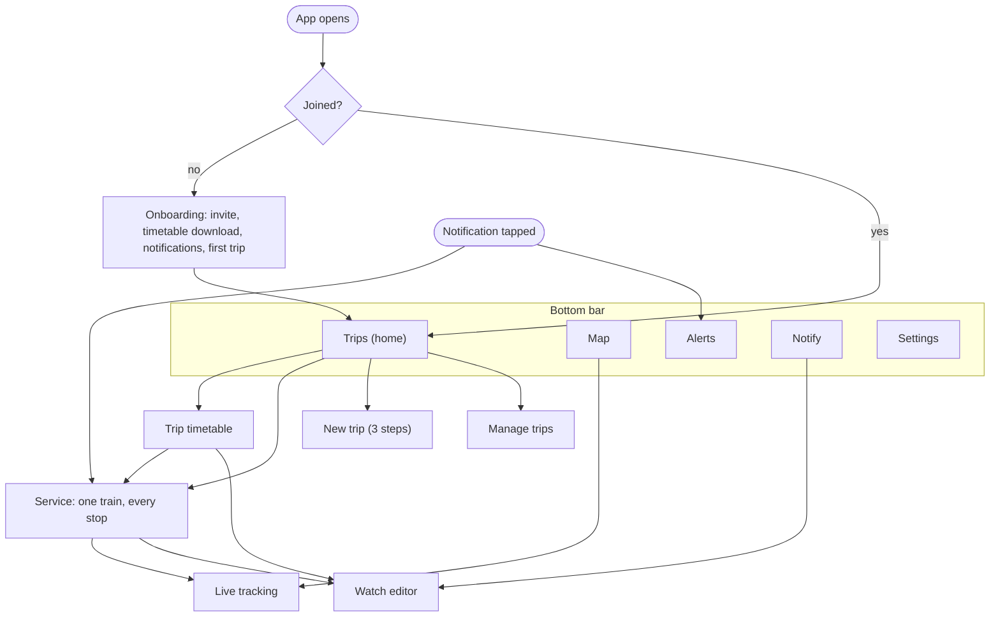

# TransitTracker Front-End Plan

Status: **Draft v1** · Platform: **Android first, iOS later** · Look:
**pixel art, game-like** · Rule: **function first** · Scope: **everything
above the `TransitCore` interface** (screens, navigation, styling,
notifications as they appear on the phone)

This is the companion to
[transittracker-backend-plan.md](transittracker-backend-plan.md). The backend
plan ends at the `TransitCore` interface
(`shared/model/.../TransitCore.kt`); this plan starts there.

**Mockups:** nine artboards on a design canvas at
<https://claude.ai/artifact/UpjCRFqexTVYB9hfSqzERg>. The canvas is private to
its author until shared from its Share menu. It holds three candidate
directions for the home screen, five key screens in the recommended direction
and a system sheet. The artboards were written without a render check, so
treat spacing in them as indicative.

### Decisions to confirm

| # | Decision | Recommendation | Why |
|---|---|---|---|
| F1 | Visual direction | **A · Indicator board** (dark platform-indicator look) | Densest and most legible of the three; section 2.1 |
| F2 | UI toolkit | **Compose Multiplatform**, screens shared by Android and iOS | The look is fully custom, so nothing is lost by not using each platform's native widgets, and iOS later becomes a thin shell instead of a second set of screens. This changes one line of the backend plan ("screens stay native") |
| F3 | Map | **Our own pixel line map** for rail; a street map only when buses arrive | Matches the look, needs no map key or billing, works on both platforms |
| F4 | Themes | **Night** by default, **Day** for sunlight, follow the phone setting | A dark board suits the concept; a light option is needed on a sunny platform |
| F5 | Sound | **Off by default** | Commuters are in quiet carriages |

---

## 0. Summary

- **The answer is on screen when the app opens.** Home shows every saved trip
  with a large countdown, expected time, platform and live status. No tap is
  needed for the daily question.
- **Pixel art carries the character; plain type carries the facts.** Pixel
  fonts, sprites, hard edges and a board-style layout, with rules that stop the
  style costing legibility (section 2.3).
- **Colour is used only for meaning:** line identity and service status. The
  rest of the interface is two tones.
- **Every status is a shape, a word and a colour**, so nothing depends on
  colour alone.
- **Game look, not game mechanics.** No points, streaks, badges or levels.
- **The app never hides how fresh its data is:** live, timetable-only and
  stale are always distinguishable.
- **Built against the fake core first** (`FakeTransitCore`), so screens can be
  finished before every backend phase is wired to a phone.
- **Effort:** roughly 9–10 weeks for one developer through to friends using it
  (section 8). This is an estimate, not a measurement.

---

## 1. What the front end is for

TransitTracker answers **"When is my next service, and is it running on
time?"** for a handful of known people. The typical use is a two-second glance
on the way to a platform: one hand, bright sun or a dark street, sometimes no
signal.

### 1.1 Design principles

| # | Principle | What it means in practice |
|---|---|---|
| 1 | Answer first | Home is the saved trips with countdowns. Search, maps and settings are one tap away, never in the way |
| 2 | Pixels for character, never at the cost of reading | Minimum sizes, contrast and a fallback font rule (section 2.3) |
| 3 | Colour only for meaning | Line colours come from the timetable data; status colours follow the green / amber / red convention; everything else is ink and paper |
| 4 | Shape + word + colour | A late train shows a triangle, the words "4 MIN LATE" and amber |
| 5 | Honest data | Live, timetable-only, stale and offline each look different and say so |
| 6 | Game look, not game mechanics | The style is retro; the behaviour is a transit tool |
| 7 | One system | One set of tokens, one button pair, one panel style, one icon grid |

---

## 2. Visual direction

### 2.1 Three directions considered

All three are on the canvas as the same home screen with the same sample data.

| | A · Indicator board (recommended) | B · Overworld | C · Handheld LCD |
|---|---|---|---|
| Idea | A station platform indicator in your pocket: dark ground, dot-matrix countdowns, signal-lamp status | Each trip is a small side-scrolling scene with stations and a train that moves along the track | A four-tone olive LCD, like an early handheld console; menus with an inverted selected row |
| Strengths | Most information per screen; status colours stand out on a dark ground; grounded in the subject, because real platform indicators are already pixel displays | The most game-like and charming; progress along the trip is visible at a glance | Highest contrast outdoors; cheapest to build; very distinctive |
| Costs | Least "playful" of the three; needs a separate Day theme for sunlight | Roughly half the trips per screen; much more artwork to draw and keep consistent; wide display font limits long station names | Loses line colours and the green / amber / red convention, which commuters rely on |

**Recommendation: A.** It best serves "highly functional". B's scenes are
worth borrowing for moments that are not time-critical (onboarding, empty
states, the timetable download), and C could return later as an optional
high-contrast theme.

### 2.2 The concept in one line

**Pocket platform:** the phone as a platform indicator board, drawn like a
16-bit game interface.

### 2.3 Rules that keep pixel art functional

| Rule | Detail |
|---|---|
| The dot | One art pixel ("dot") is 2 dp, snapped to a whole number of screen pixels on each device. Sprites and borders are whole dots, so edges are always sharp |
| No blur | No rounded corners, gradients, soft shadows or scaled-with-smoothing images. Depth comes from a hard 1-dot border and a hard lip under buttons. Skies and fills use flat bands |
| Two resolutions only | Art at 1 dot; small text at half a dot. Nothing else, so the screen never looks like mixed zoom levels |
| Minimum text sizes | Labels 11 sp, rows 15 sp, names 17 sp, countdown 60 sp or more |
| Contrast | Every text colour at least 4.5 : 1 on its ground (section 2.4 lists the calculated values) |
| Touch targets | 48 dp or more, including steppers, day toggles and list rows |
| Font scaling | Honour the Android font-size setting. Sizes step up in whole pixel multiples; layouts wrap rather than clip. Tested at 1.0, 1.3 and 2.0 |
| Readable long text | Alert descriptions and help text use the pixel text face at 15 sp with 22 sp line height. If that fails the reading test in section 6 at font scale 1.3, long text alone falls back to the system sans-serif |
| Decoration is optional | The skyline strip and all ambient animation switch off with "Plain mode", battery saver or the system reduce-motion setting. Nothing functional lives in decoration |

### 2.4 Colour

Night theme (default). Contrast is calculated against Screen / Panel.

| Token | Value | Use | Contrast |
|---|---|---|---|
| Screen | `#0A0D18` | App background | |
| Panel | `#131829` | Cards, bottom bar | |
| Raised | `#1D2440` | Secondary buttons, steppers | |
| Divider | `#2E3760` | Borders, dashed rules | |
| Secondary text | `#8C93B0` | Labels, past stops | 6.4 / 5.8 |
| Text | `#F3ECD8` | Text; also the fill of the selected item and primary button | 16.4 / 15.0 |
| Go | `#4ADE80` | On time, live, switch on | 11.1 / 10.1 |
| Caution | `#FFB020` | Late, early, platform changed, warning alerts | 10.6 / 9.6 |
| Stop | `#FF5A5F` | Cancelled, severe alerts | 6.3 / 5.8 |
| Info | `#6CB6FF` | Timetable-only, info alerts | 9.0 / 8.2 |

Rules:

- **Line colours come from the timetable** (`Route.color`). They appear only
  inside the line badge, which always has a 1-dot Text-coloured border so dark
  lines (T4) stay visible on the dark ground.
- **Badge text is black or white, whichever contrasts better** with the line
  colour, and at least 4.5 : 1. The feed's own text colour is used only when it
  passes. Example: white on T8 green is 3.9 : 1, so T8 gets black text (5.4 : 1).
- **Status colours appear only in the status slot** (lamp, status words,
  expected time). A line colour is never used to signal status, so T1 orange
  cannot be mistaken for "late" or T9 red for "cancelled".
- **Selection is inversion**, not a hue: the selected tab, row or day is a
  Text-coloured block with Screen-coloured text.

Day theme: the same tokens inverted (Screen `#F3ECD8`, Panel `#FFFBF0`, Text
`#0A0D18`, Secondary text `#5C5A4E`) with darker status colours (starting
points: Go `#14703A`, Caution `#9A5200`, Stop `#B3261E`, Info `#1F5FBF`). These
are starting values; each must pass 4.5 : 1 on Screen and Panel on a real
phone before shipping.

### 2.5 Type

Three faces, all published on Google Fonts under the SIL Open Font License
(confirm each licence file when bundling them in the app).

| Face | Role | Sizes |
|---|---|---|
| **Doto** (Black) | Dot-matrix numerals: countdowns, the clock, time pickers | 30 / 44 / 60 / 76 |
| **Pixelify Sans** (400–700) | Station names, rows, buttons with long labels, reading text | 15 / 17 / 20 / 22 |
| **Silkscreen** (400, 700) | Small capital labels, status words, button labels | 10 / 11 / 12 / 13 |

Times use 24-hour format by default with a 12-hour setting. Countdowns show
minutes ("4 MIN"); "NOW" under one minute; a clock time instead of a countdown
beyond 60 minutes. Minutes-and-seconds countdowns appear only on the service
and tracking screens.

### 2.6 Artwork

Drawn once on small grids and stored as shapes made of whole squares (or as
bitmaps scaled without smoothing), so they stay crisp on every screen.

| Set | Grid | Items |
|---|---|---|
| Status lamps | 7 × 7 | Circle (on time), triangle (changed), cross (cancelled), plus (extra), ring (timetable / stale) |
| Navigation | 12 × 12 | Train, map pin, warning triangle, bell, sliders |
| Controls | 7 × 7 | Arrows, plus, minus |
| Train glyph | 6 × 4 per car | One block per carriage, headlight at the front |
| Scene strip | 195 × 18 | Skyline with a passing train; four versions for dawn, day, dusk, night |
| Scenes | free | Platform at night (empty state), ticket (invite), train filling a track (download) |
| App and notification icons | 24 × 24 base | Train front; a single-colour version for the status bar |

### 2.7 Status language

One visual grammar for every service, on every screen.

| Core value | Lamp | Words | Colour | Also |
|---|---|---|---|---|
| `ON_TIME` | Filled circle | ON TIME | Go | |
| `LATE` | Triangle | 4 MIN LATE | Caution | Timetabled time struck through, expected time beside it |
| `EARLY` | Triangle | 1 MIN EARLY | Caution | Same treatment as late: the time is not what you expect |
| `CANCELLED` | Cross | CANCELLED | Stop | Row struck through; the next running service becomes the headline |
| `ADDED` | Plus | EXTRA SERVICE | Go | |
| `TIMETABLED` | Ring | TIMETABLE | Info | No live data for this service |
| `stale = true` | Ring | STALE · 3 MIN OLD | Secondary | Countdown prefixed with "~" |
| `platformChanged` | | NOW PLAT 6 | Caution block | Blinks at 1 Hz for 5 s, then stays inverted |
| `Occupancy` | Four pips | MANY SEATS / FEW SEATS / STANDING ONLY / FULL | Text | `UNKNOWN` shows nothing |
| `carCount` | Car blocks | 8 CARS | Text | Helps choose where to stand |

Data-level states, shown in the header chip and as a banner when not live:

| `DataStatus` | Header chip | Banner |
|---|---|---|
| Live and fresh | LIVE · 12S | none |
| `liveStale` | STALE | "Live data is delayed. Showing the last update." |
| `serverReachable = false` | OFFLINE | "No live data. Showing the timetable." |
| `statusMessage` set | | The server's message, verbatim |
| Pack `downloading` | | "Updating timetable…" with a progress track |
| Pack past `validTo` | | "Timetable is out of date. Connect to update." |

### 2.8 Motion, sound, touch

| Where | Motion |
|---|---|
| Button press | Moves down 2 dots onto its lip, 60 ms; a light haptic tick |
| Screen change | A stepped slide in four frames, 120 ms; no easing curves |
| Value changes after a refresh | The changed value flashes inverted for one frame so the eye catches a new delay |
| Countdown tick | Digits swap in two frames |
| Ambient | Only the skyline strip and the tracked train move on their own, at a low frame rate, and stop under reduce-motion or battery saver |
| Pull to refresh | A train crosses the top of the list |

Sound is off by default. If enabled later: three short chiptune notification
sounds (delay, cancellation, platform change) tied to the notification
channels.

---

## 3. App structure

### 3.1 Navigation



Five bottom-bar destinations with plain labels. The Alerts tab carries a count
of active alerts on the user's own trips.

### 3.2 Screen inventory

| Screen | Purpose | `TransitCore` calls | Phase |
|---|---|---|---|
| Onboarding | Join with an invite code, get the timetable, allow notifications, save a first trip | `joined`, `join`, `dataStatus` | F2 |
| Trips (home) | Next services for every saved trip | `trips`, `upcoming`, `dataStatus`, `alerts` | F1 |
| Trip timetable | All services for a trip on a chosen day | `timetable` | F3 |
| Service | Every stop of one service, where the train is, actions | `service`, `watchService` | F3 |
| Live tracking | The train on a line map with a countdown to your stop | `track`, `shape` | F4 |
| Map | Lines, live vehicles, nearby stations | `vehicles`, `stopsNear`, `shape` | F4 |
| New trip / edit trip | Build a trip from stations, lines and legs | `searchStops`, `stopsNear`, `linesAt`, `saveTrip` | F2 |
| Manage trips | Reorder, rename, folder, delete | `reorderTrips`, `saveTrip`, `deleteTrip` | F2 |
| Alerts | Disruptions, your trips first | `alerts` | F4 |
| Notify | List and edit push watches | `watches`, `saveWatch`, `deleteWatch`, `sendTestNotification` | F5 |
| Alarms | Phone alarms before departure or arrival | `nextAlarmTimes` | F7 |
| Settings | Data status, display, notifications, about | `dataStatus` | F6 |

---

## 4. Screens

Sample content below matches `FakeData` so mockups and the fake core agree.

### 4.1 Onboarding

Four steps, each one screen, each skippable where the app can still work.

| Step | Screen | Notes |
|---|---|---|
| 1 | **Invite ticket.** A ticket graphic with an `XXXX-XXXX` code field and a JOIN button | The server's alphabet has no I, L, O, U, 0 or 1. Accept lower case, spaces and a missing dash. `InvalidCode` → "That code isn't valid or has been used". `Failed` → "Can't reach the server" with RETRY |
| 2 | **Timetable download.** A train fills a track as the pack downloads | A real wait, so it gets the one loading scene. Allowed on any network for first install |
| 3 | **Notifications.** One sentence on what they are for, then the Android permission prompt | Skippable; Notify shows an ALLOW banner later |
| 4 | **First trip.** Opens New trip | "Also save the return trip" is on by default |

### 4.2 Trips (home)

```
┌──────────────────────────────────────┐
│ 07:38              ● LIVE 12S   [+]  │  clock, data freshness, new trip
│ WED 11 NOV                           │
│ ░░░░ skyline strip (decoration) ░░░░ │
├──────────────────────────────────────┤
│ TO WORK                              │  folder
│ ┌──────────────────────────────────┐ │
│ │ Strathfield ▶ Central            │ │
│ │ 4 MIN               07:38 struck │ │  headline service
│ │                     07:42        │ │
│ │                     ARR 07:56    │ │
│ │ ▲ 4 MIN LATE        [T9] Gordon  │ │
│ │ [PLAT 3]  ▮▮▮▮▮▮▮▮  8 CARS ■■■□  │ │
│ │ ┄┄┄┄┄┄┄┄┄┄┄┄┄┄┄┄┄┄┄┄┄┄┄┄┄┄┄┄┄┄┄┄ │ │
│ │ 07:47 [T1] Berowra · Plat 2 9 min│ │  following services
│ │ 07:53 [T9] ✕ CANCELLED       —   │ │
│ └──────────────────────────────────┘ │
│ ┌ Chatswood ▶ Tallawong   2 MIN ...┐ │
│ HOME                                 │
│ ┌ Central ▶ Strathfield   6 MIN    ┐ │  compact card
├──────────────────────────────────────┤
│ TRIPS │ MAP │ ALERTS 2 │ NOTIFY │ SET│
└──────────────────────────────────────┘
```

- The first trip in each folder is a full card (headline plus two following
  services); the rest are compact one-line cards. A density setting makes
  every card compact.
- Tap a service to open it; tap a card title for the full timetable;
  long-press a card to reorder or edit.
- A cancelled service stays visible, struck through, but never takes the
  headline: the next running service does.
- Multi-leg trips show each leg's badge and the change: "[T9] → [M1] · change
  at Chatswood · 6 min".
- After the last service: "No more services tonight · first 04:32".
- Empty state: an empty platform at night and one button, ADD YOUR FIRST TRIP.

### 4.3 Trip timetable

Origin and destination in the header; a day selector (previous day, TODAY,
next day; tap for a pixel calendar); the list of services with departure,
arrival, duration, line badge, platform and status; earlier services folded
above a NOW marker. Actions: NOTIFY ME (opens the watch editor pre-filled from
this trip), ALARM, EDIT. Alerts on this trip's lines show as one banner at the
top.

### 4.4 Service

```
┌──────────────────────────────────────┐
│ [◀]  [T9] to Gordon                  │
│      NORTHERN LINE                   │
│ ▲ 4 MIN LATE            ● LIVE 12S   │
│ ▮▮▮▮▮▮▮▮           8 CARS ■■■□ FEW   │
├──────────────────────────────────────┤
│ ■ Epping                      07:24  │  passed stops, dimmed
│ ■ Rhodes                      07:35  │
│ ▣ TRAIN IS HERE                      │  train marker on the line
│ □ North Strathfield   07:35 → 07:39  │
│ ██ Strathfield · BOARD HERE · PLAT 3 │  your stop, inverted row
│ □ Redfern             07:48 → 07:52  │
│ ▢ Central · GET OFF · PLAT 16        │  your destination, outlined row
│ □ Town Hall           07:55 → 07:59  │
├──────────────────────────────────────┤
│ LEAVES STRATHFIELD IN      [PLAT 3]  │
│ 4:12                                 │
│ [ NOTIFY ME ]   [ TRACK ]  [ ALARM ] │
└──────────────────────────────────────┘
```

The line down the left is drawn in the line colour; the travelled part is
dimmed. Skipped stops are struck through with "SKIPS". Once the train has left
your stop the footer changes to "ARRIVES CENTRAL IN".

### 4.5 Live tracking and the Map tab

- **Tracking:** the service's line drawn as a pixel path on a dark grid, your
  two stops flagged, the train as a three-car sprite that moves at each update
  (15 s, set by the server). A footer shows the countdown to your stop, the
  next stop, delay, cars and seats, with NOTIFY ME and STOP LIST.
- **Map tab:** the same map with all live vehicles on the lines of your saved
  trips, plus nearby stations when location is allowed. Tapping a station
  offers "New trip from here".
- Location permission is asked only when the user taps NEAR ME, never at
  start-up.
- A vehicle position older than 2 minutes is hidden (backend rule); the map
  says "Position unavailable" rather than showing an old dot.

### 4.6 New trip, edit and manage

Three steps with the trip shown as a ticket that fills in at the top:

1. **From:** search field with the system keyboard; results nearest-first when
   location is allowed, otherwise best match first; recent stations below.
   Each result shows the lines that call there.
2. **To:** the same.
3. **Options:** line filter (any by default), add a leg with a change station
   and minimum connection time, custom name, folder, "also save the return
   trip".

Only stations are offered (results with no parent stop); the core expands a
station to its platforms. Manage trips: drag to reorder, rename, move to a
folder, delete with a two-button confirmation.

### 4.7 Alerts

A filter (MY TRIPS · n / ALL LINES), then cards: severity icon and word, the
dates it applies, headline, line badges and which saved trip it touches;
tapping expands the description and a MORE INFO link when the alert has one.
Trips with nothing active show a green "ALL CLEAR" line, which is the common
case and worth saying.

### 4.8 Notify (push watches)

- **List:** each commute watch as a card ("Strathfield ▶ Central · Mon–Fri ·
  07:15–08:00 · late by 5 min") with a pause switch; one-off "this train"
  watches under TODAY; a "3 of 10" slot count because the server allows ten per
  device.
- **Editor:** the trip as a ticket; seven day toggles; From / Until steppers
  for the departure window; lead time; "late by" threshold; switches for
  cancelled, platform changes, line alerts and back on time; SEND TEST and
  SAVE WATCH.
- **Banners:** notifications not allowed (ALLOW); push not available on the
  server; battery-saver tip for phones that stop background delivery.

### 4.9 Alarms (later)

Phone alarms before departure or arrival for a saved trip, set from the trip
timetable. The core works out the times (`nextAlarmTimes`); the Android layer
stores and schedules them. Location alarms ("wake me before my stop") are a
later addition.

### 4.10 Settings

| Group | Contents |
|---|---|
| Data | Live status and last update; timetable packs with version and valid-to date; attribution text from the server |
| Display | Theme (Night / Day / Follow phone), 12 or 24-hour time, card density, Plain mode, sounds, haptics |
| Notifications | Permission state, a shortcut to the Android channel settings, battery-saver tip, test notification |
| About | App version, device ID (needed to revoke a device), font and data licences, new-build notice |

### 4.11 Outside the app

| Surface | Plan |
|---|---|
| Notifications | The server sends the title and text and names the channel. The app must create channels with exactly these IDs: `delays`, `cancellations`, `alerts`, `general`. Small icon: single-colour pixel train. Tap → `openFromNotification` → Service screen (or Alerts). When the app is open, show the same content as an in-app banner |
| Push token | Send to `updatePushToken` whenever Firebase issues one |
| App icon | Pixel train front on the Screen colour, with an Android themed-icon version |
| Updates | Firebase App Distribution's in-app alert; a blocking "Update required" screen when below the server's minimum version (needs a contract addition, section 7.3) |
| Home-screen widget | Later: next services for one trip, in the same style |

---

## 5. States every screen must handle

| State | Treatment |
|---|---|
| Not joined | Onboarding |
| No trips | Empty platform scene and one button |
| Loading from local data | Nothing: local queries are fast enough to show results directly. No spinners on Home |
| Waiting on the network (join, save watch, test push) | The button shows a three-frame "working" animation and is disabled; a result line appears under it |
| Offline or server down | Timetable results with the Info lamp and the offline banner. Notify shows the cached list read-only |
| Stale live data | Section 2.7 |
| No services | A plain sentence with the next first service |
| Timetable missing or out of date | Banner with progress or a prompt to connect |
| An action failed | A dialog box in the game style with a plain sentence and RETRY / CLOSE. Never an error code alone |
| Large font | Layouts wrap; countdown shrinks last |
| Screen reader | Section 6 |

---

## 6. Accessibility and legibility

- **Colour is never the only signal** (section 2.7).
- **Screen reader:** each service row is one item read as a sentence: "T9 to
  Gordon, leaves in 4 minutes, platform 3, 4 minutes late". Decorative sprites
  are hidden from the reader; icon-only buttons have labels.
- **Font scale** 1.0, 1.3 and 2.0 are part of screenshot testing.
- **Reading test for the pixel text face:** five people read an alert
  description and a list of ten station names on a phone at arm's length,
  indoors and in sunlight. If any of them struggles, long text falls back to
  the system font and station names move up one size.
- **Flashing** is limited to the platform-change blink (1 Hz, 5 s).
- **Reduce motion** and battery saver stop all ambient animation.
- **One-handed use:** primary actions sit in the bottom third; nothing
  essential is only in the top bar.

---

## 7. Build approach

### 7.1 Stack and layout

| Piece | Choice |
|---|---|
| UI | Compose Multiplatform, in a shared module so iOS reuses every screen. Compose has been stable on iOS since version 1.8 (2025); check the current release when setting up |
| State | One state holder per screen that collects `TransitCore` flows; screens never call the HTTP API or read timetable packs |
| Map | Compose canvas drawing of shapes, stops and vehicles (decision F3) |
| Push | Firebase Messaging in the Android shell |
| Widget (later) | Jetpack Glance, Android only |

```
/app/ui        shared Compose screens, design system, state holders
/androidApp    Android shell: activity, Firebase, permissions, platform glue
/iosApp        later: iOS shell
```

The shared modules currently build for the JVM only. The first front-end task
is adding the Android target to `shared:model`, `shared:timetable` and
`shared:core`, and supplying what `CoreDependencies` asks for on Android: an
HTTP engine, a key-value store, a file store for packs, the SQLite driver for
packs, zstd decompression, network status and a clock.

### 7.2 Design system in code

Built once in F1 and used by every screen: tokens (colour, type, spacing, the
dot), `PixelText`, `PixelPanel`, `PixelButton`, `PixelSwitch`, `Stepper`,
`RouteBadge`, `StatusLamp`, `PlatformSign`, `TrainGlyph`, `SeatPips`,
`Countdown`, `DialogBox`, `SceneStrip`. A gallery screen in debug builds shows
every component in every state, in both themes.

### 7.3 Gaps in the `TransitCore` contract

Found while designing against the interface. None blocks F1.

| Need | Today | Proposal | Needed by |
|---|---|---|---|
| Draw a service's line and stops on the map | `ServiceDetail` has no shape ID; `StopCall` has no position; there is no stop lookup by ID | Add `shapeId` to `ServiceDetail` and a position to `StopCall` (or `stop(id)` on the interface) | F4 |
| Alerts for one saved trip | The UI would have to match alert stop and route IDs to a trip's platforms itself, which is transit logic | `fun alertsFor(tripId): Flow<List<Alert>>` in the core | F4 |
| Preview services before saving a trip | `upcoming` and `timetable` need a saved trip ID | `fun preview(legs, count)`; until then, save first and offer Undo | F2 |
| Server feature flags and minimum app version | `/v1/config` returns `features` and `minAppVersion`; neither reaches `DataStatus` | Add both to `DataStatus` | F5 (push flag), F6 (version gate) |
| Refresh on demand | `checkForUpdates()` and `refreshWatches()` exist on `DefaultTransitCore` but not on the interface | Add to the interface | F5, F6 |
| Watch limit | Ten per device is a server constant; saving an eleventh throws | Expose the limit in config; the UI catches the error either way | F5 |
| Return trips | No notion of a reverse trip | UI creates a second saved trip with legs reversed. No core change | F2 |

Settings (theme, time format, density) and alarm definitions are front-end
data, kept in the app's own store.

### 7.4 Testing

- **Screenshot tests** of every screen and component against the fake core at
  a fixed clock, in both themes and three font scales. Pixel art makes these
  cheap and exact: any unintended change is visible.
- **State tests:** each state holder driven by fake flows through live,
  stale, offline, cancelled and platform-change cases.
- **Manual:** screen-reader pass, the reading test (section 6), a sunlight
  check of both themes, and a week of real commutes compared with station
  displays (shared with the backend plan's manual test).

---

## 8. Delivery plan

Rough weeks for one developer; estimates only.

| Phase | Goal | Done when | Depends on backend | Est. |
|---|---|---|---|---|
| **F0. Setup** | App shell builds and runs | Android target on shared modules; empty Compose app opens on a phone with the fake core; fonts bundled; tokens in code | P1 | 1 |
| **F1. System and Home** | The look is real | Component gallery complete; Home works on fake data in Night theme with every status | P1 | 1.5 |
| **F2. Join and trips** | A friend can set it up | Onboarding against the real server; timetable download; new trip, edit, manage, return trip | P2 | 1.5 |
| **F3. Timetable and service** | The daily loop | Trip timetable and Service screens with live, stale and offline states on real data | P3 | 1.5 |
| **F4. Alerts and map** | The full picture | Alerts tab; line map; live tracking | P4 and the first two rows of 7.3 | 1.5 |
| **F5. Notify** | "Your train is late" on a locked phone | Watch list and editor; push token; channels; notification tap opens the service | P5 | 1.5 |
| **F6. Finish** | Share it | Settings, Day theme, accessibility pass, App Distribution, update notice | P6 | 1 |
| **F7. Later** | As wanted | Alarms, widget, sounds, iOS shell, buses with a street map, optional themes | P7 | ongoing |

**F0–F6: about 9–10 weeks.**

---

## 9. Risks

| Risk | What we do |
|---|---|
| Pixel fonts are hard to read for long text or for some people | Minimum sizes; the reading test; system-font fallback for long text; font scaling |
| The style becomes decoration that slows the app or drains battery | Ambient animation only in two places, low frame rate, off under battery saver; no animation in lists |
| Artwork takes longer than expected | Direction A needs under 30 small sprites; scenes are limited to three; B-style scenes are optional |
| Status colours clash with line colours | Position and shape rules in 2.4 and 2.7; line colour never signals status |
| Compose on iOS behaves differently when iOS arrives | Keep platform code behind small interfaces; nothing Android-only in the shared UI module |
| Mixed pixel sizes look wrong on some screen densities | Snap the dot to whole screen pixels; screenshot tests at three densities |
| The contract gaps in 7.3 arrive late | None blocks F1–F3; raise them when F4 is scheduled |
| Dark theme is unreadable in sunlight | Day theme in F6; sunlight check in testing |

---

## 10. Open questions

- Which direction (F1)? The rest of this plan assumes A.
- Is Compose Multiplatform acceptable (F2), given the backend plan said
  screens stay native?
- Should cancelled services stay visible on Home, or collapse to a one-line
  note?
- How many following services per card: two (as drawn) or more with fewer
  trips visible?
- Is a Day theme needed for the first build to friends, or can it wait for F6?
