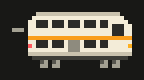
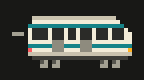
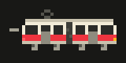
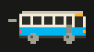
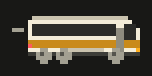
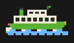
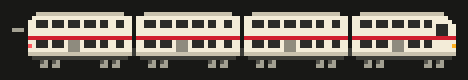
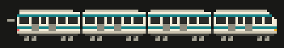
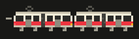
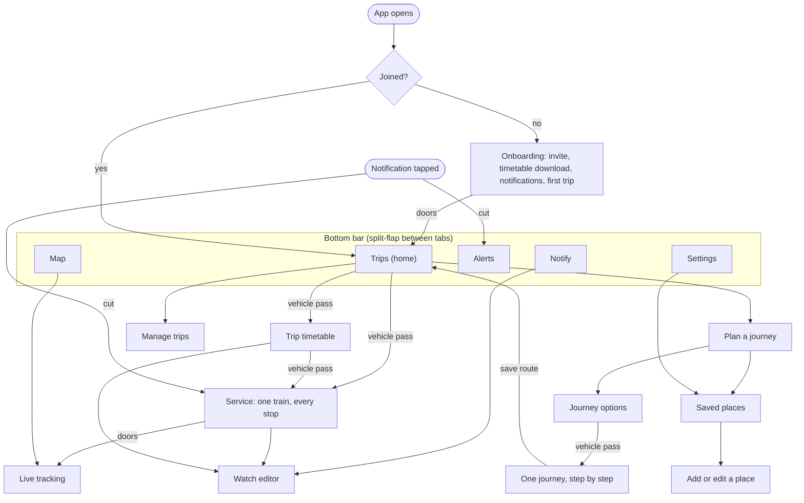

# TransitTracker Front-End Plan

Status: **Draft v2** · Platform: **Android first, iOS later** · Look:
**pixel art, game-like** · Rule: **function first** · Centrepiece:
**animation** · Scope: **everything above the `TransitCore` interface**
(screens, navigation, styling, motion, notifications as they appear on the
phone)

This is the companion to
[transittracker-backend-plan.md](transittracker-backend-plan.md). The backend
plan ends at the `TransitCore` interface
(`shared/model/.../TransitCore.kt`); this plan starts there.

**Mockups:** fifteen artboards on a design canvas at
<https://claude.ai/artifact/UpjCRFqexTVYB9hfSqzERg>, private to its author
until shared from its Share menu. It holds the three directions considered for
the home screen, four key screens in the chosen direction, a system sheet, a
sheet of the animated vehicles, a tappable prototype of the page transitions,
and a row for places and journeys (plan a journey, journey options, one
journey step by step, saved places, add a place). The artboards were written
without a render check, so treat spacing in them as indicative.

**Sprites:** the vehicle artwork is in [design/sprites](design/sprites) and is
drawn by [tools/sprites/make_sprites.py](../tools/sprites/make_sprites.py).

### Decisions

| # | Decision | Status | Choice |
|---|---|---|---|
| F1 | Visual direction | **Decided** | **A · Indicator board**: a dark platform-indicator look (section 2.1) |
| F2 | Ground colour | **Decided** | **Neutral charcoal, no purple or blue tint.** All colour on screen comes from line identity and service status (section 2.4) |
| F3 | Role of animation | **Decided** | **Central.** Animated pixel vehicles show where each service is and which way it is going, for every mode; page changes use game-style transitions (section 3) |
| F3a | Vehicle in the page transition | **Decided** | **It matches the service being opened**, in mode and line colour: a bus for a bus trip, a ferry for a ferry (section 3.4) |
| F3b | Transition timing | **Decided** | **As prototyped:** the new page is usable within 300 ms |
| F4 | UI toolkit | **Decided** | **Compose Multiplatform**, screens shared by Android and iOS. The look is fully custom, so nothing is lost by not using each platform's own widgets, and iOS later becomes a thin shell. This changes one line of the backend plan ("screens stay native") |
| F5 | Map | To confirm | **Our own pixel line map** for rail; a street map only when buses arrive. Matches the look, needs no map key or billing, works on both platforms |
| F6 | Themes | To confirm | **Night** by default, **Day** for sunlight, follow the phone setting |
| F7 | Sound | To confirm | **Off by default**; commuters are in quiet carriages |
| F8 | Saved places | **Decided** | **Addresses can be saved** (Home, Work and others), kept on the phone only, and used as the start or end of a saved trip (section 5.7) |
| F9 | How an address is found | To confirm | **TfNSW's lookup through the server, plus "use where I am now".** The server is needed for journey planning anyway, so the phone's own lookup is no longer the simpler choice (section 5.7) |
| F10 | Journey planning | **Decided** | **The app recommends ways to get from A to B**, including changes between modes and the walking time between them (section 5.6) |
| F11 | What works the journeys out | **Decided** | **TfNSW's Trip Planner, through tt-server.** Assessed as acceptable for this use. Google Maps and the other hosted services were assessed and are not recommended. An open-source planner on the home server (MOTIS) is the fallback if TfNSW's falls short (section 8.5) |

---

## 0. Summary

- **The answer is on screen when the app opens.** Home shows every saved trip
  with a large countdown, expected time, platform and live status. No tap is
  needed for the daily question.
- **A small animated vehicle on every trip shows where the service is and
  which way it is going.** There is one sprite per mode: train, metro, light
  rail, bus, coach and ferry. Its state (moving, at a stop, late, timetable
  only, cancelled) is drawn into the sprite.
- **It plans journeys.** Enter a start and an end, and the app recommends ways
  to get there by public transport: which services, where to change, how long
  each walk takes and how much time each change leaves you.
- **Places and routes are saved.** A place is a named address. Any planned
  journey can be saved as a route, which then sits on Home showing when to
  leave the door as well as when the service leaves.
- **Page changes are game-style and themed:** a train passes and wipes the
  next page in, carriage doors close and open, rows flip like a departure
  board. Each leaves the new page usable within 300 ms.
- **Pixel art carries the character; plain type carries the facts.** Rules in
  section 2.3 stop the style costing legibility.
- **Colour is used only for meaning:** line identity and service status. The
  ground is neutral charcoal.
- **Every status is a shape, a word and a colour**, so nothing depends on
  colour alone.
- **Game look, not game mechanics.** No points, streaks, badges or levels.
- **The app never hides how fresh its data is:** live, timetable-only and
  stale are always distinguishable, including in the animation.
- **Built against the fake core first** (`FakeTransitCore`).
- **Effort:** roughly 14 weeks for one developer through to friends using it
  (section 9), plus about two weeks of backend work for the journey planner
  (section 8.5). These are estimates, not measurements.

---

## 1. What the front end is for

TransitTracker answers two questions for a handful of known people: **"When
is my next service, and is it running on time?"** and **"How do I get from
here to there?"** The typical use of the first is a two-second glance
on the way to a platform: one hand, bright sun or a dark street, sometimes no
signal.

### 1.1 Design principles

| # | Principle | What it means in practice |
|---|---|---|
| 1 | Answer first | Home is the saved routes with countdowns. Planning a new journey is one tap away; maps and settings never get in the way |
| 2 | Motion is information | A moving vehicle means live data and shows position and direction. Things that are not live do not move |
| 3 | Pixels for character, never at the cost of reading | Minimum sizes, contrast and a fallback font rule (section 2.3) |
| 4 | Colour only for meaning | Line colours come from the timetable data; status colours follow the green / amber / red convention; everything else is charcoal and cream |
| 5 | Shape + word + colour | A late train shows a triangle, the words "4 MIN LATE" and amber |
| 6 | Honest data | Live, timetable-only, stale and offline each look different and say so |
| 7 | Game look, not game mechanics | The style is retro; the behaviour is a transit tool |
| 8 | One system | One set of tokens, one button pair, one panel style, one icon grid, one sprite style |

---

## 2. Visual direction

### 2.1 Three directions considered

All three are on the canvas as the same home screen with the same sample data.

| | A · Indicator board (chosen) | B · Overworld | C · Handheld LCD |
|---|---|---|---|
| Idea | A station platform indicator in your pocket: dark ground, dot-matrix countdowns, signal-lamp status | Each trip is a small side-scrolling scene with stations and a train that moves along the track | A four-tone olive LCD, like an early handheld console |
| Strengths | Most information per screen; status colours stand out on a dark ground; grounded in the subject, because real platform indicators are already pixel displays | The most game-like; progress along the trip is visible at a glance | Highest contrast outdoors; cheapest to build |
| Costs | Least playful as first drawn; needs a Day theme for sunlight | Roughly half the trips per screen; much more scenery to draw | Loses line colours and the green / amber / red convention |

**Decision: A**, taking the best idea from B: every trip carries a moving
vehicle on a track (section 3.3), without B's scenery or its loss of density.

### 2.2 The concept in one line

**Pocket platform:** the phone as a platform indicator board, drawn like a
16-bit game interface, with the vehicles as its moving parts.

### 2.3 Rules that keep pixel art functional

| Rule | Detail |
|---|---|
| The dot | One art pixel ("dot") is 2 dp, snapped to a whole number of screen pixels on each device. Sprites and borders are whole dots, so edges are always sharp |
| No blur | No rounded corners, gradients, soft shadows or scaled-with-smoothing images. Depth comes from a hard 1-dot border and a hard lip under buttons |
| Two resolutions only | Art and sprites at 1 dot; small text at half a dot. Nothing else, so the screen never looks like mixed zoom levels. The one exception is the vehicle that crosses the screen in a page transition, which is drawn double size |
| Minimum text sizes | Labels 11 sp, rows 15 sp, names 17 sp, countdown 60 sp or more |
| Contrast | Every text colour at least 4.5 : 1 on its ground (section 2.4 lists the calculated values) |
| Touch targets | 48 dp or more, including steppers, day toggles and list rows |
| Font scaling | Honour the Android font-size setting. Sizes step up in whole pixel multiples; layouts wrap rather than clip. Tested at 1.0, 1.3 and 2.0 |
| Readable long text | Alert descriptions and help text use the pixel text face at 15 sp with 22 sp line height. If that fails the reading test in section 7 at font scale 1.3, long text alone falls back to the system sans-serif |
| Motion always has a still form | Under the system reduce-motion setting or battery saver, vehicles stop animating but stay in the right place, and page transitions become cuts. No information is available only in motion |

### 2.4 Colour

The ground is neutral charcoal with a slight warm cast and no blue or purple
in it. Night theme (default); contrast is calculated against Screen / Panel.

| Token | Value | Use | Contrast |
|---|---|---|---|
| Screen | `#0C0C0A` | App background | |
| Panel | `#181816` | Cards, bottom bar | |
| Raised | `#252522` | Secondary buttons, steppers | |
| Divider | `#3D3D38` | Borders, dashed rules, sleepers | |
| Secondary text | `#A3A092` | Labels, past stops, rails | 7.5 / 6.8 |
| Text | `#F3ECD8` | Text; also the fill of the selected item and primary button | 16.6 / 15.1 |
| Go | `#4ADE80` | On time, live, switch on | 11.2 / 10.2 |
| Caution | `#FFB020` | Late, early, platform changed, warning alerts | 10.7 / 9.7 |
| Stop | `#FF5A5F` | Cancelled, severe alerts | 6.4 / 5.8 |
| Info | `#6CB6FF` | Timetable-only, info alerts | 9.1 / 8.3 |

Rules:

- **Line colours come from the timetable** (`Route.color`). They appear in the
  line badge, which always has a 1-dot Text-coloured border so dark lines (T4)
  stay visible, and as the stripe on that service's vehicle.
- **Badge text is black or white, whichever contrasts better** with the line
  colour, and at least 4.5 : 1. The feed's own text colour is used only when it
  passes. Example: white on T8 green is 3.9 : 1, so T8 gets black text (5.4 : 1).
- **Status colours appear only in the status slot** (lamp, status words,
  expected time, the tag above a late vehicle). A line colour is never used to
  signal status, so T1 orange cannot be mistaken for "late" or T9 red for
  "cancelled".
- **Selection is inversion**, not a hue: the selected tab, row or day is a
  Text-coloured block with Screen-coloured text.
- **If a line's own colour is purple or violet** (some regional and coach
  services), it is shown as published, because it identifies the line. It is
  never used for anything else.

Day theme: the same tokens inverted (Screen `#F3ECD8`, Panel `#FFFBF0`, Text
`#0C0C0A`, Secondary text `#5C5A4E`) with darker status colours (starting
points: Go `#14703A`, Caution `#9A5200`, Stop `#B3261E`, Info `#1F5FBF`), and
vehicles drawn with a 1-dot dark outline so cream bodies stay visible. These
are starting values; each must pass 4.5 : 1 on a real phone before shipping.

### 2.5 Type

Four faces, all published on Google Fonts under the SIL Open Font License.
The licence files are bundled with the app.

| Face | Role | Sizes |
|---|---|---|
| **Doto** (Black) | Dot-matrix numerals: countdowns, the clock, time pickers | 30 / 44 / 60 / 76 |
| **Pixelify Sans** (400–700) | Station names, rows, buttons with long labels, reading text | 15 / 17 / 20 / 22 |
| **Silkscreen** (400, 700) | Small capital labels, status words, button labels | 10 / 11 / 12 / 13 |
| **Jersey 15** | Every numeral outside a Doto countdown: times, platforms, minutes, route numbers | Follows the text around it |

Two changes were made for legibility once the screens were rendered at a
phone's pixel density:

- **Numerals.** Pixelify's 5 reads as an S and Silkscreen Bold's 4 closes up
  ("15:58" looked like "18:88"). Digits are set in Jersey 15 automatically,
  whatever the surrounding face.
- **Letters.** Pixelify's capital B read as G ("Gerowra"), its capital Z as 2
  ("2etland"), its round brackets as curly braces, and its joined fi, fl and
  ff as other letters ("StrathAeld"). The bundled copy of the font has B, Z
  and the brackets redrawn and those joins switched off
  (`tools/fonts/patch_pixelify.py`). The licence allows a modified
  version; the file is renamed inside and the licence text says so.

Times use 24-hour format by default with a 12-hour setting. Countdowns show
minutes ("4 MIN"); "NOW" under one minute; a clock time instead of a countdown
beyond 60 minutes. Minutes-and-seconds countdowns appear only on the service
and tracking screens.

### 2.6 Static artwork

Drawn once on small grids and stored as shapes made of whole squares, so they
stay crisp on every screen. Vehicles are covered in section 3.

| Set | Grid | Items |
|---|---|---|
| Status lamps | 7 × 7 | Circle (on time), triangle (changed), cross (cancelled), plus (extra), ring (timetable / stale) |
| Navigation | 12 × 12 | Train, map pin, warning triangle, bell, sliders |
| Controls | 7 × 7 | Arrows, plus, minus |
| Places | 12 × 12 | House, briefcase, pin |
| Scenes | free | Platform at night (empty state), ticket (invite), train filling a track (timetable download) |
| App and notification icons | 24 × 24 base | Train front; a single-colour version for the status bar |

### 2.7 Status language

One visual grammar for every service, on every screen.

| Core value | Lamp | Words | Colour | Also |
|---|---|---|---|---|
| `ON_TIME` | Filled circle | ON TIME | Go | |
| `LATE` | Triangle | 4 MIN LATE | Caution | Timetabled time struck through, expected time beside it |
| `EARLY` | Triangle | 1 MIN EARLY | Caution | Same treatment as late: the time is not what you expect |
| `CANCELLED` | Cross | CANCELLED | Stop | Row struck through; the next running service becomes the headline |
| `ADDED` | Plus | EXTRA SERVICE | Go | |
| `TIMETABLED` | Ring | TIMETABLE | Info | No live data for this service |
| `stale = true` | Ring | STALE · 3 MIN OLD | Secondary | Countdown prefixed with "~" |
| `platformChanged` | | NOW PLAT 6 | Caution block | Blinks at 1 Hz for 5 s, then stays inverted |
| `Occupancy` | Four pips | MANY SEATS / FEW SEATS / STANDING ONLY / FULL | Text | `UNKNOWN` shows nothing |
| `carCount` | | 8 CARS | Text | Helps choose where to stand |

Data-level states, shown in the header chip and as a banner when not live:

| `DataStatus` | Header chip | Banner |
|---|---|---|
| Live and fresh | LIVE · 12S | none |
| `liveStale` | STALE | "Live data is delayed. Showing the last update." |
| `serverReachable = false` | OFFLINE | "No live data. Showing the timetable." |
| `statusMessage` set | | The server's message, verbatim |
| Pack `downloading` | | "Updating timetable…" with a train filling a track |
| Pack past `validTo` | | "Timetable is out of date. Connect to update." |

---

## 3. Animation

Animation does three jobs: it shows **where a service is**, **which way it is
going**, and it makes **moving between pages** feel like one continuous place.

### 3.1 The vehicles

One sprite per mode, drawn side on, facing the way it travels. Each has a
silhouette that can be told from the others at a glance, without relying on
colour. The stripe takes the line colour at run time; the colours below are
samples.

| Mode | Sprite | How you recognise it | What moves |
|---|---|---|---|
| Train |  | Two decks of windows | Wheels turn, speed lines trail |
| Metro |  | One deck, raked nose, two stripes | Wheels turn, speed lines trail |
| Light rail |  | Pantograph, two joined sections, low floor | Wheels turn, speed lines trail |
| Bus |  | Big road wheels, lit destination sign | Wheels turn, body bounces |
| Coach |  | One long window, three axles | Wheels turn, body bounces |
| Ferry |  | Hull, funnel and flag | Water moves, hull bobs |

Each is four frames at about 8 frames a second on a grid no larger than
34 × 16 dots. Two more sprites exist for particular places:

| Sprite | Preview | Used |
|---|---|---|
| Four-car train |  | Crosses the screen when a train service is opened (section 3.4) |
| Four-car metro |  | Crosses the screen when a metro service is opened |
| Coupled light rail pair |  | Crosses the screen when a light rail service is opened |
| Train from above |  | The live map, where vehicles are seen from overhead and turn with the line |

Buses, coaches and ferries cross the screen as the single vehicle shown in the
first table.

A mode the app does not know (`OTHER`) uses a plain arrow marker in the line
colour.

### 3.2 What the vehicle tells you

The sprite's own state repeats the status language of section 2.7, so the
animation and the words never disagree.

| State | How it is drawn | When (from the core's data) |
|---|---|---|
| Moving | Wheels turn, speed lines trail | Live data, between two stops |
| At a stop | Stands still, doors open and lit:  | Now is between a stop's expected arrival and expected departure |
| Running late | Moving, with an amber "+4" tag riding above it | `delaySeconds` of 60 or more |
| Timetable only | A grey, faded ghost at the timetabled position | `TIMETABLED`: no live data |
| Stale | Stops animating and fades; the header says STALE | `stale = true` |
| Cancelled | Greyed, crossed out, never moves | `CANCELLED` |

Vehicles face the way they travel: the sprite is mirrored for services running
right to left on a strip.

### 3.3 The journey strip

A track with a vehicle on it, drawn inside each trip card on Home and at the
top of the Service screen.

```
  RHODES                      YOU                CENTRAL
    ■ ─────[▓▓▓▓]▸──── □ ───── ▣ ───────────────── □
    passed  vehicle    next    your stop           where you get off
```

- **Layout:** up to three stops before yours on the left, your stop at a fixed
  point about two-thirds along (it blinks), your destination at the right end.
  Passed stops are filled and dim; stops ahead are outlined.
- **Ground changes with the mode:** rails and sleepers for trains and metro, a
  rail under an overhead wire for light rail, a road with a dashed centre line
  for buses and coaches, a band of water for ferries.
- **Position:** between the last stop passed and the next one, in proportion
  to time: (now − expected departure from the last stop) ÷ (expected arrival
  at the next stop − that departure). This uses the stop list from
  `service(ref)`, which already carries expected times and which stops have
  been passed.
- **It keeps moving between updates.** The position is recalculated from the
  clock every frame it is shown, in whole-dot steps, so the vehicle creeps
  along rather than jumping every 30 seconds. When an update changes the
  estimate, the vehicle steps to the new place over one second.
- **It is an estimate, and looks like one when it has to.** On the strip the
  position comes from times, not GPS. With no live data the ghost sprite is
  used, so a timetabled guess is never mistaken for a tracked train.
- **Cost:** one `service(ref)` subscription for the headline service of each
  card on screen, nothing for cards off screen.
- **A journey with several rides** uses the same idea as a row of legs: a
  walking figure, then a vehicle, then a walking figure, and so on, each as
  wide as the minutes it takes. Rides carry their line colour and badge; walks
  are dotted. It appears on the recommended journey in the options list
  (section 5.6).

### 3.4 Page transitions

Three transitions, each tied to one kind of move so that the motion itself
tells you where you went. All are stepped, not eased, in keeping with the
pixel look. They can be tried in the "Page transitions" artboard on the canvas
(press Play, then tap any of the four trips, TRACK ON MAP, the back buttons and
the tabs).

| Transition | Used for | What happens | New page usable after |
|---|---|---|---|
| **Vehicle pass** | Opening something from a list (a service from Home or the timetable, a journey from the options, where the vehicle is that of its first ride), and going back | A vehicle crosses the screen and the new page is wiped in behind it. Going back, it runs the other way. The vehicle matches the service being opened, in mode and line colour | 300 ms; the vehicle never blocks touches. A four-car train or metro clears the screen by 640 ms, a bus or ferry by 400 ms |
| **Doors** | Entering and leaving the live map; arriving at Home after onboarding | Carriage doors with amber edge strips close over the page and open on the new one | 300 ms |
| **Split-flap** | Switching bottom tabs; changing the day in a timetable; rows whose values changed after a refresh | Rows flip in from top to bottom, like a departure board | 280 ms for the first row, all rows by 500 ms |
| **Cut** | Reduce motion, battery saver, opening from a notification, or a second tap during a transition | Instant | 0 ms |

Rules:

- The new page accepts touches within 300 ms. Decoration may finish later but
  never blocks input.
- A tap during a transition finishes it immediately.
- The Android back gesture plays the same transition in reverse.
- No transition stacks on another: at most one runs at a time.

### 3.5 Small motion

| Where | Motion |
|---|---|
| Button press | Moves down 2 dots onto its lip, 60 ms; a light haptic tick |
| Your stop | Blinks at 1 Hz on the journey strip and the map |
| Value changes after a refresh | The changed row flips (split-flap) so the eye catches a new delay |
| Countdown tick | Digits swap in two frames |
| Platform change | Section 2.7 |
| Walk to the stop | A walking figure  stands beside every walk time; it walks when it is time to leave and runs when you are cutting it fine (section 5.7) |
| Pull to refresh | The trip's own vehicle crosses the top of the list |
| Timetable download | A train fills a track as the progress bar |

Sound is off by default. If enabled later: three short chiptune notification
sounds (delay, cancellation, platform change) tied to the notification
channels.

### 3.6 Budget

| Limit | Value |
|---|---|
| Sprite frame rate | About 8 frames a second, from one shared clock |
| Transition frame rate | The screen's refresh rate; the stepped look comes from the animation curve, not from dropped frames |
| What animates | Only what is on screen, and only while the app is in the foreground |
| Battery saver or reduce motion | Sprites hold one frame but still sit in the right place; transitions cut |
| Screen reader | Every strip has a sentence: "The train has left Rhodes and is one stop from Strathfield" |
| Artwork size | Each sprite sheet is under 1 KB |

### 3.7 Sprite files and what is still to draw

`tools/sprites/make_sprites.py` draws every vehicle from code and writes a
sprite sheet (four frames side by side, transparent, one screen pixel per dot)
and a preview into `docs/design/sprites/`. The line colour is a parameter, so
in the app the stripe is tinted from `Route.color`.

| Done | Still to draw |
|---|---|
| Six modes, moving, side on | Doors-open frames for metro, light rail and coach |
| Doors-open frames for train, bus and ferry | Overhead views of the other five modes for the map |
| Transition vehicles for all six modes | Outlined versions for the Day theme |
| Train from above for the map | The `OTHER` marker |
| Walking figure | A running version of the walking figure |

---

## 4. App structure

### 4.1 Navigation



Five bottom-bar destinations with plain labels. The Alerts tab carries a count
of active alerts on the user's own trips.

### 4.2 Screen inventory

| Screen | Purpose | `TransitCore` calls | Phase |
|---|---|---|---|
| Onboarding | Join with an invite code, get the timetable, allow notifications, save a first trip | `joined`, `join`, `dataStatus` | F2 |
| Trips (home) | Next services for every saved trip, each with its journey strip | `trips`, `upcoming`, `service`, `dataStatus`, `alerts` | F1 |
| Trip timetable | All services for a trip on a chosen day | `timetable` | F3 |
| Service | Every stop of one service, where the vehicle is, actions | `service`, `watchService` | F3 |
| Live tracking | The vehicle on a line map with a countdown to your stop | `track`, `shape` | F4 |
| Map | Lines, live vehicles, nearby stations | `vehicles`, `stopsNear`, `shape` | F4 |
| Plan a journey | Choose a start, an end and a time | new `searchPlaces`; `stopsNear` | F2b |
| Journey options | Recommended ways to make the journey, compared | new `plan` | F2b |
| One journey | Every walk, ride and change with its times; save it as a route | new `plan`; `saveTrip` | F2b |
| Edit a saved route | Rename, folder, line filter, legs by hand | `linesAt`, `saveTrip` | F2 |
| Saved places | Save addresses and the stops within walking distance of each | `stopsNear`, `linesAt` | F2 |
| Manage trips | Reorder, rename, folder, delete | `reorderTrips`, `saveTrip`, `deleteTrip` | F2 |
| Alerts | Disruptions, your trips first | `alerts` | F4 |
| Notify | List and edit push watches | `watches`, `saveWatch`, `deleteWatch`, `sendTestNotification` | F5 |
| Alarms | Phone alarms before departure or arrival | `nextAlarmTimes` | F7 |
| Settings | Data status, display, notifications, about | `dataStatus` | F6 |

---

## 5. Screens

Sample content below matches `FakeData` so mockups and the fake core agree.

### 5.1 Onboarding

Four steps, each one screen, each skippable where the app can still work.

| Step | Screen | Notes |
|---|---|---|
| 1 | **Invite ticket.** A ticket graphic with an `XXXX-XXXX` code field and a JOIN button | The server's alphabet has no I, L, O, U, 0 or 1. Accept lower case, spaces and a missing dash. `InvalidCode` → "That code isn't valid or has been used". `Failed` → "Can't reach the server" with RETRY |
| 2 | **Timetable download.** A train fills a track as the pack downloads | A real wait, so it gets a scene. Allowed on any network for first install |
| 3 | **Notifications.** One sentence on what they are for, then the Android permission prompt | Skippable; Notify shows an ALLOW banner later |
| 4 | **First journey.** Opens Plan a journey; once a journey is saved as a route, the doors transition opens onto Home | "Also save the return" is on by default |

### 5.2 Trips (home)

```
┌──────────────────────────────────────┐
│ 07:38              ● LIVE 12S   [+]  │  clock, data freshness, plan a journey
│ WED 11 NOV                           │
├──────────────────────────────────────┤
│ TO WORK                              │  folder
│ ┌──────────────────────────────────┐ │
│ │ Home ▶ Work           [T9] Gordon│ │  a trip between two saved places
│ │ STRATHFIELD TO CENTRAL           │ │
│ │ 4 MIN               07:38 struck │ │  headline service
│ │                     07:42        │ │
│ │                     ARR 07:56    │ │
│ │ ▲ 4 MIN LATE LEAVE 07:39 [PLAT 3]│ │  leave-by time with the walking figure
│ │ ■──[▓▓▓]▸──□─────▣──────────□    │ │  journey strip, vehicle moving
│ │ RHODES           YOU      CENTRAL│ │
│ │ ┄┄┄┄┄┄┄┄┄┄┄┄┄┄┄┄┄┄┄┄┄┄┄┄┄┄┄┄┄┄┄┄ │ │
│ │ 07:47 [T1] Berowra · Plat 2 9 min│ │  following services
│ │ 07:53 [T9] ✕ CANCELLED       —   │ │
│ └──────────────────────────────────┘ │
│ ┌ Chatswood ▶ Tallawong   2 MIN ...┐ │  second card, its own strip
│ HOME                                 │
│ ┌ Central ▶ Strathfield   6 MIN    ┐ │  compact card
├──────────────────────────────────────┤
│ TRIPS │ MAP │ ALERTS 2 │ NOTIFY │ SET│
└──────────────────────────────────────┘
```

- The first trip in each folder is a full card (headline, journey strip, two
  following services); the rest are compact one-line cards. A density setting
  makes every card compact.
- Tap a service to open it (vehicle pass); tap a card title for the full
  timetable; long-press a card to reorder or edit.
- A trip between saved places is titled with the place names, with the
  stations beneath, and shows a leave-by time (section 5.7). A trip between
  two stations shows seats in that slot instead.
- A cancelled service stays visible, struck through, but never takes the
  headline: the next running service does.
- Multi-leg trips show each leg's badge and the change: "[T9] → [M1] · change
  at Chatswood · 6 min". The strip shows the first leg.
- After the last service: "No more services tonight · first 04:32".
- Empty state: an empty platform at night and one button, ADD YOUR FIRST TRIP.

### 5.3 Trip timetable

Origin and destination in the header; a day selector (previous day, TODAY,
next day; tap for a pixel calendar; the list flips when the day changes); the
list of services with departure, arrival, duration, line badge, platform and
status; earlier services folded above a NOW marker. Actions: NOTIFY ME (opens
the watch editor pre-filled from this trip), ALARM, EDIT. Alerts on this
trip's lines show as one banner at the top.

### 5.4 Service

```
┌──────────────────────────────────────┐
│ [◀]  [T9] to Gordon                  │
│      NORTHERN LINE                   │
│ ▲ 4 MIN LATE            ● LIVE 12S   │
│ ■───■───■─[▓▓▓]▸─□───▣───□───▢       │  journey strip, whole run
│                    BOARD      GET OFF│
├──────────────────────────────────────┤
│ ■ Epping                      07:24  │  passed stops, dimmed
│ ■ Rhodes                      07:35  │
│ ▣ TRAIN IS HERE                      │  marker on the line, blinking
│ □ North Strathfield   07:35 → 07:39  │
│ ██ Strathfield · BOARD HERE · PLAT 3 │  your stop, inverted row
│ □ Redfern             07:48 → 07:52  │
│ ▢ Central · GET OFF · PLAT 16        │  your destination, outlined row
│ □ Town Hall           07:55 → 07:59  │
├──────────────────────────────────────┤
│ LEAVES STRATHFIELD IN      [PLAT 3]  │
│ 4:12                                 │
│ [ NOTIFY ME ]   [ TRACK ]  [ ALARM ] │
└──────────────────────────────────────┘
```

The line down the left is drawn in the line colour; the travelled part is
dimmed. Skipped stops are struck through with "SKIPS". Once the vehicle has
left your stop the footer changes to "ARRIVES CENTRAL IN".

### 5.5 Live tracking and the Map tab

- **Tracking:** the service's line drawn as a pixel path on a dark grid, your
  two stops flagged, the vehicle seen from above, turning with the line and
  moving at each update (15 s, set by the server) and creeping in between. A
  footer shows the countdown to your stop, the next stop, delay, cars and
  seats, with NOTIFY ME and STOP LIST. Reached through the doors transition.
- **Map tab:** the same map with all live vehicles on the lines of your saved
  trips, plus nearby stations when location is allowed. Tapping a station
  offers "Plan a journey from here".
- Here the position is the vehicle's reported GPS position, snapped to the
  line. A position older than 2 minutes is hidden (backend rule); the map then
  shows the ghost at the timetabled position and says "Position unavailable".
- Location permission is asked only when the user taps NEAR ME, never at
  start-up.

### 5.6 Plan a journey

Enter a start and an end, and the app recommends ways to get there. This
replaces the earlier "new trip" wizard: a route is now something you find and
then save, not something you assemble by hand.

**1. Where and when**

| Field | How it is filled |
|---|---|
| From, To | A saved place (one tap), an address, a station or stop, or WHERE I AM |
| When | LEAVE NOW, LEAVE AT a time, or ARRIVE BY a time |
| Swap | One button reverses From and To |

Recent searches sit underneath for one-tap repeats.

**2. Journey options**

Up to about five journeys, best first. Each shows:

- when to leave, when you arrive, the total time, the number of changes and
  the total walking;
- a strip of its legs in order, each as wide as the minutes it takes (section
  3.3). On the recommended journey the strip carries the animated walking
  figure and vehicles;
- its live state, including whether a late service still makes its
  connection.

Three buttons re-sort the same results: FASTEST, FEWER CHANGES, LESS WALKING.

**3. One journey, step by step**

```
07:39  ⌂ Home                      LEAVE IN 1 MIN
       ┊ walk 3 min · 250 m
07:42  ■ Strathfield · Plat 3      [T9] to Gordon · 4 min late
07:56  ■ Central · Plat 16
       ┊ change · walk 4 min to Plat 24 · 3 min to spare
08:03  ■ Central · Plat 24         [T4] to Bondi Junction · on time
08:14  ■ Bondi Junction
       ┊ change · walk 3 min to Stand B · 3 min to spare
08:20  ■ Bondi Junction · Stand B  [333] to North Bondi · timetable
08:31  ■ Bondi Beach
       ┊ walk 2 min · 150 m
08:33  ⚲ Campbell Pde              ARRIVE
```

Rules for walking and changes:

| Rule | Detail |
|---|---|
| Every walk is a leg of its own | From the door to the first stop, between services at a change, and from the last stop to the door. Each shows minutes and distance |
| A change shows its margin | "3 MIN TO SPARE" is the time left after the walk. Green at three minutes or more, amber under three, red when the walk no longer fits |
| Live data moves the margins | If the first service runs late, the spare time at the next change shrinks on screen. When a connection can no longer be made, the journey says so and offers the next one |
| Walk times come from the planner | They follow real footpaths and station layouts, not straight lines |
| Honest about coverage | A ride on a mode without live data yet (buses at first) is marked TIMETABLE, so a journey can be part live and part timetabled |

Two actions at the bottom:

- **SAVE ROUTE** keeps the journey as a saved route on Home.
- **GO** follows this journey: the screen steps through the legs as time
  passes ("get off at the next stop", a countdown at each change) and warns
  when a later connection is at risk. GO is planned for a later phase; SAVE
  ROUTE is in the first.

**Saved routes**

A saved route remembers the pattern, not one departure: which stops, which
lines, where to change and how long each walk takes. Home then shows the next
time that pattern runs, with its leave-by time, as for a simple trip. Saved
routes work offline for the modes whose timetables are on the phone. A route
can be renamed, moved to a folder, limited to certain lines or adjusted by
hand; routes are reordered by dragging and deleted with a two-button
confirmation.

**Several ways from A to B.** A saved route can hold more than one way of
making the journey (the T9 from the station, the 400 bus from the corner).
Home shows the route's best way for when you leave: of the services you can
still make without running (leave-by not passed, counting the walk from a
saved place to each way's own stop), the one that arrives first. The services
under it are the next ones no other way beats (none leaves no earlier and
arrives sooner). The card says BEST OF 3 WAYS.

| Where | What it does |
|---|---|
| One journey, SAVE ROUTE | When a route between the same ends exists (the same saved places; a station end must share a station), the dialog offers "Add as another way to Home to Work", on by default. A way it already has says so |
| Journey options, SAVE THESE WAYS AS ONE ROUTE | Every distinct way among the journeys found, ticked, with those that cannot be saved greyed out with the reason. The same way at another time is listed once |
| The route's timetable | Tabs: BEST (every way, only the runs no other way beats) and one per way. PIN makes Home show only that way; UNPIN gives the choice back. FIND MORE WAYS NOW plans the route again from its two ends, leaving now |
| Edit route | WAYS: name each way, or remove it (a route keeps at least one) |

**Switching on the way.** Once Follow my journey knows which journey you are
on, it also knows which way: two ways can share the train you are on (stay on
it, or get off for a bus), and the way you chose stays chosen while the phone
cannot tell them apart. The on-the-way card lists OTHER WAYS FROM HERE: the
route's other ways that use the vehicle you are on (or, while changing, the
one you just left at that stop), with live times, so a late train shows a
better bus connection further on. Each says what to do differently ("CHANGE AT
REDFERN TO 333", "STAY ON TO CENTRAL"), when it arrives and how many minutes
sooner or later than yours, with SWITCH; the card then follows that way. A way
that gets off at a stop the vehicle has passed is not offered. ALL WAYS FROM
THE NEXT STOP asks the planner for every way from the next stop, at the time
you reach it, to the route's end; it is to look at only, with nothing to save.

Device alarms follow the pinned way, else the runs no other way beats. The
return of a route reverses every way. Data saved before ways existed reads as
a route with one way, and `SavedTrip.legs` stays the first way, so an older
app reading newer data still sees a working route.

Planning needs a connection; Home and saved routes do not.

### 5.7 Saved places, and trips between them

A **place** is a named address: Home, Work, the gym. A **trip** is the app's
word for a saved route: where from, where to, which lines, any changes, a name
and a folder. A trip can start or end at a place instead of at one station.

| Step | What happens |
|---|---|
| Add a place | Type an address, or tap USE WHERE I AM NOW. The app lists the stations within walking distance, nearest first, each with an estimated walk time. Switch off any you would not use; tap a walk time to correct it. Choose a name and an icon |
| Use it in a journey | In Plan a journey, pick a place for From, To or both with one tap. The planner works from the address itself. Switching a stop off in the place removes journeys that start or end there |
| On the home screen | The card is titled with the place names. Each service shows which stop it leaves from and a **leave-by time** (departure minus the walk to that stop), with the walking figure beside it |
| Edit a place | Changing its stops updates every trip that uses it |

The leave-by label has three states, because the app does not know whether you
are still at home or already on the platform:

| State | Label | Walking figure |
|---|---|---|
| Plenty of time | LEAVE BY 07:39 | Stands |
| Within two minutes of leave-by | LEAVE NOW | Walks |
| Past leave-by, service not yet gone | RUN | Runs; the service stays visible |

Rules:

- **Places stay on the phone.** They are never sent to the server. Only the
  address text you type is sent, to whichever lookup service is used. Push
  watches keep using stations, not addresses.
- **Walk times come from the planner** where it has them, and from
  straight-line distance otherwise. Either can be corrected, and estimates are
  labelled on the add-a-place screen.
- **Walking distance:** train and metro stations within 1.5 km, nearest three
  at most; light rail stops and ferry wharves within 1 km, nearest two; bus and
  coach stops within 500 m, nearest five. (Light rail and ferry were first put
  with buses at 500 m; that left out Randwick Light Rail, 529 m from a home in
  Coogee St, Randwick.)
- **Where the stops come from:** the phone's timetable has only trains and
  metro, so the server is also asked for the stops near the address
  (`GET /v1/stops/near`, from TfNSW's Trip Planner). Without the server, the
  timetable's stations are still offered with a note saying buses, light rail
  and ferries could not be looked up; if that leaves nothing, the app says the
  lookup failed rather than that nothing is near.

One limit:

- **Live data covers trains and metro at first.** The planner covers every
  mode, so a journey from an address can use a bus straight away, but that bus
  is shown as timetabled until bus live data is added.

How an address is turned into a position (decision F9):

| Option | For | Against |
|---|---|---|
| The phone's own address lookup | No server work; free; available on Android and iOS | Quality varies by phone; the address text goes to Google or Apple |
| TfNSW's stop finder through the server | Made for NSW; the same on every phone | A new server endpoint; counts against the TfNSW quota; the Trip Planner product must be added to the API key |
| USE WHERE I AM NOW | No lookup at all; private; works offline | You have to be standing there |

Recommendation: TfNSW's lookup through the server, with USE WHERE I AM NOW
alongside it. The server is needed for journey planning anyway, and it gives
the same results on every phone. The phone's own lookup stays as a fallback
for when the server cannot be reached.

### 5.8 Alerts

A filter (MY TRIPS · n / ALL LINES), then cards: severity icon and word, the
dates it applies, headline, line badges and which saved trip it touches;
tapping expands the description and a MORE INFO link when the alert has one.
Trips with nothing active show a green "ALL CLEAR" line, which is the common
case and worth saying.

### 5.9 Notify (push watches)

- **List:** each commute watch as a card ("Strathfield ▶ Central · Mon–Fri ·
  07:15–08:00 · late by 5 min") with a pause switch; one-off "this train"
  watches under TODAY; a "3 of 10" slot count because the server allows ten per
  device.
- **Editor:** the trip as a ticket; seven day toggles; From / Until steppers
  for the departure window; lead time; "late by" threshold; switches for
  cancelled, platform changes, line alerts and back on time; SEND TEST and
  SAVE WATCH.
- **Banners:** notifications not allowed (ALLOW); push not available on the
  server; battery-saver tip for phones that stop background delivery.

### 5.10 Alarms (later)

Phone alarms before departure or arrival for a saved trip, set from the trip
timetable. The core works out the times (`nextAlarmTimes`); the Android layer
stores and schedules them. Location alarms ("wake me before my stop") are a
later addition.

### 5.11 Settings

| Group | Contents |
|---|---|
| Places | The saved places list |
| Data | Live status and last update; timetable packs with version and valid-to date; attribution text from the server |
| Display | Theme (Night / Day / Follow phone), 12 or 24-hour time, card density, reduce motion, sounds, haptics |
| Notifications | Permission state, a shortcut to the Android channel settings, battery-saver tip, test notification |
| About | App version, device ID (needed to revoke a device), font and data licences, new-build notice |

### 5.12 Outside the app

| Surface | Plan |
|---|---|
| Notifications | The server sends the title and text and names the channel. The app must create channels with exactly these IDs: `delays`, `cancellations`, `alerts`, `general`. Small icon: single-colour pixel train. Tap → `openFromNotification` → Service screen (or Alerts), with no transition. When the app is open, show the same content as an in-app banner |
| Push token | Send to `updatePushToken` whenever Firebase issues one |
| App icon | Pixel train front on the Screen colour, with an Android themed-icon version |
| Updates | Firebase App Distribution's in-app alert; a blocking "Update required" screen when below the server's minimum version (needs a contract addition, section 8.3) |
| Home-screen widget | Later: next services for one trip with a still vehicle on its strip |

---

## 6. States every screen must handle

| State | Treatment |
|---|---|
| Not joined | Onboarding |
| No trips | Empty platform scene and one button |
| Loading from local data | Nothing: local queries are fast enough to show results directly. No spinners on Home |
| Waiting on the network (join, save watch, test push) | The button shows a three-frame "working" animation and is disabled; a result line appears under it |
| Offline or server down | Timetable results with the Info lamp, ghost vehicles and the offline banner. Notify shows the cached list read-only |
| Planning with no connection | Plan a journey says planning is offline and offers the saved routes and recent journeys instead |
| No journey found | A plain sentence, and the nearest stops to each end so the user can see why |
| Stale live data | Section 2.7; vehicles stop animating |
| No services | A plain sentence with the next first service; an empty track |
| Timetable missing or out of date | Banner with progress or a prompt to connect |
| An action failed | A dialog box in the game style with a plain sentence and RETRY / CLOSE. Never an error code alone |
| Large font | Layouts wrap; countdown shrinks last |
| Reduce motion | Section 2.3 |
| Screen reader | Section 7 |

---

## 7. Accessibility and legibility

- **Colour is never the only signal** (section 2.7), and motion is never the
  only signal (section 2.3).
- **Screen reader:** each service row is one item read as a sentence: "T9 to
  Gordon, leaves in 4 minutes, platform 3, 4 minutes late". Each journey strip
  has a sentence of its own. Decorative sprites are hidden from the reader;
  icon-only buttons have labels.
- **Font scale** 1.0, 1.3 and 2.0 are part of screenshot testing.
- **Reading test for the pixel text face:** five people read an alert
  description and a list of ten station names on a phone at arm's length,
  indoors and in sunlight. If any of them struggles, long text falls back to
  the system font and station names move up one size.
- **Flashing** is limited to 1 Hz (your stop, the platform-change blink).
- **Reduce motion** and battery saver stop sprite animation and turn page
  transitions into cuts.
- **One-handed use:** primary actions sit in the bottom third; nothing
  essential is only in the top bar.

---

## 8. Build approach

### 8.1 Stack and layout

| Piece | Choice |
|---|---|
| UI | Compose Multiplatform, in a shared module so iOS reuses every screen. Compose has been stable on iOS since version 1.8 (2025); check the current release when setting up |
| State | One state holder per screen that collects `TransitCore` flows; screens never call the HTTP API or read timetable packs |
| Sprites | Sprite sheets drawn without smoothing; one shared frame clock; position snapped to whole dots |
| Transitions | A transition layer in the navigation host: the old page stays underneath, the new page is clipped or flipped in, and the vehicle or doors are drawn above both |
| Map | Compose canvas drawing of shapes, stops and vehicles (decision F5) |
| Push | Firebase Messaging in the Android shell |
| Widget (later) | Jetpack Glance, Android only |

```
/app/ui          shared Compose screens, design system, sprites, state holders
/androidApp      Android shell: activity, Firebase, permissions, platform glue
/iosApp          later: iOS shell
/tools/sprites   sprite generator
```

The shared modules currently build for the JVM only. The first front-end task
is adding the Android target to `shared:model`, `shared:timetable` and
`shared:core`, and supplying what `CoreDependencies` asks for on Android: an
HTTP engine, a key-value store, a file store for packs, the SQLite driver for
packs, zstd decompression, network status and a clock.

### 8.2 Design system in code

Built once in F1 and used by every screen: tokens (colour, type, spacing, the
dot), `PixelText`, `PixelPanel`, `PixelButton`, `PixelSwitch`, `Stepper`,
`RouteBadge`, `StatusLamp`, `PlatformSign`, `SeatPips`, `Countdown`,
`DialogBox`, and the motion pieces: `VehicleSprite` (mode, line colour, state,
direction), `JourneyStrip`, and the three page transitions. A gallery screen
in debug builds shows every component and every vehicle in every state, in
both themes.

### 8.3 Gaps in the `TransitCore` contract

Found while designing against the interface. None blocks F1; the journey strip
needs nothing new.

| Need | Today | Proposal | Needed by |
|---|---|---|---|
| Draw a service's line and stops on the map | `ServiceDetail` has no shape ID; `StopCall` has no position; there is no stop lookup by ID | Add `shapeId` to `ServiceDetail` and a position to `StopCall` (or `stop(id)` on the interface) | F4 |
| Alerts for one saved trip | The UI would have to match alert stop and route IDs to a trip's platforms itself, which is transit logic | `fun alertsFor(tripId): Flow<List<Alert>>` in the core | F4 |
| Preview services before saving a trip | `upcoming` and `timetable` need a saved trip ID | `fun preview(legs, count)`; until then, save first and offer Undo | F2 |
| Server feature flags and minimum app version | `/v1/config` returns `features` and `minAppVersion`; neither reaches `DataStatus` | Add both to `DataStatus` | F5 (push flag), F6 (version gate) |
| Refresh on demand | `checkForUpdates()` and `refreshWatches()` exist on `DefaultTransitCore` but not on the interface | Add to the interface | F5, F6 |
| Watch limit | Ten per device is a server constant; saving an eleventh throws | Expose the limit in config; the UI catches the error either way | F5 |
| Return trips | No notion of a reverse trip | UI creates a second saved trip with legs reversed. No core change | F2 |
| Saved places | Nothing in the contract. A leg already takes a set of origin and destination stops, and each departure says which stop it leaves from, so trips between places and leave-by times need no core change | Places are stored by the front end, with the place IDs each trip uses. Optionally add them to `SavedTrip` later so a backup stays in one piece | F2 |
| Address to position | None | `suspend fun searchPlaces(query, near)` returning addresses, stations and stops, served by the backend (section 8.5); the phone's lookup as a fallback | F2 |
| Plan a journey between two places | Nothing: the core only answers for saved stop-to-stop trips | `suspend fun plan(request): PlanResult`, returning journeys made of walk and ride legs, served by the backend (section 8.5) | F2b |
| Save a planned journey as a route | `saveTrip` takes legs with sets of stops and lines | A helper that turns a journey's rides into legs, with each walk as that leg's minimum connection time. No change to the stored format | F2b |
| Live state of a planned journey | The live overlay works per saved trip or per service | `fun follow(journey): Flow<JourneyState>`, which re-applies live data to each ride and recomputes the spare time at each change | F2b for the margins; later for GO |
| A push watch for a place with several stations | `WatchDto` takes one origin station | Watch the nearest switched-on station by default and let the user pick; or allow several stations per watch | F5 |
| "Where I am" as a start or end | None | The planner takes a position directly | F2b |

Settings (theme, time format, density) and alarm definitions are front-end
data, kept in the app's own store.

**Found while the screens were built.** The screens work without these (each
has a workaround, named here), so none blocks a first release.

| Need | What the front end does today | Proposal |
|---|---|---|
| A stop by its ID (name, parent station, position) | Station names come only from saved trips; the planner treats "has lines" as "known" and finds the station by name nearby; the map finds stop positions by searching for each stop's name | `suspend fun stop(id): Stop?` on the interface |
| A line by its ID | Alert badges for lines not on a saved trip show the raw ID | `suspend fun route(id): Route?` |
| The lines a saved trip can use | The app's one alert rule (`ui/alerts`) takes the lines that call at both ends of a leg | `suspend fun linesFor(trip): Set<RouteId>`, or `alertsFor(tripId)` as above |
| A one-off watch for part of a run | The watch covers the whole run | `watchService(ref, rules, boardStopId, alightStopId)` on the interface (it exists on `DefaultTransitCore`) |
| Why a watch could not be saved | Guessed from the HTTP status and the message | A typed result: saved, limit reached, offline, not found |
| Pausing a watch with no end date | Pauses for ten years | A paused flag, or a null end |
| Timetable download progress, failure and retry | Progress by file (done, half, none); "no change for 60 s" counts as stalled; RETRY only listens again | Bytes done and total and a failure reason in `PackStatus`; `checkForUpdates()` on the interface |
| A name for a timetable file | Tidies the ID ("syd-rail" becomes "Syd rail") | A display name in `PackStatus` |
| Walking time from an address to a stop | Straight-line distance at 80 m a minute, marked as an estimate; the user can correct it | A walking-time answer from the planner |
| The map's line shape | Straight segments between stops | `shapeId` and `StopCall.position` as above; the change is confined to `CoreMapGeometry.service()` |
| Plan a journey from a station on the map | Opens the planner from a saved place that uses the station, else blank | Front end: let `Route.PlanJourney` take a starting point |

### 8.4 Testing

- **Screenshot tests** of every screen, component and vehicle state against
  the fake core at a fixed clock and a fixed animation frame, in both themes
  and three font scales. Pixel art makes these cheap and exact.
- **Motion tests:** vehicle position on the strip for known times (before the
  first stop, mid-way, dwelling, after the last stop, across midnight); each
  transition reaches its end state and accepts a tap within 300 ms.
- **State tests:** each state holder driven by fake flows through live, stale,
  offline, cancelled and platform-change cases.
- **Manual:** screen-reader pass, the reading test (section 7), a sunlight
  check of both themes, frame-rate and battery checks on a mid-range phone
  with ten trips on screen, and a week of real commutes compared with station
  displays (shared with the backend plan's manual test).

### 8.5 What the journey planner needs from the backend

The backend plan assumed saved stop-to-stop trips, with free-form journey
planning "later, if ever" (its assumption A5). Planning is now a requirement,
so something has to work the journeys out.

| Option | How | For | Against |
|---|---|---|---|
| **TfNSW's Trip Planner, through tt-server** (recommended) | The server passes a journey request to TfNSW's Trip Planner API with the key it already holds, and returns a trimmed result | Covers every mode today, including those whose timetables are not on the phone yet; walks follow real footpaths; little to build; nothing new to run | Needs a connection; each search is a call against the daily quota; the choice of journeys is TfNSW's |
| Google Maps (Routes API) | The server asks Google for public transport routes | Strong address search and walking directions; works anywhere in the world; free at this scale | Its terms do not allow the results to be used with a non-Google map, which rules out our own line map; results may not be stored, apart from coordinates for 30 days, which conflicts with saved routes; rides carry no trip ID, so they cannot be tied to our live data, tracking or push watches; needs a Google billing account |
| A planner on the phone | Search the timetable packs on the device | Works offline; no quota | Weeks of work; needs every mode's timetable on the phone (the bus pack is large); walks would be straight-line guesses |
| An open-source planner on the home server (MOTIS, or OpenTripPlanner) | Run the planner yourself, fed with the TfNSW timetable files the server already downloads each night, plus OpenStreetMap for walking | Every planned ride carries exactly the trip ID the live feeds use, so it ties to live data, tracking and notifications without guesswork; no quota; no dependence on TfNSW changing its planner; MOTIS includes address search | Another service to run and keep fed; its memory needs for Sydney are untested (OpenTripPlanner is known to be memory-hungry; MOTIS is the lighter of the two); its journeys may differ from the official planner's |
| Other hosted services: TripGo, HERE Public Transit, Transitland, Transitous | Ask a third party's planner | TripGo has a free tier and is made by a Sydney company; Transitous is free and community-run | None beats TfNSW here. Each adds a third party with its own terms and no link to our trip IDs. Transitland's routing covers North America only and ignores live data. Transitous is run by volunteers and its NSW coverage is unconfirmed |

**Is TfNSW's Trip Planner acceptable?** Yes, on what could be checked.

| Question | Finding |
|---|---|
| May it be used this way? | The Open Data Hub's FAQ says data and APIs under the Creative Commons Attribution 4.0 licence may be reused and redistributed, with attribution, which the app already shows. API keys are to be kept private, which the server design does. Confirm the licence shown on the Trip Planner dataset page itself before building |
| Limits | 60,000 calls a day and 5 a second on the default plan, shared with the live feeds |
| Does it do the job? | It returns whole journeys with walking legs, changes and times, and has its own address and stop search |
| Known weaknesses | Its trip IDs do not always match the live feeds, so matching needs a fallback; the API changed in August 2025; live feeds have occasional outages, so timetabled times are always the fallback |

**Why not Google Maps?** It would cost nothing at this scale: public transport
requests are billed at the lowest tier, with 10,000 free a month and US$5 per
1,000 after that (asking for real-time transit data moves to the next tier:
5,000 free, then US$10 per 1,000). The obstacles are its terms and its data,
not its price, as set out in the table above. It would suit a different app:
one that uses Google's own map as its map and does not save routes.

**The fallback.** The server's `/v1/plan` and `/v1/places` answers are in our
own format, not TfNSW's, so the engine behind them can be changed without
touching the app. If matching TfNSW's rides to live data proves unreliable in
practice, or its planner is often unavailable, the replacement is MOTIS on the
home server. A half-day trial import of the Sydney data would show how much
memory it needs, and is worth doing before it is ever needed.

These findings come from search results quoting the official pages. The pages
themselves could not be opened from the session that wrote this plan, so read
the two sets of terms once before building.

What the recommended option adds to the server:

| Addition | Detail |
|---|---|
| `GET /v1/places?q=…&near=…` | Addresses, stations and stops matching the text, from TfNSW's stop finder. Typing is debounced on the phone and answers are cached briefly on the server |
| `POST /v1/plan` | A start and an end (a position or a stop), a time, and leave-after or arrive-by. Returns journeys as walk and ride legs with times, stops, platforms, line, trip ID where known, and walking minutes and metres |
| API key | The Trip Planner product added to the existing Open Data Hub application |
| Limits | A per-device limit (for example 30 searches an hour); identical searches within a minute served from cache |
| Privacy | Start and end points go to TfNSW from the server with no device identifier, and are neither stored nor logged |
| Matching rides to our own data | Each ride is matched to the phone's timetable by trip ID, falling back to line, stop and scheduled time. TfNSW's developer forum reports that the planner's trip IDs do not always match the live feeds, so a ride that cannot be matched keeps the planner's own times and is shown as TIMETABLE |

Notes:

- **Quota:** one search is one call, and typing an address a few more. For
  ten people that is a few hundred calls a day at most, against the 60,000 a
  day the backend plan works to.
- **Check before building:** TfNSW upgraded these APIs in August 2025, so
  field names should be taken from the current Swagger description and the
  Trip Planner API manual, not from older examples.
- **Effort:** about two weeks across the server and the core: the two
  endpoints with tests on recorded responses, the mapping into walk and ride
  legs, the matching, and `plan` and `searchPlaces` in the core. This is an
  estimate.

Sources: [Trip Planner APIs dataset](https://opendata.transport.nsw.gov.au/dataset/trip-planner-apis),
[Trip Planner API manual v3.2](https://developer.transport.nsw.gov.au/sites/default/files/2023-08/Trip%20Planner%20API%20manual-opendataproduction%20v3.2.pdf),
[forum: RealtimeTripID differences for the same journey](https://opendataforum.transport.nsw.gov.au/t/realtimetripid-differences-for-the-same-journey/2032),
[forum: walking legs in the trip API](https://opendataforum.transport.nsw.gov.au/t/trip-api-requires-walking-with-no-walking-leg/7930),
[Open Data Hub FAQs](https://opendata.transport.nsw.gov.au/faqs),
[Open Data Hub API basics](https://opendata.transport.nsw.gov.au/developers/api-basics),
[Open Data Hub terms](https://opendata.transport.nsw.gov.au/sites/default/files/2024-09/TfNSW-Open-Data-Portal-Terms.pdf),
[Open Data Hub acceptable use policy](https://opendata.transport.nsw.gov.au/sites/default/files/2024-09/TfNSW-Acceptable-Use-Policy.pdf),
[Google Routes API usage and billing](https://developers.google.com/maps/documentation/routes/usage-and-billing),
[Google Maps Platform pricing list](https://developers.google.com/maps/billing-and-pricing/pricing),
[Google Maps Platform service specific terms](https://cloud.google.com/maps-platform/terms/maps-service-terms),
[Google Routes API policies](https://developers.google.com/maps/documentation/routes/policies),
[Google Routes API: get a transit route](https://developers.google.com/maps/documentation/routes/transit-route),
[MOTIS](https://github.com/motis-project/motis),
[OpenTripPlanner system requirements](https://docs.opentripplanner.org/en/latest/System-Requirements/),
[TripGo API pricing](https://skedgo.com/tripgo-api/pricing/),
[HERE Public Transit API](https://docs.here.com/transit/docs/readme-public-transit-api-v8),
[Transitland routing API](https://www.transit.land/documentation/routing-api/),
[Transitous overview](https://deepwiki.com/public-transport/transitous).

---

## 9. Delivery plan

Rough weeks for one developer; estimates only.

| Phase | Goal | Done when | Depends on backend | Est. |
|---|---|---|---|---|
| **F0. Setup** | App shell builds and runs | Android target on shared modules; empty Compose app opens on a phone with the fake core; fonts bundled; tokens in code | P1 | 1 |
| **F1. System, motion and Home** | The look and the movement are real | Component gallery complete; six vehicles animate in every state; journey strip positions a vehicle from fake data; three transitions work in the gallery; Home works on fake data | P1 | 2.5 |
| **F2. Join and places** | A friend can set it up | Onboarding against the real server; timetable download; saved places with address lookup; edit and manage saved routes | P2, and the places endpoint in 8.5 | 2 |
| **F2b. Plan a journey** | From A to B, with changes and walks | Search by place, address, stop or where I am; journey options with leg strips; the step-by-step journey with live margins at each change; save as a route; leave-by times on Home | The planner endpoint in 8.5 | 3 |
| **F3. Timetable and service** | The daily loop | Trip timetable and Service screens with live, stale and offline states on real data; transitions wired into navigation | P3 | 1.5 |
| **F4. Alerts and map** | The full picture | Alerts tab; line map with vehicles seen from above; live tracking | P4 and the first two rows of 8.3 | 1.5 |
| **F5. Notify** | "Your train is late" on a locked phone | Watch list and editor; push token; channels; notification tap opens the service | P5 | 1.5 |
| **F6. Finish** | Share it | Settings, Day theme with outlined vehicles, accessibility pass, App Distribution, update notice | P6 | 1 |
| **F7. Later** | As wanted | GO (following a journey leg by leg), alarms, widget, sounds, iOS shell, live data and a street map for buses, optional themes | P7 | ongoing |

**F0–F6: about 14 weeks, plus about two weeks of backend work for the planner
(section 8.5).**

### 9.1 Where the build stands

Every screen in section 5 except Alarms (5.10) is built in `app/ui` and runs
on the fake core and the fake planner: Home, trip timetable, service, live
tracking and the Map tab, the three planner screens with save-as-route, saved
places and route editing, Alerts, Notify and the watch editor, onboarding and
Settings, with the three page transitions and both themes. Each has unit tests
for its rules and its state holder, and rendered screenshots
(`./gradlew :app:ui:screenshots`).

| Still to do | Why it is not done |
|---|---|
| Run it against the real server | The screens have only been run on fake data. The Android shell wires the real core in its `live` flavour; nothing here could install or run an Android app, so that is the first thing to try on a phone |
| The planner's server endpoints (section 8.5) | A separate piece of server work. Until it lands, the live app's planner answers "unavailable" and the demo app uses the fake planner |
| GO, alarms, the home-screen widget, sounds, the iOS shell | Deliberately left for later (F7) |
| The gaps in section 8.3 | Each has a workaround in the app today |
| Large font sizes, and gestures on the map | Not exercised: there is no display here. Screens were checked from still renders at phone size and density |

---

## 10. Risks

| Risk | What we do |
|---|---|
| Animation costs frame rate or battery | The budget in 3.6: 8 frames a second, on-screen only, foreground only; measured on a mid-range phone in F1 |
| A vehicle's position on the strip is taken as exact | It is drawn from times, and the ghost sprite is used whenever there is no live data; the map is the place for GPS |
| Transitions become tiresome on the hundredth use | 300 ms to a usable page; a tap skips them; reduce motion turns them off; review after the week of real commutes |
| A leave-by time is wrong because the walk estimate is wrong | Estimates are labelled and can be corrected per stop; the service's own departure time stays the headline |
| An address is not found, or is placed in the wrong spot | USE WHERE I AM NOW always works; the stops found are shown for the user to confirm before saving |
| The planner cannot be reached, or the quota runs out | Home and saved routes keep working from the phone's timetable; Plan a journey says planning is offline; searches are limited per device and cached |
| A recommended change is too tight in practice | The spare time is shown at every change, recomputed from live data, and turns amber under three minutes |
| A journey that mixes live and timetabled rides reads as fully live | Every ride carries its own lamp, and the options list says which modes are live |
| A planned ride cannot be matched to our live data | It keeps the planner's times and is marked TIMETABLE; the app never guesses |
| Pixel fonts are hard to read for long text or for some people | Minimum sizes; the reading test; system-font fallback for long text; font scaling |
| Artwork takes longer than expected | The six moving vehicles already exist and are generated from code; the remaining list in 3.7 is small |
| Status colours clash with line colours | Position and shape rules in 2.4 and 2.7; line colour never signals status |
| Compose on iOS behaves differently when iOS arrives | Keep platform code behind small interfaces; nothing Android-only in the shared UI module |
| Mixed pixel sizes look wrong on some screen densities | Snap the dot to whole screen pixels; screenshot tests at three densities |
| The contract gaps in 8.3 arrive late | None blocks F1–F3; raise them when F4 is scheduled |
| Dark theme is unreadable in sunlight | Day theme in F6; sunlight check in testing |

---

## 11. Open questions

- Should GO (following a journey leg by leg) be in the first build, or later
  as planned?
- Does "save routes" also mean following a line on its own (the 333, or T1)
  without a from and a to? That would be a short list of favourite lines
  feeding Alerts and the Map. It is not in this plan yet.
- Should cancelled services stay visible on Home, or collapse to a one-line
  note?
- How many following services per card: two (as drawn) or more with fewer
  trips visible?
- Is a Day theme needed for the first build to friends, or can it wait for F6?
