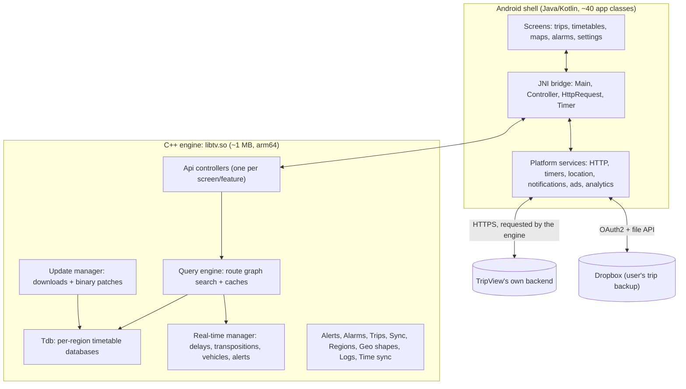

# TripView Architecture (Reference Analysis)

This document explains how **TripView Lite for Android** is built, based on a
static analysis of the shipped app. It exists as design reference for
TransitTracker. It is not a specification of TripView's private server API,
and TransitTracker must not call TripView's servers. See
[tripview-purpose-and-plan.md](tripview-purpose-and-plan.md) for what the app
does and how TransitTracker should approach the same problem.

## 1. Scope and method

| Item | Detail |
|---|---|
| App | TripView Lite, package `com.grofsoft.tripview.lite` |
| Version | 4.5.6 (build 689), Android minSdk 32, targetSdk 36 |
| Files analysed | `base.apk` (app code, resources) and `split_config.arm64_v8a.apk` (native libraries), pulled from a phone with the app installed from Google Play |
| Integrity | Both files carry intact v2 and v3 APK signatures from the TripView developer's certificate (in use since 2010) |
| Tools | REA (archive inventory, signature and native export inspection), androguard (manifest and class inventory), `strings` and `llvm-objdump` (targeted disassembly of the native core) |
| Not done | No app execution, no network capture, no full decompilation of the native core (no Ghidra available) |

Every finding below is marked:

- **Observed**: read directly from the app (manifest, class names, strings, specific machine-code sequences).
- **Inferred**: a reasonable conclusion from observed evidence that the app does not state outright.

## 2. The big picture

TripView is a **thin native Android shell around a cross-platform C++
engine**. The engine owns almost everything: timetable storage, journey
search, real-time data, alerts, alarms, trip storage and sync. The Android
layer draws screens and performs the operating-system work the engine asks
for: HTTP requests, timers, location and notifications.

**Inferred:** the same engine ships on iPhone and Apple Watch. The Android
build contains `SiriController` and `WatchController` classes, which only make
sense on Apple platforms.

## 3. Layer 1: the Android shell

**Observed.** App code lives in two Java packages:

- `com.grofsoft.tripview`: about 40 classes, nearly all screens (`Activity`
  classes) and custom views.
- `com.grofsoft.tv`: the 6-class bridge to the native engine.

### Screens (observed activity names)

| Area | Screens |
|---|---|
| Home and trips | `TripViewActivity` (launcher), `NewTripActivity`, `EditTripActivity`, `BuildTripActivity`, `ManageTripsActivity`, `EditFolderActivity`, `RenameActivity` |
| Timetables | `SummaryActivity`, `TimetableListActivity`, `ServiceInfoActivity`, `LineListActivity`, `ConnectionTimesActivity`, `RouteOptionsActivity`, `SearchActivity` |
| Maps | `SelectMapActivity`, `StreetMapActivity`, `SDActivity` with `SDSplitLayout` (inferred: split timetable/map view) |
| Alarms | `AlarmEditActivity`, `AlarmViewActivity`, plus `AlarmReceiver` and `AlarmLocationService` |
| Data and sync | `SelectDatabaseActivity`, `SyncActivity`, `ConnectActivity` |
| Other | `SettingsActivity`, `AboutActivity`, `SupportActivity`, `WebActivity`, `IndicatorActivity`, `DevelActivity` (developer tools), `DiagnosticProvider` |

Custom views include `OccupancyView` (how full a service is),
`TrackerTimerView` (live tracking countdown), `IndicatorView` and
`FontFitTextView`. Ads come through `AdProvider` / `AdProviderAdmob`.

### The JNI bridge (observed)

| Class | Role |
|---|---|
| `Main` | One-time engine start-up (`init`) and global settings such as 24-hour time |
| `Controller` | Generic channel to one engine controller: `init`, `start`, `stop`, `destroy`, and `queryInternal(id, args)` for typed calls. The engine pushes events back through `notify(id, map)` |
| `HttpRequest` | The engine asks Java to run an HTTP request (`start`, `addHeader`); Java streams results back (`handleHeader`, `handleData`, `handleCompletion`) |
| `Timer` | Platform timer that calls back into the engine (`run`) |
| `Data$Struct`, `Util` | Marshalling of structured values between Java and C++ |

**Inferred:** the Java side uses Google's Cronet HTTP stack (its Play
Services properties file is bundled), but the engine decides *what* to request
and *when*.

## 4. Layer 2: the C++ engine

**Observed.** The engine's run-time type information exposes its module
structure (C++ namespaces):

| Namespace | Responsibility |
|---|---|
| `Api::*Controller` (about 27) | One controller per screen or feature: Main, Trip, EditTrip, Build, Search, TimetableList, ServiceDetail, Connection, RailMap, Alarm, EditAlarm, Alert, Sync, Region, Settings, AutoUpdate, Location, Watch, WatchSettings, Siri, About, Tools, Global, App and others |
| `Tdb` | Timetable database: one database per region, holding service lists, lines, locations (stops), pattern maps and interchange maps |
| `Update` | Downloads timetable data and applies **binary patches** in a background work item |
| `Query` | Journey engine: `AsyncEngine`, `Route::Graph`, `Query`, `SuperQuery`, and a `Cache` keyed by database, service list, route graph and real-time bundle |
| `Rtd` | Real-time data: requests and parses a `Bundle` of live updates |
| `Alert` | Service disruption alerts |
| `Alarm` | Departure, arrival and location-based alarms |
| `Trip` | The user's saved trips (`Trip`, `Group` = folder, `Segment` = leg) |
| `Sync` | Dropbox backup and sync of trips |
| `Region` | Available regions and which one is active |
| `Geo` | Route shapes for drawing lines on maps |
| `Log`, `Cfg`, `System`, `Net`, `Util`, `Block` | Logging and log upload, configuration, platform abstraction, timers, background work queue, zlib compression |

### 4.1 Timetable storage (observed + inferred)

- Each region's timetable is a local binary database file (`.tdb`).
- Its contents (observed in patch error messages): **lines**,
  **locations**, **service lists**, **pattern maps** and **interchange map**.
- The `Update` manager first asks the server for an info document, then
  downloads either a full database or a **patch** (observed fields:
  `patchUrl`, `patchSize`, `patchTime`).
- Patches are checked before use (observed errors: "Unsupported patch
  version", "Patch timestamp doesn't match", "Patch missing manifest").
- **Inferred:** patches keep daily timetable updates to a few kilobytes
  instead of re-downloading whole regions.
- Data is zlib-compressed (observed `inflate`/`deflate` use).

### 4.2 Journey search (observed + inferred)

- Search runs **entirely on the phone** against the local `.tdb` (observed
  logs: "Created graph for", "Graph search from", "Created query with").
- A saved trip is defined by source and destination stops (`srcStops`,
  `dstStops`) and can contain several legs (`segments`). Connection times
  between legs are configurable.
- A **SuperQuery** caches results for a whole date range and is extended on
  demand (observed: "Extending superQuery range to").
- When the date changes, queries are recalculated (observed: "Date range has
  changed. Requesting Recalc.").
- **Inferred:** this is why TripView works offline and answers instantly.
  The network is only needed for real-time updates and data updates.

### 4.3 Real-time data (observed in machine code)

This is the most closely analysed part.

1. **Request.** The real-time manager asks the backend for live data. Each
   request is **scoped to the active region and the specific routes in the
   user's current trips**, not the whole network. It carries an app
   authentication header.
2. **Response content.** The response is parsed into four collections,
   logged as "Parsed N delays, N vehicles, N alerts, N transpositions":
   - **Delays**: per trip and stop, with platform, offsets, a `stale` flag and
     matching-tolerance fields.
   - **Transpositions** (inferred meaning): a service operated by a different
     train or set than scheduled.
   - **Vehicles**: live positions for map tracking, with vehicle descriptions
     and occupancy.
   - **Alerts**: disruptions attached to the response.
3. **Overlay, not replace.** The live bundle is fed into the query engine
   (`updateRealTimeData`), which adjusts the offline timetable results. The
   timetable stays the source of truth; real-time is a layer on top.
4. **Pacing is set by the server.** Two values come back in the response and
   control the next request:

   | Setting | Default in code if missing | Used for |
   |---|---|---|
   | `pollInterval` | **30 seconds** | Normal real-time refresh |
   | `trackerPollInterval` | **15 seconds** | Faster refresh (inferred: while live-tracking a vehicle) |

   The next request time is last update time plus the interval, logged as
   "Next real-time update in N seconds". The app does not cap these values,
   so the server can slow down or speed up the entire fleet of devices at
   any time. **Inferred:** this is TripView's main load-control lever.

### 4.4 Alerts (observed)

The alert feed uses **HTTP conditional requests**. The app stores the
server's `ETag` and the last update time, sends `If-None-Match` next time, and
treats an unchanged answer as "Alerts have not changed". Nothing is
re-downloaded or re-parsed when alerts haven't changed.

### 4.5 Time synchronisation (observed)

Server responses include a server-time header. A `TimeSyncProvider` uses it
to correct for a wrong phone clock, which matters when countdowns are shown
in seconds.

### 4.6 Trips, alarms and sync (observed)

- Trips, folders, alarms and cached alerts are stored as local JSON files
  (`trips.json`, `alarm.json`, `alerts.json`, `config.json`,
  `regions.json`, `sync.json`).
- Optional sync to the user's own **Dropbox** account via OAuth2, with
  conflict retry ("Retrying due to conflict").
- Alarms can fire on time or on location (`AlarmLocationService`, settings
  `alarmMode` and `alarmDistance`). Alarms that are invalid after a region
  change are deleted automatically.

### 4.7 Diagnostics (observed)

The engine keeps a log buffer that can be uploaded to TripView's support
backend, and the app embeds Firebase Crashlytics native crash handlers.

## 5. Network model summary

| Traffic | Who decides | Pattern |
|---|---|---|
| Config and region list | Engine | Fetched at start-up and on refresh |
| Timetable data | `Update` manager | Info check, then binary patch or full download |
| Real-time | `Rtd` manager | Poll every 30 s (15 s when tracking), interval set by server, scoped to region + routes |
| Alerts | `Alert` manager | Conditional GET with ETag |
| Map shapes | `Geo` | On demand per line |
| Dropbox | `Sync` | User-initiated or background, OAuth2 |
| Ads, analytics | Google SDKs | Standard SDK behaviour (Lite edition only shows ads) |

**Observed:** the app contains no references to Transport for NSW hosts,
GTFS or protobuf. **Inferred:** TripView's backend ingests Transport for NSW
open data and republishes it to the app in compact, app-specific formats.
How the backend does that is not visible from the app.

## 6. Third-party components (observed)

- Google Mobile Ads (AdMob): Lite edition ads.
- Firebase Analytics, Sessions and Crashlytics (including native crash
  reporting).
- Google Maps (street map).
- Google Play licensing and install referrer.
- AndroidX: WorkManager, Room, DataStore, Startup, ProfileInstaller.
- Kotlin coroutines; OkHttp public-suffix data; protobuf runtime (used by
  Google SDKs, not by the timetable engine).

## 7. Permissions (observed)

Location (fine and coarse, for alarms and "near me"), internet and network
state, foreground service and wake lock (location alarms), vibrate, basic
phone state, Play licensing, and advertising-ID permissions. This is a modest
set for a transit app.

## 8. Known unknowns

- The exact binary layout of `.tdb` databases and patches.
- The exact journey-search algorithm and how results are ranked.
- How live delays are matched to scheduled services in detail
  (`mtype`/`mtol` fields suggest a matching type and tolerance).
- Server-side rate limits and how TripView's backend sources data.
- The precise condition that switches between the 30 s and 15 s intervals.

## 9. Design lessons for TransitTracker

1. **Offline-first.** Keep the static timetable on the device; search
   locally; the network is for freshness, not for answers.
2. **Small updates.** Ship timetable changes as diffs, not full downloads.
3. **Real-time as an overlay.** Layer delays and cancellations over the
   schedule rather than replacing it, and mark stale data.
4. **Server-controlled pacing.** Put the poll interval in a server response
   or remote config so load can be tuned without an app release.
5. **Ask for less.** Scope requests to the routes on screen and use
   conditional requests so unchanged data costs nothing.
6. **One engine, many shells.** A shared core keeps behaviour identical
   across phone, watch and other platforms.

How these apply to TransitTracker, using Transport for NSW's open data
directly, is set out in
[tripview-purpose-and-plan.md](tripview-purpose-and-plan.md).
