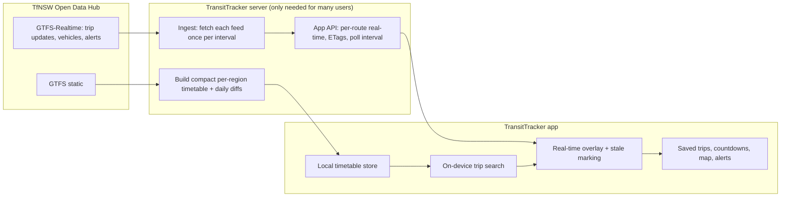

# TripView: Purpose, Features, and the TransitTracker Plan

Part 1 explains what TripView is for and everything it does, based on the
static analysis described in
[tripview-architecture.md](tripview-architecture.md). Part 2 turns that into
a plan for TransitTracker, built directly on Transport for NSW (TfNSW) open
data.

---

## Part 1: TripView

### 1.1 Purpose

TripView answers one question as fast as possible: **"When is my next
service, and is it running on time?"**

It is built around the user's **regular trips** (for example, home to work)
rather than around general-purpose journey planning. Open the app and your
saved trips are already showing upcoming departures, live delays and
countdowns, with no searching and no typing.

It has served NSW public transport users since 2008 (the bundled About page
reads "© 2008–2026 TripView Pty Ltd").

### 1.2 Who it is for

- **Daily commuters** on Sydney Trains, Metro, buses, ferries and light rail,
  plus NSW regional services (observed region data includes Hunter and
  Wollongong).
- **People who want reliability without data use.** Timetables work offline
  and update in small patches.
- **Sydney Trains staff.** A customised staff edition exists (observed in the
  bundled About page).

### 1.3 Editions and business model (observed)

| Edition | How it is paid for | Differences |
|---|---|---|
| **TripView Lite** | Free, with Google AdMob ads | Trips are not saved on exit by default; no trip folders, multitasking or alarms |
| **TripView** (full) | One-off paid app | Saved trips, folders, multitasking, alarms, no ads |
| **Sydney Trains edition** | Provided to staff | Custom icon and branding |

Lite and full are the same code; features are switched with flags
(`featureSaveTrips`, `featureFolders`, `featureAlarms`).

### 1.4 Complete feature inventory

Taken from the app's screens, settings keys and engine modules.

**Trips**
- Create a trip from a source stop to a destination stop; give custom names
  to either end.
- Multi-leg trips built leg by leg, with adjustable connection times between
  legs and per-line exclusions.
- Organise trips into folders; reorder by drag and drop; remember the most
  recently used trip.
- Automatic routing option (`autoRoute`).

**Timetables**
- Summary view of upcoming departures for each saved trip.
- Full timetable list for a trip on any date.
- Service detail: every stop of a specific service.
- Line lists and line search.
- Optional extra timetables that the user can turn on.
- 24-hour or 12-hour time.

**Real-time**
- Live delays and cancellations overlaid on the timetable.
- Platform information and platform changes.
- Transpositions (a service run by a different train or set than planned).
- Live vehicle positions and a tracking countdown.
- Occupancy (how full a service is).
- Warnings such as "This train is longer than the platform at…".
- Stale-data marking when live information is old.

**Alerts**
- Network disruption alerts, with a badge and detail view.

**Maps**
- Rail network map.
- Street map with route shapes (Google Maps), split-screen with the
  timetable.

**Alarms** (full edition)
- Alarm before departure or arrival.
- Location-based alarm when within a set distance of a stop.
- Alarms cleaned up automatically after a region change.

**Sync and devices**
- Back up and sync trips via the user's own Dropbox.
- Smartwatch support: show trips on the watch, auto-add, auto-reverse
  direction, sort by distance, most-recently-used at top.
- Siri support (iOS build, inferred from the shared engine).

**Data and maintenance**
- Choose the region/timetable database.
- Automatic timetable updates with a user-selectable update policy.
- Support page, diagnostics and log upload, developer tools screen.

### 1.5 Design principles (inferred from the architecture)

1. **Instant answers.** Everything a user sees first is computed on the
   phone from local data.
2. **Offline-first.** The network adds freshness, not core function.
3. **Minimal data use.** Binary patches for timetables, requests scoped to
   the routes on screen, conditional requests for alerts.
4. **Central control.** The server sets the polling rate (30 s normal, 15 s
   tracking by default), so load is tuned without app updates.
5. **One engine everywhere.** A shared C++ core keeps iOS, Android and watch
   behaviour consistent.

---

## Part 2: TransitTracker plan

### 2.1 Purpose (draft, to confirm)

> TransitTracker shows NSW public transport users their next services, with
> live delays and vehicle positions, using Transport for NSW open data
> directly.

Things to decide before building:

- Platform: Android only, iOS too, or web?
- Audience: personal tool, or a public app with many users? This changes the
  architecture (see 2.4).
- Scope: Sydney only, or all of NSW? Which modes?

### 2.2 Ground rules

- **Use TfNSW Open Data only.** Do not call TripView's servers or reuse its
  formats. TripView is a design reference, not a data source.
- **Respect the TfNSW licence and attribution requirements** (TfNSW open
  data is generally published under Creative Commons Attribution; confirm the
  current terms on the Open Data Hub and show the required attribution in the
  app).
- **Never ship an API key inside a public app or this public repo.** Keys go
  in environment configuration or behind a server.

### 2.3 Data sources (TfNSW Open Data Hub)

| Need | TfNSW source | Notes |
|---|---|---|
| Timetables, stops, routes | **GTFS static** timetable bundles | Large zip files; refreshed regularly |
| Delays, cancellations, platform changes | **GTFS-Realtime trip updates** (per mode) | Protobuf; refreshes roughly every 15–30 s |
| Live positions, occupancy | **GTFS-Realtime vehicle positions** | Per mode |
| Disruptions | **GTFS-Realtime service alerts** | Changes slowly; cache aggressively |
| Journey planning (optional) | **Trip Planner API** | Use only if on-device search is out of scope |

### 2.4 Rate limits and the architecture decision

TfNSW gives each API key a quota. The standard free tier has historically been
about **5 requests per second and 60,000 requests per day**. **Verify the
current figures and the higher-volume tiers on the Open Data Hub** before
relying on them.

What that quota means in practice:

| Polling interval | Calls per feed per day | Feeds covered by 60,000/day |
|---|---|---|
| 15 s | 5,760 | about 10 |
| 30 s | 2,880 | about 20 |
| 60 s | 1,440 | about 41 |

Each mode has its own trip-update, vehicle-position and alert feeds, so a
Sydney-wide app easily needs 10–20 feeds.

**Decision rule:**

- **Personal use (one or a few devices):** the app can call TfNSW directly
  with the user's own key, polling only the feeds for the user's saved trips,
  every 30 s while the app is open.
- **Many users:** do what TripView does. Run a **small server** that fetches
  each feed once per interval, decodes it, and serves trimmed per-route data
  to every device. One server key then serves any number of users. Devices
  never hold the TfNSW key.

### 2.5 Target architecture

Patterns to adopt from TripView:

1. **Local timetable.** Store the next few weeks of services for the user's
   region on the device and search locally.
2. **Diff updates.** Ship timetable changes as small patches.
3. **Overlay real-time.** Match live updates to scheduled services by trip
   and stop; mark data older than about two poll intervals as stale.
4. **Server-set polling.** Return the poll interval in every response
   (default 30 s, 15 s while tracking) and obey it in the app.
5. **Scoped, conditional requests.** Ask only for routes on screen; use
   `ETag`/`If-None-Match` (or `If-Modified-Since`) so unchanged data is free.
6. **Pause when hidden.** Stop polling when the app is in the background.
7. **Back off on errors.** On HTTP 429 or 5xx, wait longer before retrying
   (exponential backoff) instead of retrying on the normal timer.

### 2.6 Phased plan

| Phase | Goal | Done when |
|---|---|---|
| **0. Decide** | Confirm purpose, platform, audience and scope (2.1); get a TfNSW API key; confirm current quota and licence | Answers recorded in this file |
| **1. Static data** | Download and parse GTFS static for one mode (e.g. Sydney Trains); store stops, routes and services | Can list the next departures between two stops offline |
| **2. Saved trips** | Save, name, reorder and delete trips; show upcoming departures on open | App opens straight to live-looking countdowns from local data |
| **3. Real-time overlay** | Poll GTFS-Realtime trip updates for the saved trips' routes; apply delays, cancellations, platform changes; stale marking | Countdown reflects a live delay within one poll interval |
| **4. Alerts and vehicles** | Service alerts with ETag caching; vehicle positions on a map | Disruptions shown; train visible on map |
| **5. Efficiency** | Diff-based timetable updates; server-set poll interval; backoff | Daily update costs kilobytes, not megabytes |
| **6. Scale (if needed)** | Shared server that fans out real-time data | Device count no longer affects TfNSW quota use |
| **7. Extras** | Multi-leg trips, alarms, widgets or watch, more modes and regions | As prioritised |

### 2.7 Risks

| Risk | Mitigation |
|---|---|
| Exceeding the TfNSW quota | Poll only what's needed, 30 s default, pause in background; server fan-out for many users |
| Leaking the API key in a public repo | Keep keys in local env files excluded by `.gitignore`, or behind the server |
| Real-time matched to the wrong service | Match on GTFS trip ID first; fall back carefully; show "scheduled" when unsure |
| Large GTFS downloads | Pre-process into a compact store; update with diffs |
| Licence or attribution breach | Follow the Open Data Hub terms; show attribution in the app |
| Confusing users with old data | Stale marking and a "last updated" time |

### 2.8 Open questions

- What platform and audience is TransitTracker for (2.1)?
- Is a server acceptable, or must the app be device-only?
- Which modes and regions are in the first release?
- Is on-device journey search needed, or are saved stop-to-stop trips enough
  for version one?

The detailed backend design (cloud service and shared on-device core) is in
[transittracker-backend-plan.md](transittracker-backend-plan.md).
